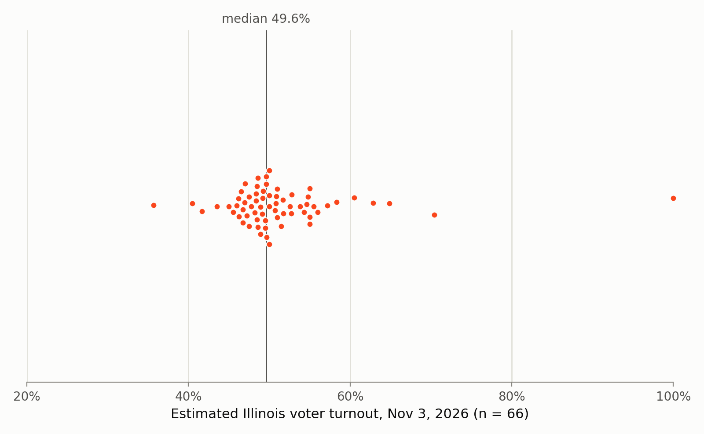
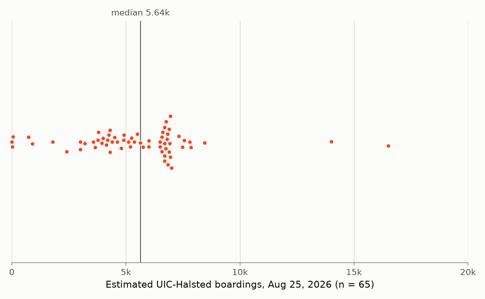
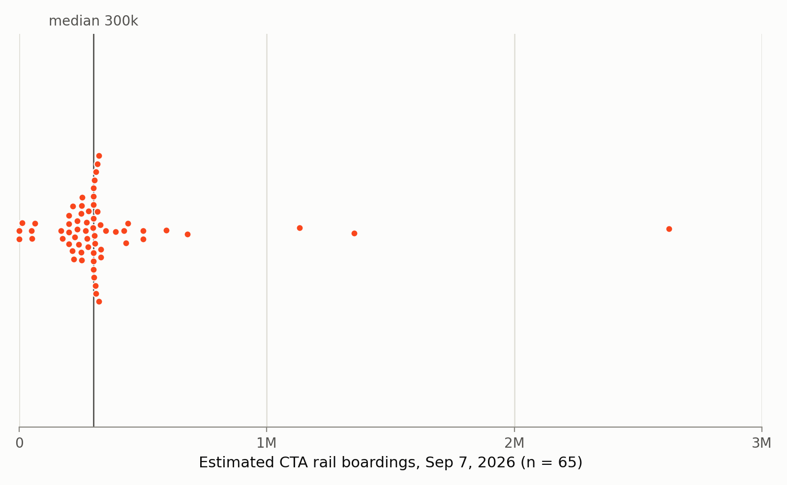
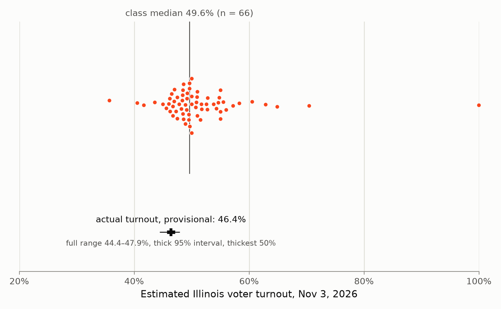
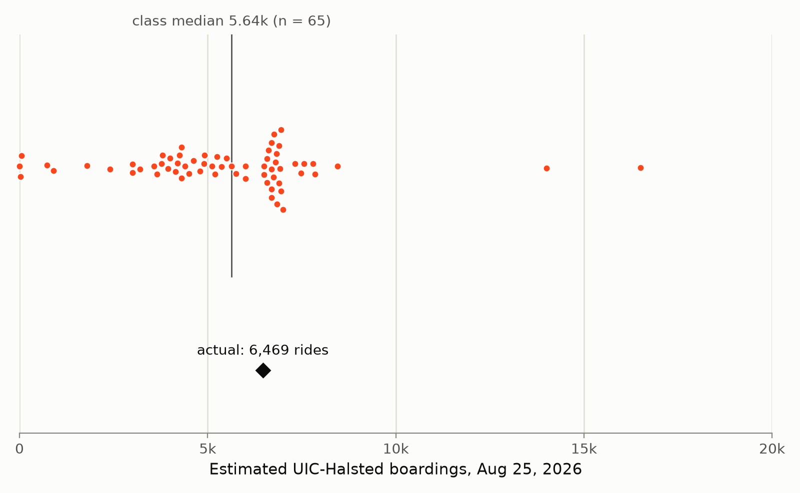

# Vox Classis (2026): Student Estimates

Estimates from CS 418 (Intro to Data Science) students at UIC, Fall 2026, collected in Homework 8.

(*Vox classis* means "voice of the class," after Galton's *Vox Populi*,"voice of the people")

Instructions were: "We have not yet covered estimation in depth in this course. Make your best attempt using your current knowledge and any outside resources you find helpful; any answer will receive full credit."

## Files

Each file has one column of estimates in random order. Values are as submitted, so typos and unit mistakes are not corrected. Blank (null) responses are omitted. Each file also includes <5 synthetic decoy values, mixed in with real values; they were chosen so that the median, quartiles, and IQR are unchanged and no decoy is an outlier (all fall within Q1 − 1.5 IQR to Q3 + 1.5 IQR). The n below includes the decoy values (62, 61, and 61 real responses).

| File | Column | n | Question |
|---|---|---|---|
| `illinois-voter-turnout-estimates-2026.csv` | `turnout_pct` | 66 | "Estimate the Illinois voter turnout rate for the general election on Tuesday, November 3, 2026." |
| `uic-halsted-boardings-estimates-2026.csv` | `uic_halsted_boardings` | 65 | "Estimate the number of boardings at the CTA UIC-Halsted Blue Line station on Tuesday, August 25, 2026, the second day of instruction for the UIC fall semester." |
| `cta-rail-boardings-estimates-2026.csv` | `cta_rail_boardings` | 65 | "Estimate the total number of CTA rail boardings on Monday, September 7, 2026." |

`plot-estimates.py` draws a swarm plot (`.png`) for each CSV.

## Plots

Each dot is one student's estimate. The vertical line marks the median, the statistic Galton used as the *vox populi*. Regenerate with `python3 plot-estimates.py`.

*Not shown: one estimate of 731,135 boardings. The median and n include it.*

*Not shown: two estimates, of 90,000,000 and 13,000,000 boardings. The median and n include them.*

## Actual values

- **Turnout:** TBD. Ballots counted divided by voting-eligible population, as reported by the [University of Florida Election Lab](https://election.lab.ufl.edu/voter-turnout/). Provisional estimate: 46.4% (95% interval 45.7–47.1%), from NBC's count of governor votes as of November 4, 2026 (96.9% of expected votes in) and UF Election Lab v0.2's voting-eligible population. Sources and the model are in `results.csv` and `turnout_range()` in `plot-estimates.py`.

- **UIC-Halsted:** 6,469 rides. The `rides` figure for `station_id` 40350 in [CTA - Ridership - 'L' Station Entries - Daily Totals](https://data.cityofchicago.org/Transportation/CTA-Ridership-L-Station-Entries-Daily-Totals/5neh-572f/about_data) ([this row](https://data.cityofchicago.org/resource/5neh-572f.json?station_id=40350&date=2026-08-25T00:00:00.000)); the dataset's rows were last updated October 28, 2026. Historical data is in [`../../cta-ridership/`](../../cta-ridership/).

*Not shown: one estimate of 731,135 boardings. The median and n include it.*

- **CTA rail:** TBD. The `rail_boardings` figure in [CTA - Ridership - Daily Boarding Totals](https://data.cityofchicago.org/Transportation/CTA-Ridership-Daily-Boarding-Totals/6iiy-9s97/about_data). As of November 11, 2026 the dataset runs through August 31, 2026. September 7, 2026 was Labor Day, which the prompt did not mention.

## Disclaimers

- Names, IDs, and timestamps are removed.
- Not a random or representative sample of anyone; these are one class's responses to a homework prompt.
- Accuracy, completeness, etc. not guaranteed.
