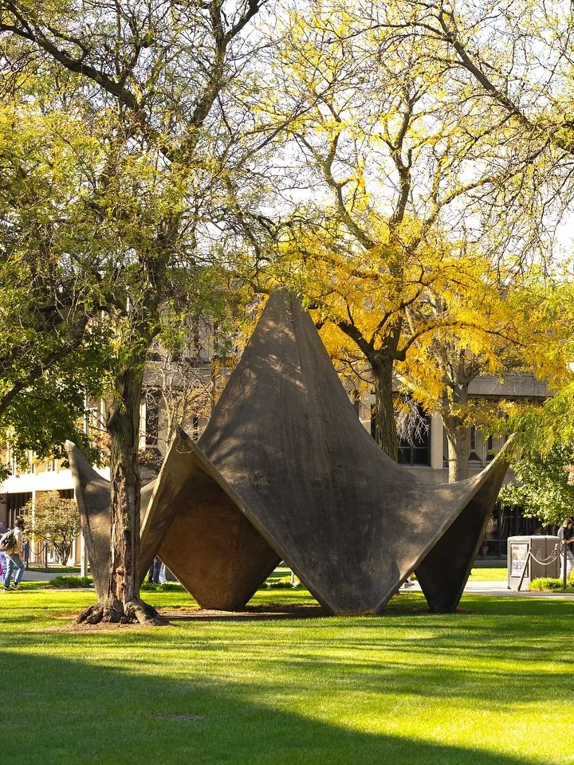
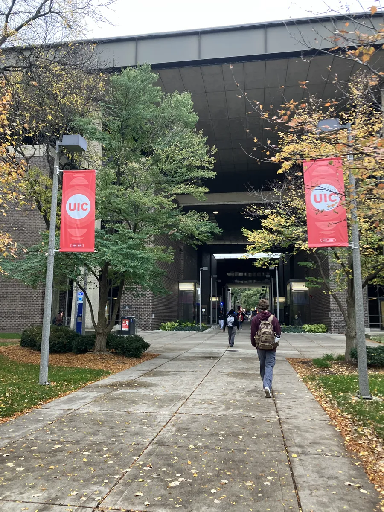
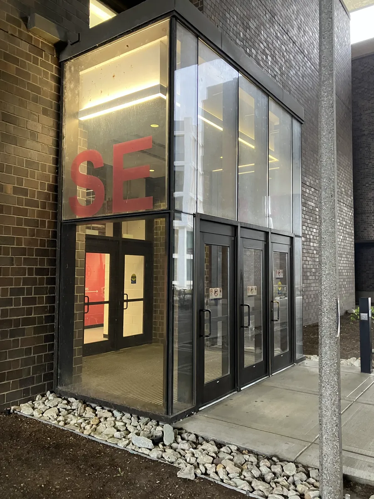
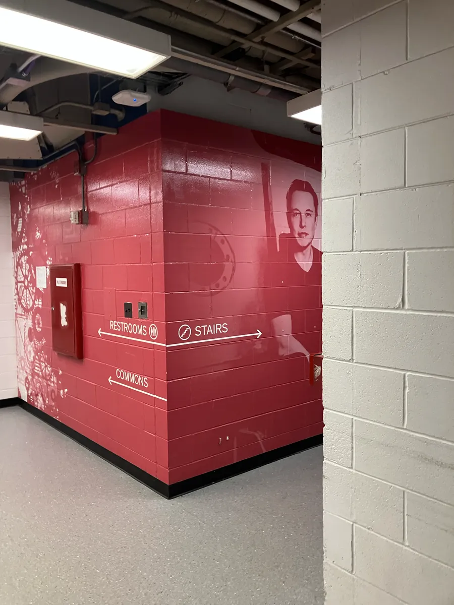
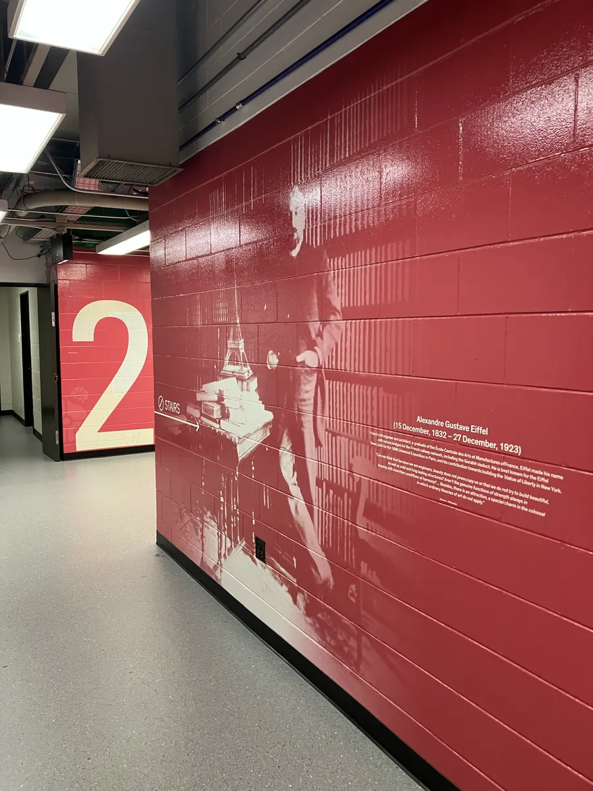
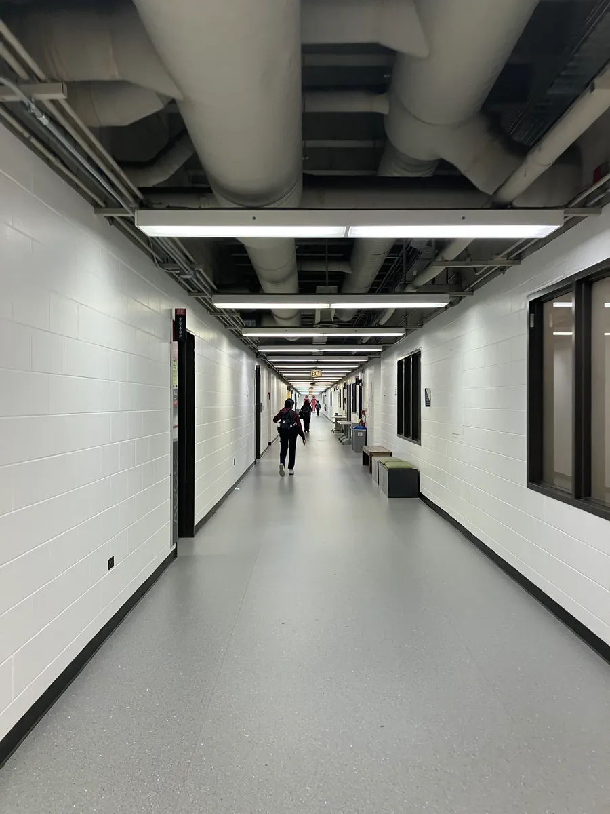

# Getting to SELE 2254

The computer-based testing facility is room 2254 in Science and Engineering Labs East (SELE). Here is how to get there...

## 0. Start at the Lecture Center

From the Lecture Center area, head toward the hyperbolic paraboloid (the saddle-shaped concrete sculpture on the way to CDRLC)
## 1. Walk past the hyperbolic paraboloid

Walk past the hyperbolic paraboloid and keep going toward the Science and Engineering Labs.

## 2. Walk through the covered passage toward the CDRLC

Walk through the big covered passage toward the Computer Design Research and Learning Center (CDRLC).

## 3. Find the SE entrance

Find the southeast entrance to SELE. It has a big red "SE" on the glass.

## 4. Go upstairs

Once inside, follow the "STAIRS" signs.

## 5. Go to the second floor and keep turning right

Take the stairs to the second floor (look for the big "2" on the wall), then keep turning right until you reach 2254.

