# Week 10 Slide Deck {.course-title}

<h2>Clustering; PCA, Model Evaluation</h2>

Jack Bandy
2026

# Week 10, Day 1 {.course-title .photo-title data-state="photo-title" background-image="../assets/orange-line-stops-better/stop11-ashland-b.jpg" background-size="cover"}

CS 418 · Week 10 · 🟠 Ashland 🟠

---

## {.photo-only data-state="photo-only" background-image="../assets/orange-line-stops-better/stop11-ashland-b.jpg" background-size="cover"}

---

## Map for Week 10, Day 1 {.split}

::: {.split-content .narrow-aside}

::: {}
- Unsupervised Learning
- Clustering
- K-Means
- Hierarchical Clustering
- Density-Based Clustering
:::

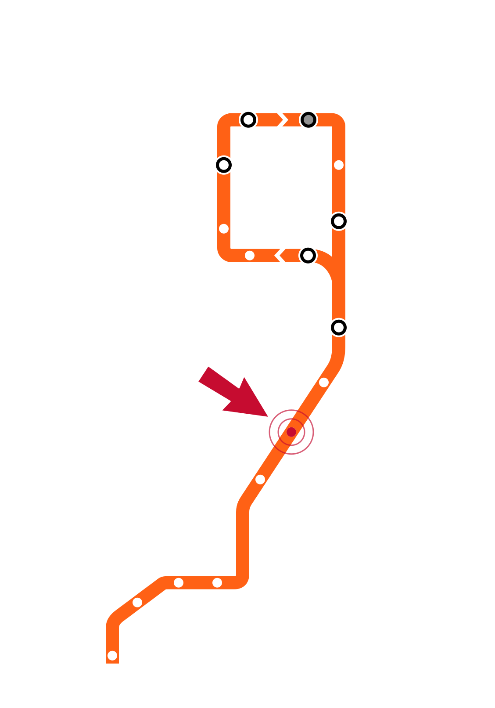{.figure alt="Orange Line map with the Ashland stop marked, the Week 10 stop"}

:::

---

## Any questions? {#any-questions-day-1}

- Homework 10 due today (11:59pm) in PrairieLearn
- Wednesday: Coding Exercise 3 due;
    - also project checkpoint: data documentation
- Group Projects?
- Other logistics?
- (You can also stay after class for questions)

---

## The Data Science Lifecycle {.image-frame-slide}

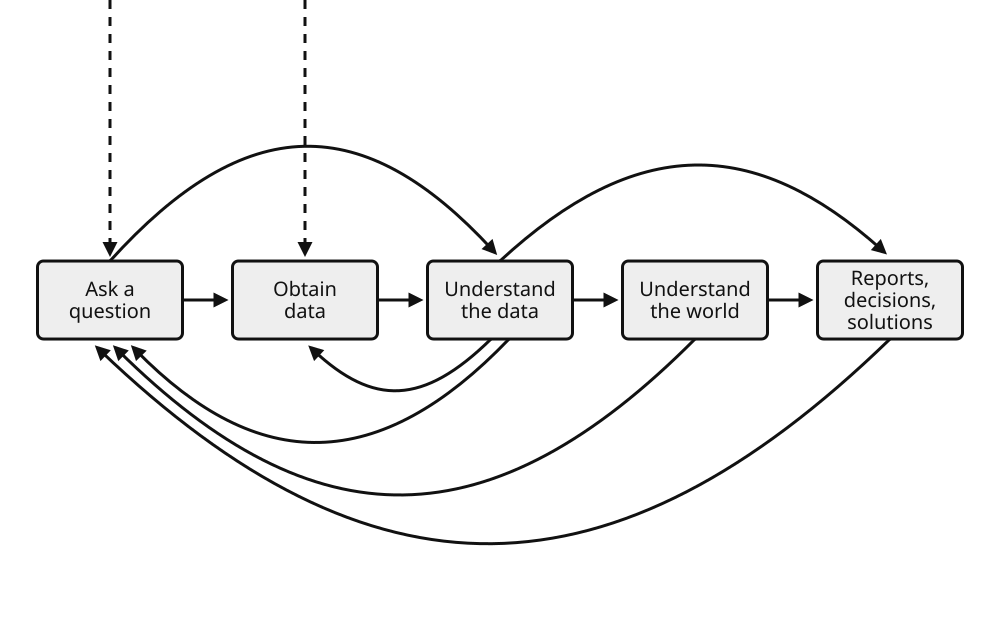

# Unsupervised Learning {.section-header}

## Supervised vs. Unsupervised {.split}

::: {.split-content}

::: {.dense}
- Supervised: predict the value of a particular variable based on the values of other variables.
    - The variable being predicted is called the target.

::: {.fragment fragment-index=1}
- Unsupervised: aim to identify patterns and relationships in the data
    - There is no target variable.
- No explicit feedback whether outputs are correct
:::
:::

::: {.captioned-figure}
::::: {.r-stack .peek-stack}
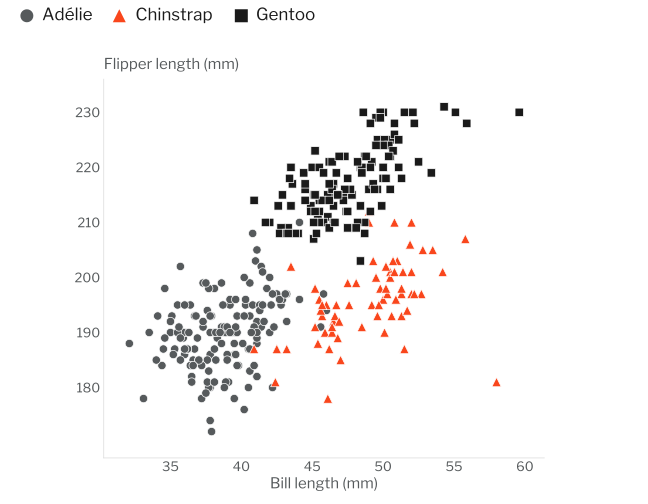

::: {.fragment fragment-index=1}
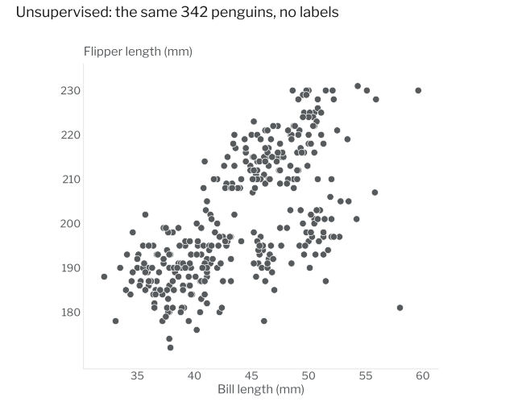
:::
:::::

::: {.caption}
Palmer Penguins (Week 8 and 9), bill length vs. flipper length.
:::
:::

:::

---

## What Is Unsupervised Learning For? {.split}

::: {.split-content .golden-columns}

::: {.dense}
Key utility:

- Understand underlying structure of data
- Compress data
- Detect outliers
- Facilitate other learning

Common uses of unsupervised learning:

- Clustering
- Dimensionality reduction
- Density estimation
:::

::: {.captioned-figure}

::: {.caption}
Sandhill cranes migrating, Jasper-Pulaski Fish and Wildlife Area, November 2017. Photo by David Wilson, via [Wikimedia Commons](https://commons.wikimedia.org/wiki/File:20171127_19_Sandhill_Crane_Migration,_Jasper_Pulaski_State_Wildlife_Area_-_Flickr_-_davidwilson1949.jpg)
:::
:::

:::

# Clustering {.section-header}

## Vocab: What Is Clustering? {.split}

::: {.split-content .golden-columns}

::: {.dense}
Cluster analysis: "observations within a group are similar to one another and different from observations in other groups"

- Find meaningful clusters
    - groups of observations that share some common characteristics.
- Find useful clusters
    - groups of observations that can be used to summarize the data

:::

::: {.captioned-figure}
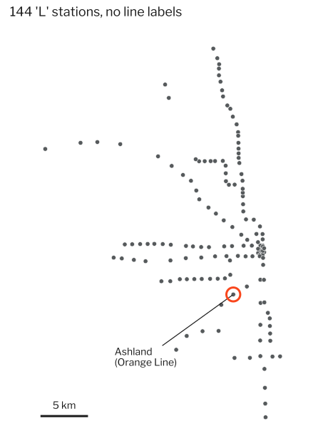

::: {.caption}
CTA stops, one point per stop, from `datasets/chicago-l-stations`.
:::
:::

:::

---

## Types of Clusterings {.split}

::: {.split-content .golden-columns}

::: {.dense}
A clustering is a collection of clusters.

- Complete (every observation belongs to a cluster) vs. partial (observations may not belong to any cluster).
- Non-overlapping (observations belong to a single cluster) vs. overlapping (observations may belong to multiple clusters).

::: {.fragment}
- This map: partial and non-overlapping.
    - Hollow stations belong to no cluster
:::
:::

::: {.captioned-figure}
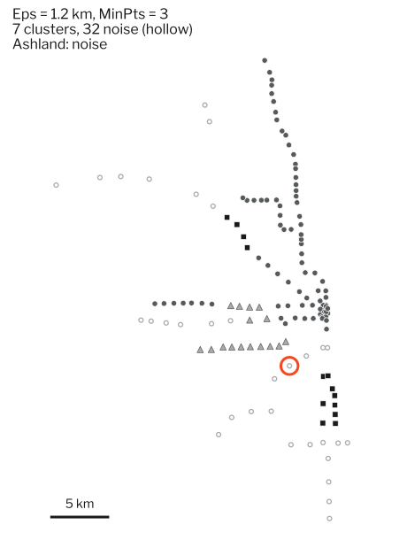

::: {.caption}
Preview: DBSCAN, later today.
:::
:::

:::

# K-Means {.section-header}

## Centroids and SSE {.split}

::: {.split-content .golden-figure}

::: {.dense}
- K-means clustering assigns observations to $K$ different clusters based on proximity to a "centroid"
- Centroid: $c_i = \frac{1}{n_i} \sum_{x \in C_i} x$
- The goal of K-means clustering is to minimize the sum of squared errors:

$$SSE = \sum_{i=1}^{K} \sum_{x \in C_i} \text{dist}(x, c_i)^2$$
:::

::: {.captioned-figure}
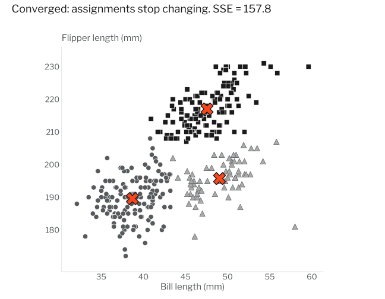

::: {.caption}
DSFI calls SSE the total "WSSD" (within-cluster sum of squared distances).
:::
:::

:::

---

## The K-Means Algorithm {.split}

::: {.split-content}

::: {.dense}
Algorithm for K-Means clustering:

1. Select $K$ observations as the initial centroids

::: {.fragment fragment-index=2}
2. Assign each observation to the cluster of its 'closest' centroid.
:::

::: {.fragment fragment-index=3}
3. Recompute centroids
:::

::: {.fragment fragment-index=4}
4. Repeat until centroids do not change (or change is below some threshold).
:::
:::

::: {.captioned-figure}
::::: {.r-stack .peek-stack}
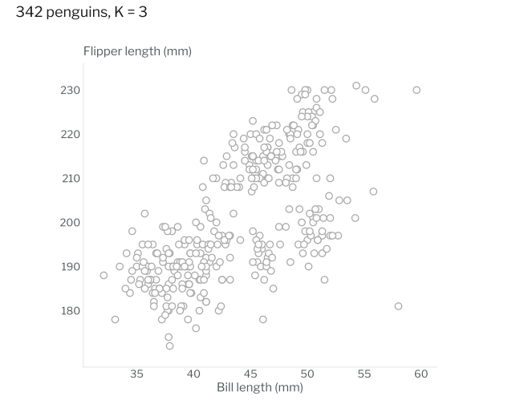

::: {.fragment fragment-index=1}
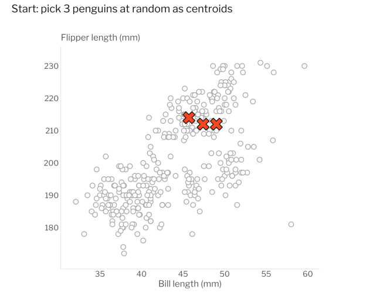
:::

::: {.fragment fragment-index=2}
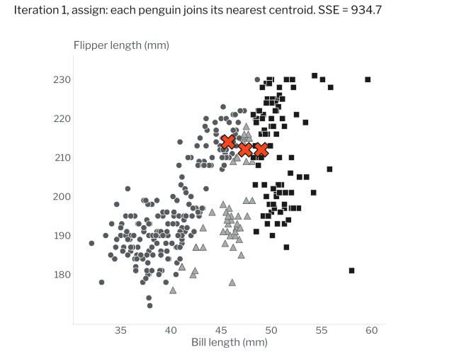
:::

::: {.fragment fragment-index=3}
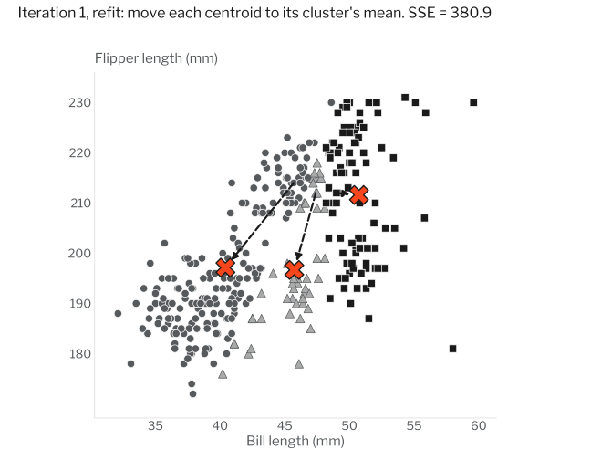
:::

::: {.fragment fragment-index=4}
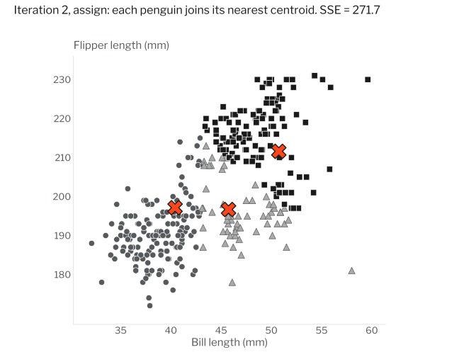
:::

::: {.fragment fragment-index=5}
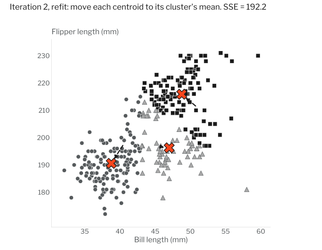
:::

::: {.fragment fragment-index=6}
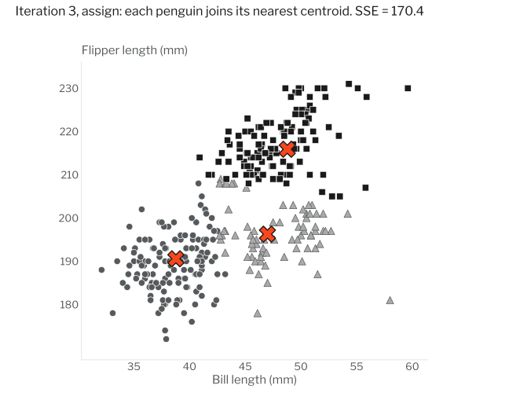
:::

::: {.fragment fragment-index=7}

:::
:::::

::: {.caption}
Standardized bill length and flipper length, as in DSFI ch. 9.
:::
:::

:::

---

## Does It Always Work? {.split}

::: {.split-content}

::: {.dense}
- It is guaranteed to converge, but...
    -  not necessarily to a global optimum
- K-means optimization is NP-hard.
- Time: $O(I \cdot n \cdot K)$ for $I$ iterations
    - $I$ is often small as most changes occur in the first few iterations.

::: {.fragment fragment-index=1}
- "This looks like a relatively bad clustering of the data, but K-means cannot improve it." (DSFI)
:::
:::

::: {.captioned-figure}
::::: {.r-stack .peek-stack}
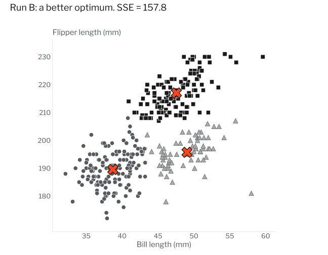

::: {.fragment fragment-index=1}
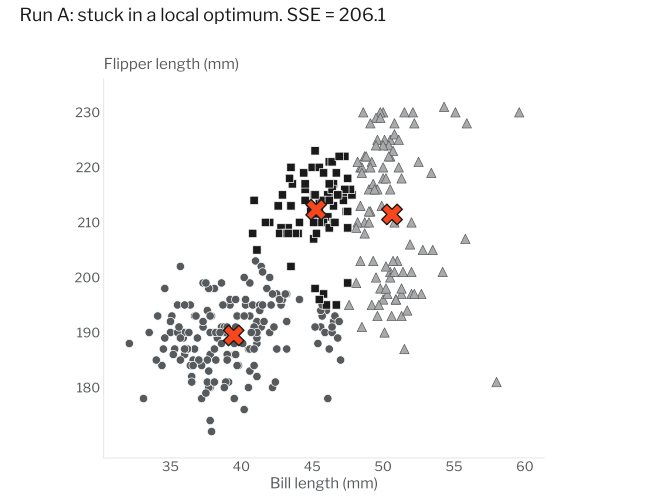
:::
:::::

::: {.caption}
Same data, same $K = 3$, two random starts (2 of 200 random starts got stuck).
:::
:::

:::

---

## Choosing Initial Centroids {.split}

::: {.split-content}

::: {.dense}
- Randomly chosen initial centroids can produce poor results.
- Restarts: perform multiple runs, then keep the set of clusters with the minimum SSE.

::: {.fragment fragment-index=1}
- Furthest-first: choose the observation that is farthest from any of the initial centroids already chosen.
:::

::: {.fragment fragment-index=3}
- It can select outliers as the initial centroids.
:::
:::

::: {.captioned-figure}
::::: {.r-stack .peek-stack}
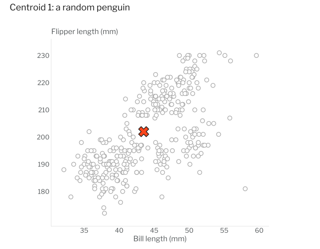

::: {.fragment fragment-index=1}
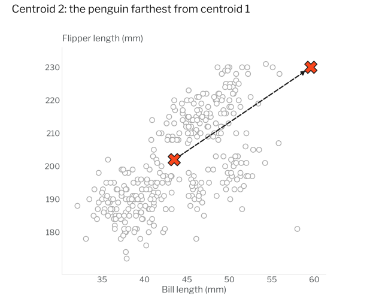
:::

::: {.fragment fragment-index=2}
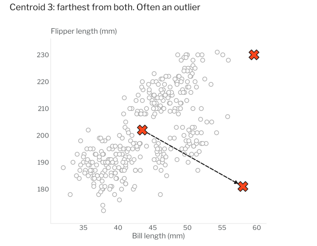
:::
:::::
:::

:::

---

## Standardize First {.split}

::: {.split-content}

::: {.dense-smaller}
- k-means uses distance, so units matter
- Body mass is in grams (about 2,700–6,300); bill length in millimeters (about 32–60)
- In raw units, one gram counts as much as one millimeter, so body mass decides almost everything

::: {.fragment fragment-index=1}
- Standardize each feature (mean 0, SD 1), as in DSFI: "We will begin by using a version of the data that we have standardized"
- Agreement with species rises from 0.33 to 0.75 (adjusted Rand index, Wednesday)
:::
:::

::: {.captioned-figure}
::::: {.r-stack .peek-stack}
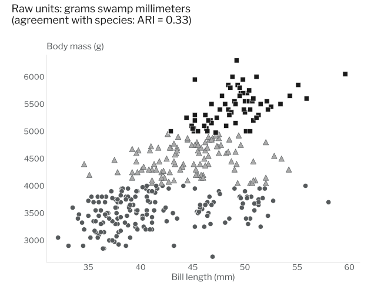

::: {.fragment fragment-index=1}
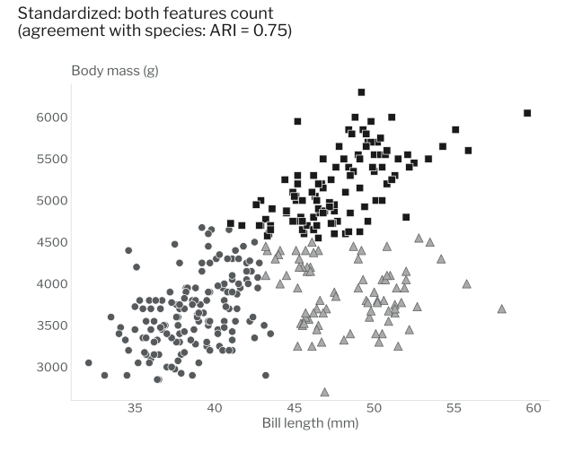
:::
:::::
:::

:::

---

## Choosing K {.split}

::: {.split-content}

::: {.dense}
- Increasing k will always decrease the objective function. Should k = n? Balance compression with accuracy.

::: {.fragment fragment-index=1}
- The value of unsupervised metrics tends to improve until the correct number of clusters is found and then to degrade if the clusters continue to be split. This approach is known as the elbow method.
- But: the elbow method does not always work well. More on Wednesday.
:::
:::

::: {.captioned-figure}
::::: {.r-stack .peek-stack}
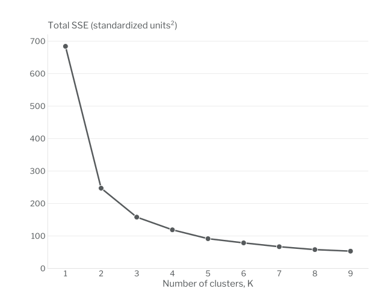

::: {.fragment fragment-index=1}
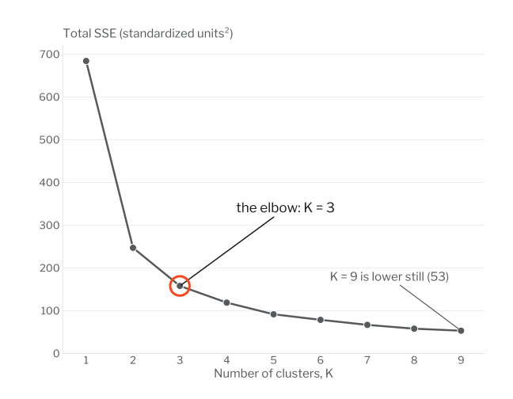
:::
:::::
:::

:::

---

## K-Means: Pros and Cons {.split}

::: {.split-content .golden-columns}

::: {.dense}
Computationally efficient (time and space)

Disadvantages:

- Number of clusters $K$ must be specified in advance.
- May detect suboptimal clusters.
- Sensitive to outliers.
-  difficulty detecting clusters that have non-spherical shapes or widely different sizes, densities.
:::

::: {.captioned-figure}
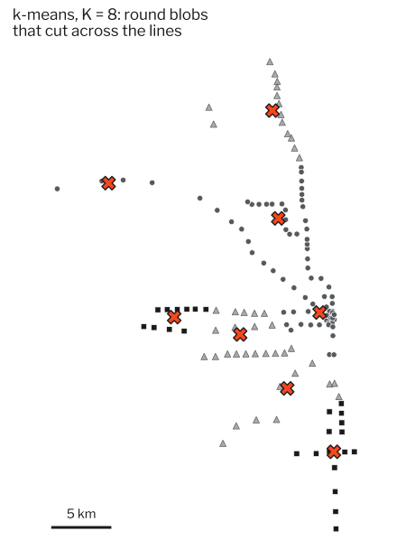

::: {.caption}
Train lines are not round.
:::
:::

:::

---

## K-Medoids {.split}

::: {.split-content}

::: {.dense}
- The medoid of a cluster $C_i$ is the observation with the minimum average distance to all the observations in the cluster.
- Unlike the centroid of a cluster $C_i$, the medoid will always be an observation in the cluster.

::: {.fragment fragment-index=1}
- K-medoids clustering is more robust to noise and outliers.
- Cost: computing the medoid of a cluster is computationally expensive ($O(n^2)$ in the worst case).
:::
:::

::: {.captioned-figure}
::::: {.r-stack .peek-stack}
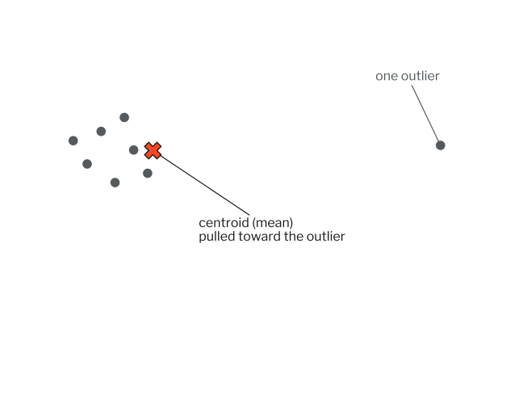

::: {.fragment fragment-index=1}
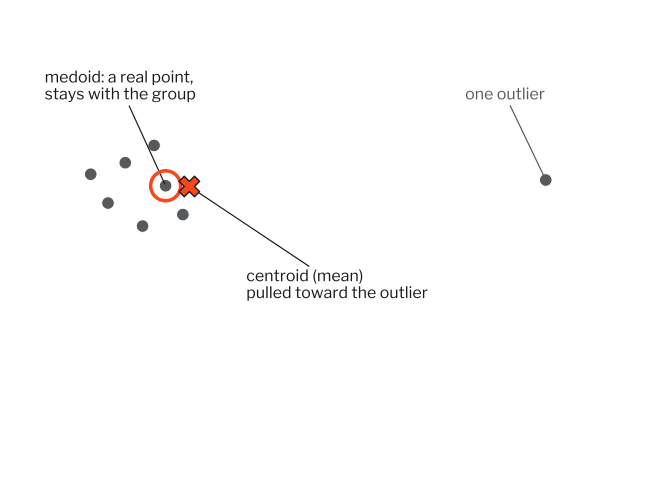
:::
:::::
:::

:::

---

## K-Medoids, Step by Step {.image-frame-slide}

:::: {.r-stack .peek-stack}

::: {}
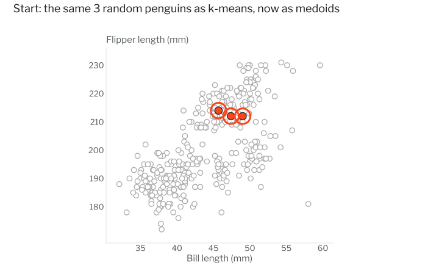
:::

::: {.fragment}
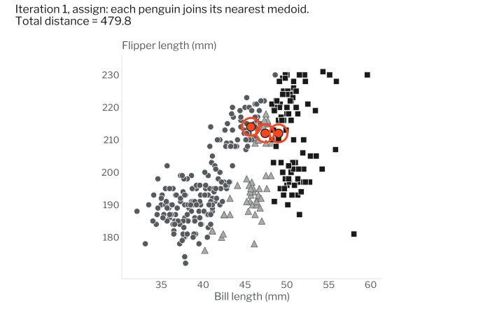
:::

::: {.fragment}
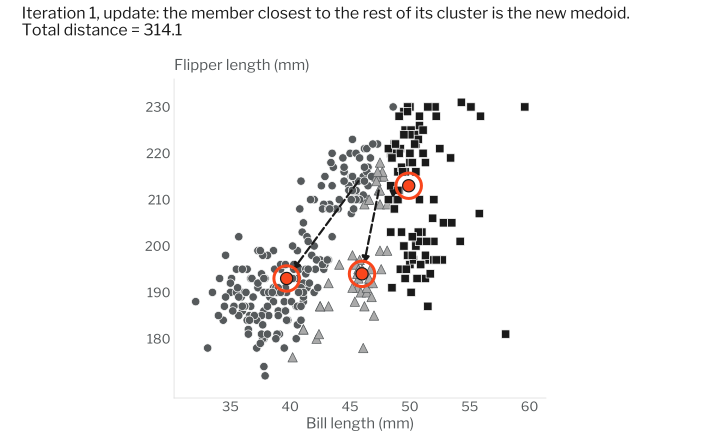
:::

::: {.fragment}
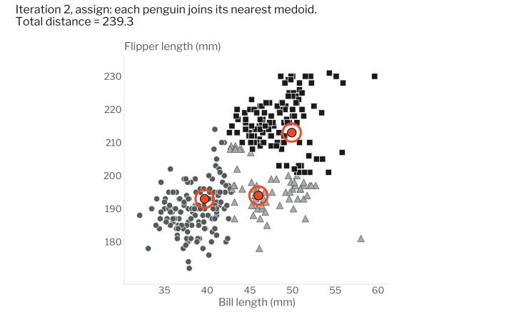
:::

::: {.fragment}
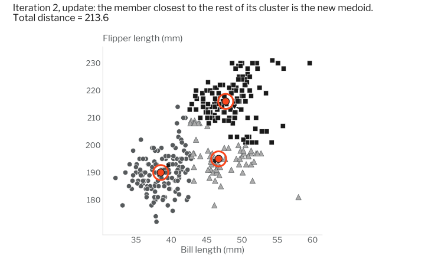
:::

::: {.fragment}
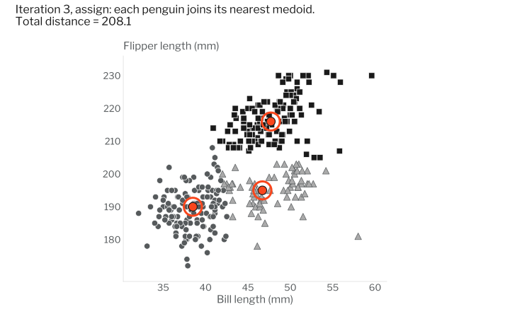
:::

::: {.fragment}
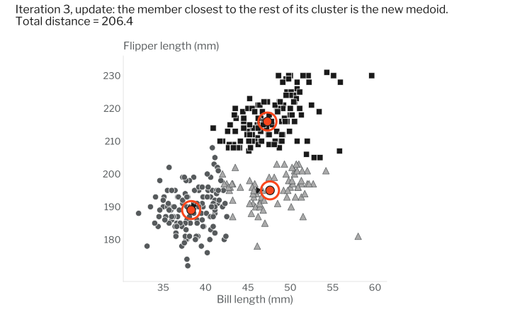
:::

::: {.fragment}
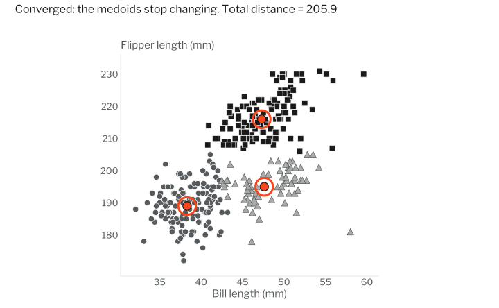
:::

::::

# Hierarchical Clustering {.section-header}

## Nested Clusters {.split}

::: {.split-content .golden-figure}

::: {.dense}
- Hierarchical clustering: find a set of nested clusters that can be organized as a tree (or dendrogram).
- Agglomerative clustering starts with observations as individual clusters and merges the 'closest' pair of clusters at each step until there is a single cluster.
:::

::: {.captioned-figure}
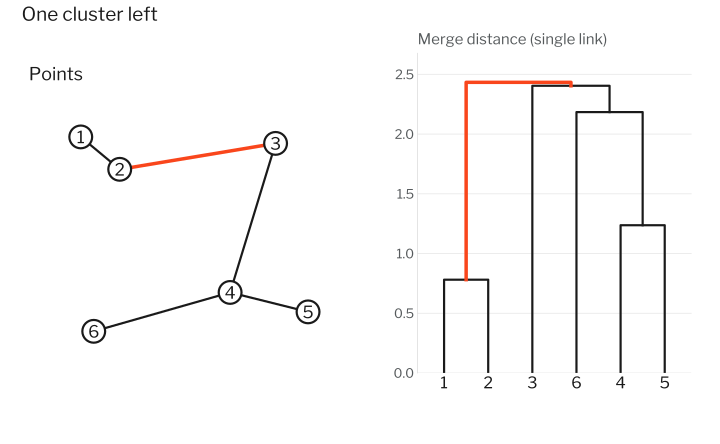
:::

:::

---

## Agglomerative Clustering, Step by Step {.image-frame-slide}

:::: {.r-stack .peek-stack}

::: {}
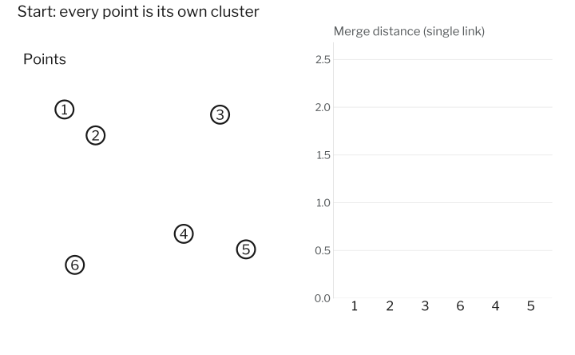
:::

::: {.fragment}
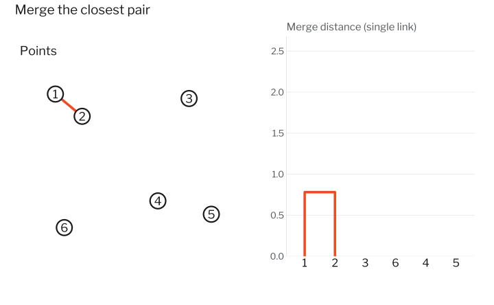
:::

::: {.fragment}
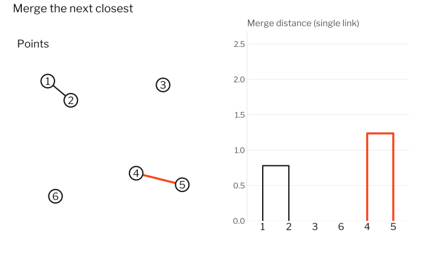
:::

::: {.fragment}
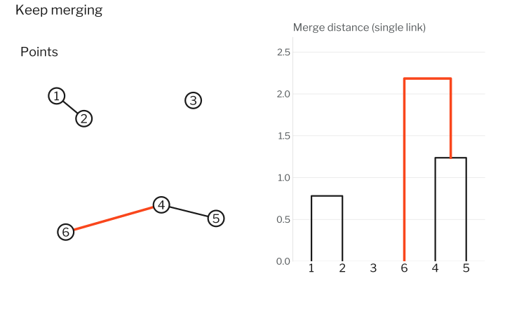
:::

::: {.fragment}
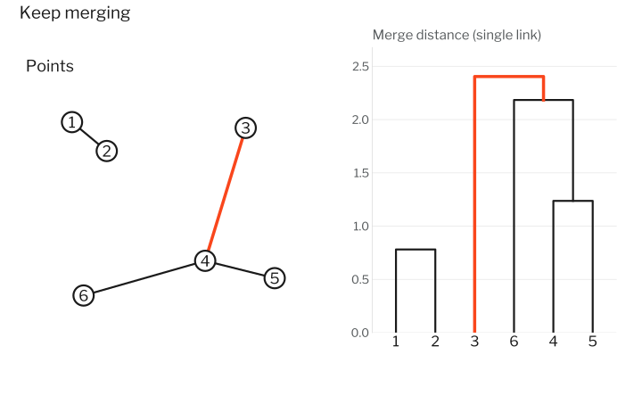
:::

::: {.fragment}

:::

::::

---

## Metrics: How Close Are Two Clusters? {.split}

::: {.split-content}

::: {.dense}
- Single link (MIN): the minimum distance between any two points across the clusters.

::: {.fragment fragment-index=1}
- Complete link (MAX): the maximum distance.
:::

::: {.fragment fragment-index=2}
- Average link: the average distance over all pairs of observations in the two clusters.
:::

::: {.fragment fragment-index=3}
- Ward's: the increase in the squared error that results when the two clusters are merged.
:::
:::

::: {.captioned-figure}
::::: {.r-stack .peek-stack}
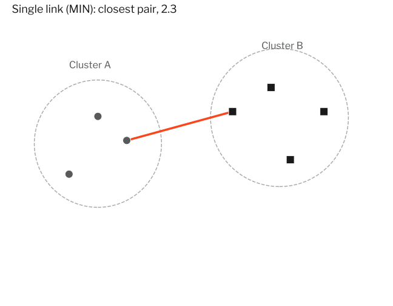

::: {.fragment fragment-index=1}
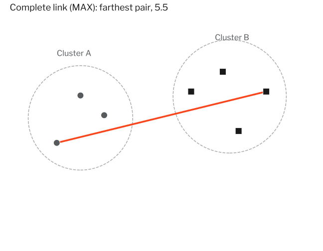
:::

::: {.fragment fragment-index=2}
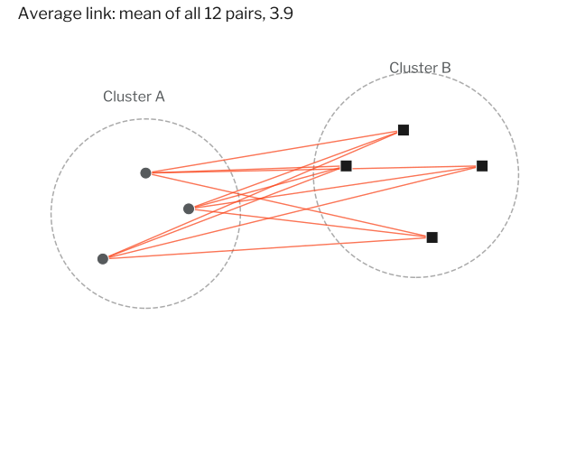
:::

::: {.fragment fragment-index=3}
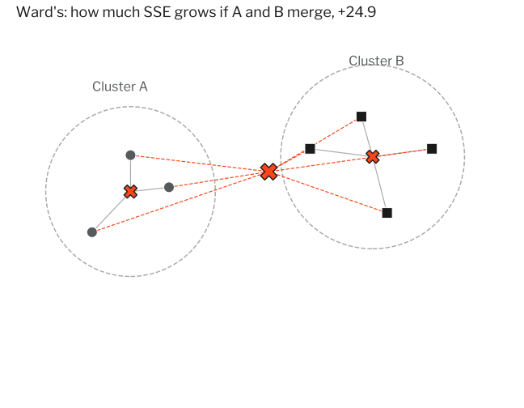
:::
:::::
:::

:::

---

## Linkage Changes the Tree {.image-frame-slide}

:::: {.r-stack}

::: {}
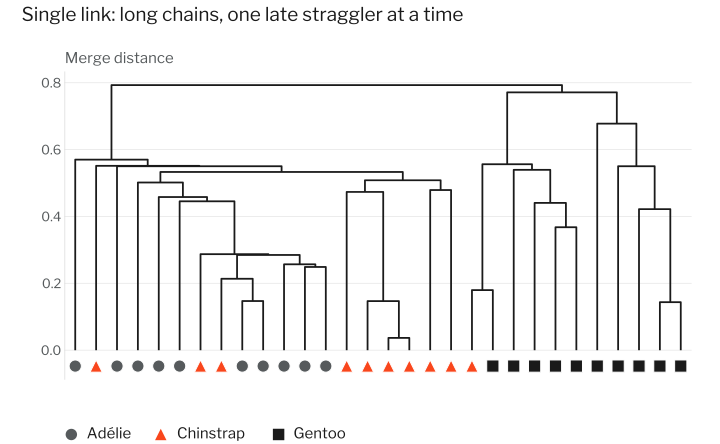
:::

::: {.fragment fragment-index=1}
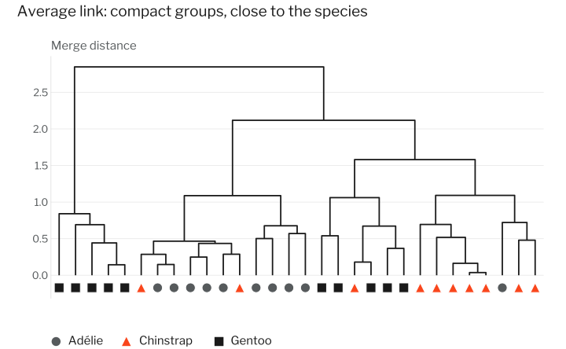
:::

::: {.fragment fragment-index=2}
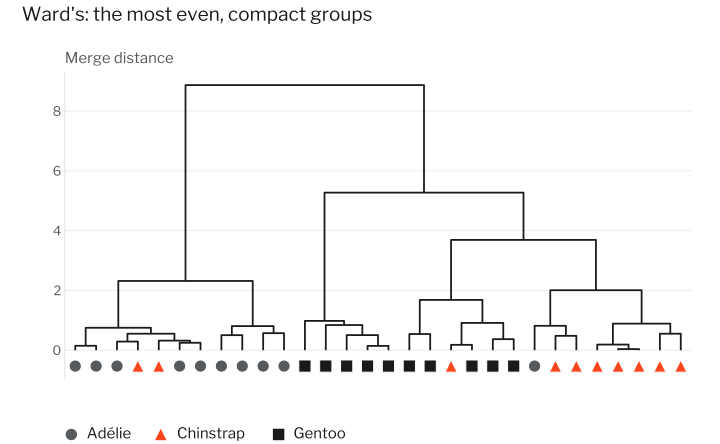
:::

::::

:::: {.r-stack .dense style="margin-top: 14px"}

::: {.fragment .fade-out fragment-index=1}
**Single link:** cluster distance = the *closest* pair. One near neighbor is enough to merge, so clusters grow a point at a time into long chains.
:::

::: {.fragment .fade-in-then-out fragment-index=1}
**Average link:** the average distance over *all* pairs. One close pair can't decide alone, so groups stay compact.
:::

::: {.fragment fragment-index=2}
**Ward's:** merge the two clusters whose union adds the least squared error, "similar to the k-means objective" (scikit-learn), so groups come out even.
:::

::::

---

## Elbow Neighbor Exercise {.split}

::: {.split-content .golden-columns}

::: {.dense}
TODO
:::

<iframe src="https://dodatascience.fun/timer/" title="CTA-style countdown timer" loading="lazy" style="width: 100%; height: 420px; display: block; border: 1px solid #999; box-shadow: 0 10px 28px rgba(0,0,0,0.12); border-radius: 3px;"></iframe>

:::

---

## Hierarchical Clustering: Pros and Cons

::: {.dense}
Advantages:

- Returns hierarchy of clusters.
- Can return clusters of different sizes.

Disadvantages:

- Computationally expensive (time and space).
    - $O(n^2)$ space for the proximity matrix;
    - $O(n^3)$ time (or $O(n^2 \log n)$ if using a heap)
- Merging decisions are made locally and cannot be reversed.
    - This may result in suboptimal clusterings, particularly when the data is noisy or high-dimensional.
:::

# Density-Based Clustering {.section-header}

## DBSCAN, Step by Step: Who Is Crowded? {.image-frame-slide}

:::: {.r-stack .peek-stack}

::: {}
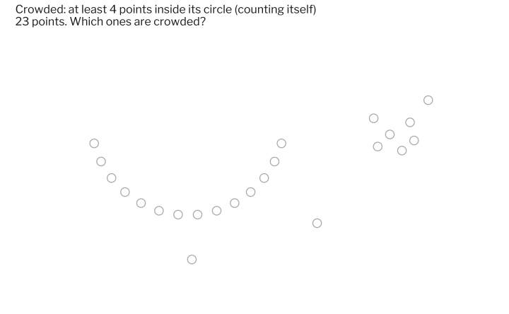
:::

::: {.fragment}
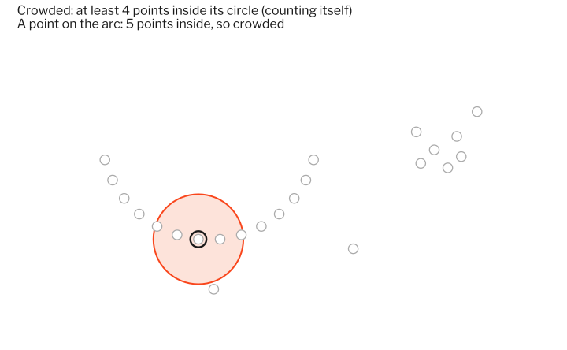
:::

::: {.fragment}
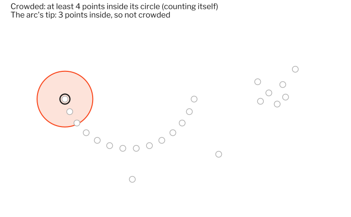
:::

::: {.fragment}

:::

::: {.fragment}

:::

::::

---

## DBSCAN, Step by Step: Grow a Cluster {.image-frame-slide}

:::: {.r-stack .peek-stack}

::: {}

:::

::: {.fragment}

:::

::: {.fragment}

:::

::: {.fragment}

:::

::: {.fragment}

:::

::::

---

## DBSCAN, Step by Step: Repeat, Then Noise {.image-frame-slide}

:::: {.r-stack .peek-stack}

::: {}

:::

::: {.fragment}

:::

::: {.fragment}

:::

::::

::: {.notes}
- Next slide names the two knobs: the circle's radius is $Eps$, and "at least 4 points, counting itself" is $MinPts = 4$.
- Crowded points are core points; the arc's tips and the group's straggler are border points; the loners are noise.
- Contrast with k-means: no $K$, and the arc stays one cluster because it grows point to point instead of around a center.
:::

---

## Core, Border, Noise {.split}

::: {.split-content .golden-figure}

::: {.dense}
Density-based clustering aims to locate regions of high density that are separated from one another by regions of low density.

::: {.fragment fragment-index=1}
- Core: at least $MinPts$ observations within a distance of $Eps$.
:::

::: {.fragment fragment-index=2}
- Border: not a core point but falls within the neighborhood of a core point.
:::

::: {.fragment fragment-index=3}
- Noise: neither a core point nor a border point.
:::
:::

::: {.captioned-figure}
::::: {.r-stack .peek-stack}

::: {.fragment fragment-index=1}

:::

::: {.fragment fragment-index=2}

:::

::: {.fragment fragment-index=3}

:::
:::::

::: {.caption}
$MinPts$ counts the point itself here, as scikit-learn's `min_samples` does.
:::
:::

:::

---

## DBSCAN {.split}

::: {.split-content .golden-columns}

::: {.dense}
Algorithm for DBSCAN:

1. Label all points as core, border, or noise points.
2. Discard noise points.
3. Put an edge between all core points within a distance of $Eps$ of each other.
4. Assign each group of connected core points to a separate cluster.
5. Assign each border point to one of the clusters of its associated core points.

No $K$: very popular for geospatial applications.
:::

::: {.captioned-figure}

:::

:::

---

## Choosing Eps: Too Large, Too Small {.split}

::: {.split-content .golden-columns}

::: {.dense}
- If $Eps$ is too large, then many observations may be assigned to the same cluster.

::: {.fragment fragment-index=1}
- If $Eps$ is too small, then many observations may be discarded or assigned to separate clusters.
:::
:::

::: {.captioned-figure}
::::: {.r-stack .peek-stack}

::: {.fragment fragment-index=1}

:::
:::::
:::

:::

---

## Choosing Eps: The k-dist Curve {.split}

::: {.split-content .golden-figure}

::: {.dense}
- The basic approach to find $Eps$ involves measuring the average distance from each observation to its $k$th nearest neighbor ($k$-dist), where $k = MinPts$.
- Look for where the sorted curve bends upward
:::

::: {.captioned-figure}

::: {.caption}
With $MinPts = 3$ counting the station itself, the relevant distance is to the 2nd-nearest *other* station.
:::
:::

:::

---

## Eps Values on CTA Example {.split}

::: {.split-content .golden-columns}

::: {.dense}
- 0.8 km: 81 stations are noise
- 1.2 km: dense corridors become clusters

::: {.fragment fragment-index=1}
- 2.0 km: nearly everything is one cluster
:::

::: {.fragment fragment-index=2}
- Ashland (Orange Line) is noise at 0.8 and 1.2 km: its 2nd-nearest other station is 1.7 km away, vs. 0.9 km for a typical North Side station
- DBSCAN has difficulty detecting clusters with different densities.
:::
:::

::: {.captioned-figure}
::::: {.r-stack .peek-stack}

::: {.fragment fragment-index=0}

:::

::: {.fragment fragment-index=1}

:::
:::::
:::

:::

---

## DBSCAN Parameters in Cook County Condo Sales {.image-frame-slide}

::: {.caption}
2025 condo sales from `datasets/cook-county-home-sales-2025` (Cook County Assessor), one unit per sale (`num_parcels_sale == 1`); DBSCAN with $MinPts = 40$.
:::

:::: {.r-stack .peek-stack}

::: {}

:::

::: {.fragment}

:::

::: {.fragment}

:::

::: {.fragment}

:::

::: {.fragment}

:::

::: {.fragment}

:::

::::

::: {.notes}
- Bulk sales of many units at once are left out: one sale would be its own dense "cluster".
- $MinPts = 40$: a core sale has at least 40 sales within $Eps$.
- $Eps$ = 0.1 km: almost every sale (96%) is noise; the 11 clusters are tiny.
- $Eps$ = 0.2 km: short stretches of the lakefront become clusters; 80% noise.
- $Eps$ = 0.3 km: downtown, Lake View, and Edgewater are separate clusters; 66% of sales are noise.
- $Eps$ = 0.5 km: the lakefront joins into one cluster of 4,953 sales; suburban clusters also appear (Evanston, Oak Park, Des Plaines, Schaumburg, ...), most of them off this zoomed map.
- $Eps$ = 1.0 km: one cluster of 7,539 sales covers most of the North Side; only 21% noise.
- As with the CTA stops, $Eps$ decides what counts as one "place".
:::

---

## Elbow Neighbor Exercise {.split}

::: {.split-content .golden-columns}

::: {.dense}
TODO
:::

<iframe src="https://dodatascience.fun/timer/" title="CTA-style countdown timer" loading="lazy" style="width: 100%; height: 420px; display: block; border: 1px solid #999; box-shadow: 0 10px 28px rgba(0,0,0,0.12); border-radius: 3px;"></iframe>

:::

---

## DBSCAN: Pros and Cons {.split}

::: {.split-content .golden-columns}

::: {.dense}
Advantages:

- Robust to noise and outliers because it discards noise points.
- Can detect clusters of different shapes and sizes.

Disadvantages:

- Has difficulty detecting clusters with different densities.
- Parameters $Eps$ and $MinPts$ must be specified in advance.
:::

::: {.captioned-figure}

::: {.caption}
The answer key we never gave any algorithm: the actual lines, in CTA route colors.
:::
:::

:::

---

## Which Technique When? {.image-frame-slide}

::: {.caption}
Exercise 15.4: Which clustering technique will perform better for each dataset and why? After the scikit-learn ["Comparing different clustering algorithms on toy datasets"](https://scikit-learn.org/stable/auto_examples/cluster/plot_cluster_comparison.html) figure.
:::

# Wrap-Up {.section-header}

## Upload your worksheet {#upload-worksheet-day-1}

Take a picture of your worksheet, upload it in Canvas

# That's All for Today, See You Wednesday! {.section-header .no-index}

# Week 10, Day 2 {.course-title .photo-title data-state="photo-title photo-title-zoom" background-image="../assets/orange-line-stops-better/stop11-ashland-b.jpg" background-size="cover"}

<h2>PCA, Model Evaluation</h2>

Jack Bandy
2026

---

## Map for Week 10, Day 2 {.split}

::: {.split-content .narrow-aside}

::: {}
- Principal Component Analysis
- What Are We Evaluating?
- Held-Out Data
- Classification Metrics
- Multiclass Classification
- Evaluating Clusterings
- The Model Is Not the World
:::

{.figure alt="Orange Line map with the Ashland stop marked, the Week 10 stop"}

:::

---

## Any questions? {#any-questions-day-2}

- Coding Exercise 3 is due today
- Project checkpoint today: data documentation
- Group Projects?
- Other logistics?

# Principal Component Analysis {.section-header}

## Dimensionality Reduction {.split}

::: {.split-content .golden-figure}

::: {.dense}
Goal: extract hidden lower-dimensional structure from high dimensional datasets.

Why?

- To visualize data more easily
- To remove noise in data
- To lower resource requirements for storing/processing data
- To improve classification/clustering
:::

::: {.captioned-figure}

::: {.caption}
Two measurements per penguin. Can one number do the job?
:::
:::

:::

---

## Principal Components {.split}

::: {.split-content}

::: {.dense}
- Goal: find a small number of 'directions' in input space that explain variation in input data; re-represent data by projecting along those directions.
- Important assumption: variation contains information.

::: {.fragment fragment-index=1}
- Principal components are orthogonal directions that capture most of the variance in the data.
- Select M eigenvectors with the largest eigenvalues of the covariance matrix.
:::
:::

::: {.captioned-figure}
::::: {.r-stack .peek-stack}

::: {.fragment fragment-index=1}

:::
:::::
:::

:::

---

## How Many Components? {.split}

::: {.split-content .golden-figure}

::: {.dense}
- Now all four measurements: bill length, bill depth, flipper length, body mass (standardized)
- "This can be determined by looking at the cumulative explained variance ratio as a function of the number of components" (PDSH)
- A scree plot: bars for each component, a line for the running total
- Two components keep 88% of the variance
:::

::: {.captioned-figure}

:::

:::

---

## What Do the Components Mean? {.split}

::: {.split-content .golden-figure}

::: {.dense}
- PDSH asks "what the reduced dimensions mean."
- Each component is a weighted sum of *all* the original features
- PC1: long flippers, heavy, long bill, shallow bill (roughly: "big penguin")
- PC2: mostly bill depth and bill length
- The tradeoff: fewer numbers, but each one is harder to name
:::

::: {.captioned-figure}

:::

:::

---

## Four Measurements, Two Numbers {.split}

::: {.split-content}

::: {.dense}
- "PCA is fundamentally a dimensionality reduction algorithm, but it can also be useful as a tool for visualization, for noise filtering, for feature extraction and engineering, and much more." (PDSH)
- PCA never saw the species; the groups show up anyway

::: {.fragment}
- "PCA's main weakness is that it tends to be highly affected by outliers in the data." (PDSH)
:::
:::

::: {.captioned-figure}

:::

:::

---

## Meet Pete Crow-Armstrong {.split}

::: {.split-content .golden-columns}

::: {.dense}
**#4, CF, Chicago Cubs**

- PCA for short
- 2025 NL All-Star, Gold Glove winner
- Hit for the cycle on June 15, 2026
    - I was there!
    - And I thought... PCA with PCA?
:::

::: {.captioned-figure}

::: {.caption}
Pete Crow-Armstrong batting for the Iowa Cubs, 2023. Photo: Minda Haas Kuhlmann, [CC BY 2.0](https://creativecommons.org/licenses/by/2.0/), via [Wikimedia Commons](https://commons.wikimedia.org/wiki/File:Pete_Crow-Armstrong_(53104160703).jpg); cropped.
:::
:::

:::

---

## PCA on PCA: The Data {.split}

::: {.split-content .golden-figure}

::: {.dense}
- 40 qualified MLB center fielders, 2026 (Baseball Savant)
- 11 standardized stats:
	- Discipline: K, whiff, chase, walk %
	- Power: ISO, barrel %, hard-hit %
	- Legs: sprint speed, steals
	- Glove: OAA, arm strength
- Can two numbers do the job?
:::

::: {.captioned-figure}

:::

:::

---

## How Many Components? (Again) {.split}

::: {.split-content .golden-figure}

::: {.dense}
- Penguins: two components kept 88% of the variance
- Center fielders: two components keep 55%
- Real data is messier: no single "big player" direction
- Still: each standardized stat is 1/11 ≈ 9% of the variance, so PC1 alone is worth about four stats
:::

::: {.captioned-figure}

:::

:::

---

## What Do the Components Mean? (Again) {.split}

::: {.split-content .golden-figure}

::: {.dense}
- PC1: strikeouts, whiffs, *and* power all go up together. Call it "swing big."
- PC2: chasing goes up, walking goes down, plus speed and defense. Call it "chase and run."
- The names are ours, not PCA's: PCA only gives the weights
:::

::: {.captioned-figure}

:::

:::

---

## Where Is PCA in PCA-Space? {.split}

::: {.split-content .golden-figure}

::: {.dense}
- Corners: Kwan (contact), Cruz (swing big), Trout (walks), Rafaela (chase and run)

::: {.fragment fragment-index=1}
- Crow-Armstrong: 2nd of 40 on PC1, 5th on PC2
- Led all 40 in HR (45), steals (41), OAA (26), and ISO
- An outlier, and PCA is "highly affected by outliers" (PDSH)
:::
:::

::: {.captioned-figure}
::::: {.r-stack}

::: {.fragment fragment-index=1}

:::
:::::
:::

:::

# What Are We Evaluating? {.section-header}

## Recall: Overfitting {.image-frame-slide}

::: {.caption}
"Overfitting happens when the model follows the data too closely and picks up the variability in the random noise in the outcome." Lau, Gonzalez, and Nolan, ["Overfitting"](https://learningds.org/ch/16/ms_overfitting.html), *Learning Data Science*, §16.1. [review: Week 8]
:::

# Held-Out Data {.section-header}

## Train and Test {.split}

::: {.split-content .golden-figure}

::: {.dense}
- "We often do not have the luxury of collecting additional data to assess a model, so instead we set aside a portion of our data, called the test set, to stand in for new data." (LDS)
- "Typically, the test set consists of 10% to 25% of the data." (LDS)
- "this division into two parts is often made at random, so the train and test sets are similar to each other." (LDS)
:::

::: {.captioned-figure}

::: {.caption}
Lau, Gonzalez, and Nolan, ["Train-Test Split"](https://learningds.org/ch/16/ms_train_test.html), *Learning Data Science*, §16.2.
:::
:::

:::

---

## Cross-Validation {.split}

::: {.split-content}

::: {.dense}
- "The idea is to further divide the train set into separate parts where we fit the model on one part and evaluate it on another. This approach is called cross-validation." (LDS)
- "Typically, we use 5 or 10 folds." (LDS)
- "Combine the error in fitting each model across the folds, and choose the model with the smallest error." (LDS)
- Then, once: score the chosen model on the test set [review: Week 9 code demo]
:::

::: {.captioned-figure}
::::: {.r-stack .peek-stack}

::: {.fragment}

:::

::: {.fragment}

:::

::: {.fragment}

:::

::: {.fragment}

:::
:::::

::: {.caption}
Lau, Gonzalez, and Nolan, ["Cross-Validation"](https://learningds.org/ch/16/ms_cv.html), §16.3.
:::
:::

:::

# Classification Metrics {.section-header}

## A Needle in a Haystack {.split}

::: {.split-content .golden-figure}

::: {.dense}
- Sometimes training examples are drawn from an imbalanced distribution.
- The 'needle in a haystack' problem: e.g., find fraudulent transactions in credit card histories.
- Our haystack: Week 9's Chinstrap vs. the rest
- Why is this a big problem for machine learning?
:::

::: {.captioned-figure}

:::

:::

---

## Pitfalls of Accuracy {.split}

::: {.split-content}

::: {.dense}
- Accuracy is not a good metric when some errors matter more than others.
    - Given a medical record, predict whether a patient has cancer
- Confusion matrix: true/false positives, true/false negatives [review: Week 9]

::: {.fragment fragment-index=1}
- "So even with an accuracy of 89%, the precision and recall of the classifier were both relatively low." "A recall of just 25% would likely be unacceptable!" (DSFI)
:::
:::

::: {.captioned-figure}
::::: {.r-stack .peek-stack}

::: {.fragment fragment-index=1}

:::
:::::

::: {.caption}
Logistic regression on bill length and flipper length, 5-fold cross-validated predictions.
:::
:::

:::

---

## Precision and Recall {.split}

::: {.split-content .golden-figure}

::: {.dense}
- Precision: % positive predictions that are correct.
$$\text{Precision} = \frac{TP}{TP + FP}$$
- Recall: % positive true labels that are predicted.
$$\text{Recall} = \frac{TP}{TP + FN}$$

::: {.fragment}
- Different ranking cutoff thresholds lead to different precision-recall tradeoffs.
:::
:::

::: {.captioned-figure}
::::: {.r-stack .peek-stack}

::: {.fragment}

:::

::: {.fragment}

:::
:::::
:::

:::

---

## The Precision–Recall Tradeoff {.split}

::: {.split-content .golden-figure}

::: {.dense}
- Each cutoff gives one (recall, precision) point
- High cutoff: few guesses, mostly right (high precision, low recall)
- Low cutoff: many guesses, finds almost all (high recall, lower precision)
- What to do if one class is more important than the other?
    - Cancer screening? Spam filter? Searching for documents?
:::

::: {.captioned-figure}

:::

:::

---

## F-Score {.split}

::: {.split-content .golden-figure}

::: {.dense}
- F-score: harmonic mean.
$$F = \frac{2 \cdot Pr \cdot Re}{Pr + Re}$$
- Weighted F-score: if precision is more important than recall.
$$F_\beta = \frac{(1 + \beta^2) \cdot Pr \cdot Re}{\beta^2 \cdot Pr + Re}$$
- Harmonic mean: one low score drags the whole thing down
:::

::: {.captioned-figure}

:::

:::

---

## Fixing Imbalance {.split}

::: {.split-content}

::: {.dense}
- Undersample the majority class; more computationally efficient.
- Oversample the minority class; the base binary classifier might do better with more training examples.
- Efficient implementations incorporate weight in the algorithm instead of explicitly duplicating data. You can use the imblearn Python library (e.g., the ADASYN algorithm).
- Resample the training data only, never the test set
:::

::: {.captioned-figure}
::::: {.r-stack .peek-stack}

::: {.fragment}

:::

::: {.fragment}

:::
:::::
:::

:::

---

## Elbow Neighbor Exercise {.split}

::: {.split-content .golden-columns}

::: {.dense}
TODO
:::

<iframe src="https://dodatascience.fun/timer/" title="CTA-style countdown timer" loading="lazy" style="width: 100%; height: 420px; display: block; border: 1px solid #999; box-shadow: 0 10px 28px rgba(0,0,0,0.12); border-radius: 3px;"></iframe>

:::

# Multiclass Classification {.section-header}

## One vs. Rest, One vs. One {.image-frame-slide}

:::: {.r-stack .peek-stack}

::: {}

:::

::: {.fragment}

:::

::::

::: {.caption}
One versus rest: train K-many binary classifiers; classifier k predicts whether an example belongs to class k or not. One versus one: build classifiers for all pairs of classes; predict the class that has the most binary classifier 'votes'.
:::

---

## Which Needs More Classifiers? {.split}

::: {.split-content .golden-figure}

::: {.dense}
Which one requires more base classifiers?

A) One-versus-rest (OVR)

B) One-versus-one (OVO)

::: {.fragment}
- OVR: $K$ classifiers. OVO: $K(K-1)/2$.
- OVR can lead to imbalanced datasets for each binary classifier.
- Some models are multiclass already: straightforward with decision trees or KNN.
:::
:::

::: {.fragment .captioned-figure}

:::

:::

---

## A Three-Class Confusion Matrix {.split}

::: {.split-content .golden-figure}

::: {.dense}
- Rows: true species; columns: predicted species
- The diagonal is correct; everything else is a mistake, and *which* mistake
- Chinstraps are the hardest: 9 of 68 missed
- Precision and recall per class: treat each species as "positive" in turn
:::

::: {.captioned-figure}

::: {.caption}
Week 9's RBF-kernel SVM, bill length and flipper length, 5-fold cross-validated.
:::
:::

:::

# Evaluating Clusterings {.section-header}

## Why Evaluate a Clustering? {.split}

::: {.split-content}

::: {.dense}
Cluster evaluation allows us to:

- Evaluate how well a clustering structure fits the data.
- Determine the correct number of clusters.
- Compare two sets of clusters to determine which is better.

::: {.fragment fragment-index=1}
- Unsupervised (internal): "without any external information."
- Supervised (external): matches some external structure (ground truth).
:::
:::

::: {.captioned-figure}
::::: {.r-stack .peek-stack}

::: {.fragment fragment-index=1}

:::
:::::

::: {.caption}
Monday: two k-means runs. Which is better, and how would we know?
:::
:::

:::

---

## Cohesion and Separation {.split}

::: {.split-content .golden-figure}

::: {.dense}
Cohesion measures how similar the observations in a cluster are. Separation measures how distinct a cluster is from other clusters.

$$\text{cohesion}(C_i) = \frac{1}{\frac{|C_i|(|C_i|-1)}{2}} \sum_{x, y \in C_i} \text{proximity}(x, y)$$

::: {.fragment fragment-index=1}
$$\text{separation}(C_i, C_j) = \frac{1}{|C_i||C_j|} \sum_{x \in C_i,\, y \in C_j} \text{proximity}(x, y)$$
:::
:::

::: {.captioned-figure}
::::: {.r-stack .peek-stack}

::: {.fragment fragment-index=1}

:::
:::::
:::

:::

---

## Silhouette Coefficient {.split}

::: {.split-content .golden-figure}

::: {.dense}
The silhouette coefficient measures the goodness of a cluster with respect to both cohesion and separation.

$$s_i = \frac{b - a}{\max(a, b)}$$

- $a$: the average distance between the $i$th observation and all other observations in the same cluster.
- $b$: the average distance between the $i$th observation and all other observations in the closest cluster.
- Between -1 and 1; a negative value indicates an incorrect clustering, and a value of 0 indicates overlapping clusters.
:::

::: {.captioned-figure}

:::

:::

---

## A Silhouette for Every Penguin {.split}

::: {.split-content .golden-figure}

::: {.dense}
- One bar per penguin, sorted within each k-means cluster
- The silhouette coefficient of a cluster is given by the average silhouette coefficient of the observations in the cluster.
- A few penguins near zero or below: they sit between two clusters
- Mean over all penguins: 0.52
:::

::: {.captioned-figure}

:::

:::

---

## Back to Choosing K {.split}

::: {.split-content}

::: {.dense}
- Monday: the SSE elbow said $K = 3$

::: {.fragment fragment-index=1}
- Silhouette says $K = 2$ (0.54), with $K = 3$ close behind (0.52)
- The elbow method does not always work well. The definition of a cluster used by a clustering technique may differ from that of the cluster evaluation metric.
- Which would you report? What else would you need to know?
:::
:::

::: {.captioned-figure}
::::: {.r-stack .peek-stack}

::: {.fragment fragment-index=1}

:::
:::::
:::

:::

---

## Elbow Neighbor Exercise {.split}

::: {.split-content .golden-columns}

::: {.dense}
TODO
:::

<iframe src="https://dodatascience.fun/timer/" title="CTA-style countdown timer" loading="lazy" style="width: 100%; height: 420px; display: block; border: 1px solid #999; box-shadow: 0 10px 28px rgba(0,0,0,0.12); border-radius: 3px;"></iframe>

:::

---

## When You Have the Answer Key {.split}

::: {.split-content .golden-figure}

::: {.dense}
- A clustering can also be evaluated by comparing the predicted cluster labels against the true cluster labels of the observations (ground truth). This information can be tabulated in a contingency matrix.
- Like a confusion matrix, with clusters in place of predicted classes
- In practice, the ground truth is almost never available. The penguins are a rare exception.
:::

::: {.captioned-figure}

:::

:::

---

## Clusters vs. Classifier {.split}

::: {.split-content .golden-figure}

::: {.dense}
- k-means never saw a single label
- The SVM was trained on 4/5 of the labels each fold
- Both put 327 of 342 penguins (96%) in the "right" group

::: {.fragment fragment-index=1}
- On these two features, the species *are* the clusters
- On the CTA stops, the lines were not
:::
:::

::: {.captioned-figure}
::::: {.r-stack .peek-stack}

::: {.fragment fragment-index=1}

:::
:::::
:::

:::

---

## External Metrics {.smaller}

::: {.dense}
Classification-oriented:

- Precision: measures the fraction of a cluster $C_i$ that consists of observations of a given class $k$.
- Recall: measures the extent to which a cluster $C_i$ contains all observations of a given class $k$.
- Entropy: measures the degree to which each cluster $C_i$ consists of observations of a single class $k$.

Similarity-oriented, counting *pairs* of observations:

- $\text{Jaccard} = \frac{N_{11}}{N_{01} + N_{10} + N_{11}}$, $\quad RI = \frac{N_{00} + N_{11}}{N_{00} + N_{01} + N_{10} + N_{11}}$
- $N_{11}$ is the number of pairs of observations that belong to the same class and the same cluster.
- The adjusted Rand index is a version of the Rand index corrected for chance. Random clusters will have an adjusted Rand index of 0.
- Penguins, k-means: ARI = 0.89
:::

# The Model Is Not the World {.section-header}

## A Map Is Not the Territory {.split}

::: {.split-content .golden-columns}

::: {.dense}
> A map is not the territory it represents, but, if correct, it has a similar structure to the territory, which accounts for its usefulness

Alfred Korzybski (1931), quoted in *Ethics in Data Science*, ch. 4

- Clusters, components, and scores are maps too
- A high silhouette or a high F-score says the map is tidy, not that it is the territory
:::

::: {.captioned-figure}

::: {.caption}
Compare Monday's station map: same stops, different "structure."
:::
:::

:::

---

## Multiple Correct Models {.split}

::: {.split-content .golden-figure}

::: {.dense}
- Penguins: $K = 2$ (silhouette) or $K = 3$ (elbow, species)?
- CTA stops: compact neighborhoods (Ward's) or connected corridors (DBSCAN)?
- Chinstraps: cutoff 0.8 (precision) or 0.2 (recall)?
- Each is a defensible answer to a different question

:::

::: {.captioned-figure}

::: {.caption}
Michalski's trains, from *Ethics in Data Science*, ch. 4 (Helff et al., 2023).
:::
:::

:::

# Wrap-Up {.section-header}

## Upload your worksheet {#upload-worksheet-day-2}

Take a picture of your worksheet, upload it in Canvas

# That's All for Today, See You Monday! {.section-header .no-index}

# Appendix: More Clustering {.section-header}

## Soft Clustering

::: {.dense}
- Soft clustering: allow points to belong to multiple clusters.
- For example: one cluster may have a responsibility of .7 for a data point and another may have a responsibility of .3.
- Allows a cluster to use more information about the data in the refitting step.
- An overlapping clustering.
:::

::: {style="border:3px dashed #f9461c; border-radius:12px; padding:0.8em 1em; margin-top:0.4em;"}
[TODO]{.eyebrow .todo}

::: {.dense}
- **TK** figure: penguins between Adélie and Chinstrap with split responsibilities
:::
:::

---

## Color Compression {.split}

::: {.split-content}

::: {.dense}
- Each pixel uses 24 bits for its color: 0-255 per R/G/B.
- Clustering 3-dim RGB vectors of pixels is used in image compression: store the cluster mean instead of RGB.
- How many bits does it take to encode an image with 100 pixels where only their 2 clusters are encoded?
- See PDSH, ["Example 2: k-means for color compression"](https://jakevdp.github.io/PythonDataScienceHandbook/05.11-k-means.html)
:::

::: {.captioned-figure}
::::: {.r-stack}

::: {.fragment fragment-index=1}

:::

::: {.fragment fragment-index=2}

:::

::: {.fragment fragment-index=3}

:::

::: {.fragment fragment-index=4}

:::

::: {.fragment fragment-index=5}

:::

::: {.fragment fragment-index=6}

:::
:::::

::: {.caption}
k-means on pixel colors in CIELAB. Photo: Pi.1415926535, [Wikimedia Commons](https://commons.wikimedia.org/wiki/File:Entrance_to_Ashland_station,_December_2018.JPG), [CC BY-SA 3.0](https://creativecommons.org/licenses/by-sa/3.0/) (recolored versions too).
:::
:::

:::

---

## Color Compression, Again {.image-frame-slide}

:::: {.r-stack .peek-stack}

::: {}

:::

::: {.fragment}

:::

::: {.fragment}

:::

::: {.fragment}

:::

::: {.fragment}

:::

::: {.fragment}

:::

::: {.fragment}

:::

::::

::: {.caption}
Photo: Warren LeMay, [Wikimedia Commons](https://commons.wikimedia.org/wiki/File:View_from_Chicago_River_at_Park_No._571,_Eleanor_Street,_Bridgeport,_Chicago,_IL_(54832903478).jpg), [CC BY-SA 4.0](https://creativecommons.org/licenses/by-sa/4.0/) (recolored versions too).
:::

---

## Stations in Two Dimensions {.split}

::: {.split-content .golden-figure}

::: {.dense}
- New features: *when* people ride, not *where*
- Two per station (2025 medians): typical weekday entries; Saturday ÷ weekday
- Standardize, then k-means

::: {.fragment fragment-index=1}
- K = 4, including a weekend-heavy group: O'Hare, Addison, Chinatown, …
:::
:::

::: {.captioned-figure}
::::: {.r-stack}

::: {.fragment fragment-index=1}

:::
:::::
:::

:::

---

## Add a Third Feature {.split}

::: {.split-content .golden-figure}

::: {.dense}
- Third feature: busiest day ÷ typical day
- Lifted into 3-D, a few stations from *different* clusters rise above the rest

::: {.fragment fragment-index=1}
- k-means again: the spiky stations form their own cluster
- New features, new clusters
:::
:::

::: {.captioned-figure}
::::: {.r-stack}

::: {.fragment fragment-index=1}

:::
:::::
:::

:::

---

## All Six Features {.split}

::: {.split-content .golden-columns}

::: {.dense}
- Six features per station, from 2025 daily entries (medians):
    - typical weekday (log scale)
    - Saturday ÷ weekday; Sunday ÷ weekday
    - summer ÷ winter weekday
    - busiest day (99th percentile) ÷ typical day
    - 2025 ÷ 2019 weekday
- Standardized; k-means, K = 4. The cluster names are ours.
- Left out: Damen-Lake (opened 2024); Lawrence and Berwyn (no entries until July 2025)
:::

::: {.captioned-figure}

::: {.caption}
CTA stop entries, daily totals, from `datasets/cta-ridership`.
:::
:::

:::

---

## What Makes Each Cluster Different? {.split}

::: {.split-content .golden-figure}

::: {.dense}
- Loop commuter: Saturday ≈ half a weekday
- Event & destination (O'Hare, Addison, Sox-35th, Chinatown, …): busy weekends; busiest days ≈ 2.4× typical
- Busy all week vs. neighborhood: mostly size

::: {.fragment}
- Midway lands with the Loop commuters; O'Hare doesn't. Why?
:::
:::

::: {.captioned-figure}

:::

:::

---

## Outliers Within a Cluster {.split}

::: {.split-content .golden-figure}

::: {.dense}
- Spikiest stations (busiest day ÷ typical day): Addison 3.4, Sox-35th 3.1, UIC-Halsted 2.9, Harrison 2.9
- Addison had 83 days at 2× its median or more; 81 of them fall between April and October

::: {.fragment}
- What might explain these spikes?
- Why would UIC-Halsted be so spiky?
:::
:::

::: {.captioned-figure}

:::

:::

---

## Turning Reviews into Two Numbers {.split}

::: {.split-content .golden-figure}

::: {.dense}
- TF-IDF: each review → 3,480 numbers, one per term; high if the review uses it, discounted if many reviews do
- Truncated SVD (PCA's cousin for text): directions = weighted sums of all terms
- Score = the review's numbers × the weights, added up
- Direction 1 is mostly common words; we plot 2 and 3
:::

::: {.captioned-figure}

:::

:::

---

## Reviews in Two Dimensions {.split}

::: {.split-content .golden-figure}

::: {.dense}
- Each dot: one review, placed by its scores on directions 2 and 3
- A review with no heavily weighted words lands near (0, 0)

::: {.fragment fragment-index=1}
- k-means, K = 3: a "love" arm, an "ok" arm, one big blob
:::

::: {.fragment fragment-index=2}
- The arms follow sentiment; the blob doesn't
:::
:::

::: {.captioned-figure}
::::: {.r-stack}

::: {.fragment fragment-index=1}

:::

::: {.fragment fragment-index=2}

:::
:::::
:::

:::

---

## Clustering Reviews Without Labels {.image-frame-slide}

:::: {.r-stack}

::: {}

:::

::: {.fragment}

:::

::::

::: {.caption}
The result with all 100 compressed dimensions; k-means, K = 6. From `datasets/movie-reviews`. The labels were never used.
:::

---

## Counting Sentiment Words {.split}

::: {.split-content .golden-figure}

::: {.dense}
- A simpler pair of numbers: how many positive words and how many negative words a review uses
- Word lists from Hu and Liu (2004): 2,006 positive, 4,783 negative
- No labels used, and no TF-IDF or SVD: just counting

::: {.fragment fragment-index=1}
- k-means, K = 3, on log(1 + count): mostly positive words, mostly negative words, lots of both
:::

::: {.fragment fragment-index=2}
- The clusters lean toward a sentiment but never own one, and "meh" gets no cluster
- The lists weren't built for movies: *plot* and *funny* count as negative, and *like* as positive
:::
:::

::: {.captioned-figure}
::::: {.r-stack}

::: {.fragment fragment-index=1}

:::

::: {.fragment fragment-index=2}

:::
:::::
:::

:::

---

## Information Criteria

::: {.dense}
- Use information criteria: the Bayes information criterion (BIC) and the Akaike information criterion (AIC).
- Both add a penalty that grows with $K$, so more clusters must earn their keep
:::

---

## Coordinate Descent

::: {.dense}
The optimization method is a form of coordinate descent (iterate between m and r):

- Fix centers m, optimize assignments r (choose the cluster whose mean is closest).
- Fix assignments r, optimize means m (average of assigned data points).

"both the label update and the center update decrease total WSSD in each iteration" (DSFI), so k-means must stop.
:::

# Sources {.sources}

1. GitHub source: <https://github.com/jackbandy/data-science-fun/blob/main/docs/slides/week10.qmd>.
2. Slides developed using materials from [Elena Zheleva](https://www.cs.uic.edu/~elena/) and [Gonzalo Bello Lander](https://cs.uic.edu/profiles/gonzalo-bello/), the Berkeley DS 100 team, Marine Carpuat, and Brian Ziebart.
3. Slide deck built with [Quarto](https://quarto.org/) revealjs.
4. Title font is Big Shoulders; Body font is [Libre Franklin](https://en.wikipedia.org/wiki/Franklin_Gothic#Libre_Franklin).
5. Elena Zheleva, CS 418 lecture slides, Mar. 10 and Mar. 19, 2026 (using materials by the Berkeley DS 100 team, Marine Carpuat, and Brian Ziebart).
6. Gonzalo Bello Lander, CS 418 Lecture 14 ("Clustering (I): Basic Concepts & Hierarchical Clustering") and Lecture 15 ("Clustering (II): More Clustering Techniques"), 2026. Exercises 14.1, 14.2, 15.2, 15.3, and 15.4 are from these slides.
7. Tiffany Timbers, Trevor Campbell, Melissa Lee, Joel Ostblom, and Lindsey Heagy, *[Data Science: A First Introduction (Python Edition)](https://python.datasciencebook.ca/)*, [ch. 6](https://python.datasciencebook.ca/classification2.html) and [ch. 9](https://python.datasciencebook.ca/clustering.html).
8. Jake VanderPlas, *[Python Data Science Handbook](https://jakevdp.github.io/PythonDataScienceHandbook/)*, ["In Depth: Principal Component Analysis"](https://jakevdp.github.io/PythonDataScienceHandbook/05.09-principal-component-analysis.html) and ["In Depth: k-Means Clustering"](https://jakevdp.github.io/PythonDataScienceHandbook/05.11-k-means.html), text CC BY-NC-ND.
9. Sam Lau, Joseph Gonzalez, and Deborah Nolan, *[Learning Data Science](https://learningds.org/)*, [ch. 16](https://learningds.org/ch/16/ms_intro.html) ("Model Selection").
10. Roger D. Peng and Elizabeth Matsui, *[The Art of Data Science](https://bookdown.org/rdpeng/artofdatascience/)*, [ch. 8](https://bookdown.org/rdpeng/artofdatascience/inference-vs-prediction-implications-for-modeling-strategy.html).
11. *Ethics in Data Science* (course mini-book), [ch. 4, "Ethics in Understanding"](/ethics-in-data-science/book/Ethics-in-Data-Science.pdf); Alfred Korzybski, "A Non-Aristotelian System and Its Necessity for Rigour in Mathematics and Physics," Supplement III to *Science and Sanity* (1931).
12. scikit-learn developers, ["Comparing different clustering algorithms on toy datasets"](https://scikit-learn.org/stable/auto_examples/cluster/plot_cluster_comparison.html).
13. Week 10 figures: [`clustering-visuals`](https://github.com/jackbandy/data-science-fun/tree/main/docs/assets/clustering-visuals), [`pca-visuals`](https://github.com/jackbandy/data-science-fun/tree/main/docs/assets/pca-visuals), and [`model-evaluation-visuals`](https://github.com/jackbandy/data-science-fun/tree/main/docs/assets/model-evaluation-visuals), each with its generator script and `SOURCES.md`.
14. Penguins: Allison Horst, Alison Hill, and Kristen Gorman, [palmerpenguins](https://doi.org/10.5281/zenodo.3960218) (2020), CC0; data originally from Kristen B. Gorman, Tony D. Williams, and William R. Fraser, "Ecological Sexual Dimorphism and Environmental Variability within a Community of Antarctic Penguins (Genus *Pygoscelis*)," *PLoS ONE* 9(3): e90081 (2014), <https://doi.org/10.1371/journal.pone.0090081>.
15. L stations: City of Chicago Data Portal, [CTA System Information: List of 'L' Stops](https://data.cityofchicago.org/Transportation/CTA-System-Information-List-of-L-Stops/8pix-ypme); course copy in [`datasets/chicago-l-stations`](https://github.com/jackbandy/data-science-fun/tree/main/datasets/chicago-l-stations). Route colors per the [CTA Trademark Guidelines for Developers](https://www.transitchicago.com/developers/branding/).
16. Michalski's trains: Ryszard S. Michalski, "Pattern Recognition as Rule-Guided Inductive Inference," *IEEE TPAMI* (1980); figure as reproduced in Lukas Helff et al., "V-LoL: A Diagnostic Dataset for Visual Logical Learning" (2023).
17. Center fielders: [Baseball Savant](https://baseballsavant.mlb.com/) (MLB Advanced Media), 2026 Outs Above Average, custom batting, and arm strength leaderboards; course copy in [`datasets/mlb-center-fielders-2026`](https://github.com/jackbandy/data-science-fun/tree/main/datasets/mlb-center-fielders-2026).
18. CTA ridership: City of Chicago Data Portal, [CTA Ridership: 'L' Station Entries, Daily Totals](https://data.cityofchicago.org/Transportation/CTA-Ridership-L-Station-Entries-Daily-Totals/5neh-572f); course copy in [`datasets/cta-ridership`](https://github.com/jackbandy/data-science-fun/tree/main/datasets/cta-ridership).
19. Linkage definitions and comparison: scikit-learn developers, *User Guide*, ["Hierarchical clustering"](https://scikit-learn.org/stable/modules/clustering.html#hierarchical-clustering) (quoted on "Linkage Changes the Tree").
20. Movie reviews: Yupeng Hou, Jiacheng Li, Xiangjun Fu, Zhankui He, An Yan, Xiusi Chen, and Julian McAuley, "Bridging Language and Items for Retrieval and Recommendation: Benchmarking LLMs as Semantic Encoders," [arXiv:2403.03952](https://arxiv.org/abs/2403.03952) (2024), [Amazon Reviews 2023](https://amazon-reviews-2023.github.io/); course sample in [`datasets/movie-reviews`](https://github.com/jackbandy/data-science-fun/tree/main/datasets/movie-reviews).
21. Sentiment word lists: Minqing Hu and Bing Liu, "Mining and Summarizing Customer Reviews," *Proceedings of the Tenth ACM SIGKDD International Conference on Knowledge Discovery and Data Mining* (KDD 2004): 168–177, <https://doi.org/10.1145/1014052.1014073>; [Opinion Lexicon](https://www.cs.uic.edu/~liub/FBS/sentiment-analysis.html) by Bing Liu, CC BY 4.0; course copy in [`datasets/movie-reviews/opinion-lexicon`](https://github.com/jackbandy/data-science-fun/tree/main/datasets/movie-reviews/opinion-lexicon).
22. Ashland photo: Pi.1415926535, ["Entrance to Ashland station, December 2018"](https://commons.wikimedia.org/wiki/File:Entrance_to_Ashland_station,_December_2018.JPG), CC BY-SA 3.0, via Wikimedia Commons; the recolored versions on the Color Compression slide are also CC BY-SA 3.0.
23. Skyline photo: Warren LeMay, ["View from Chicago River at Park No. 571, Eleanor Street, Bridgeport, Chicago, IL"](https://commons.wikimedia.org/wiki/File:View_from_Chicago_River_at_Park_No._571,_Eleanor_Street,_Bridgeport,_Chicago,_IL_(54832903478).jpg), CC BY-SA 4.0, via Wikimedia Commons; the recolored versions on "Color Compression, Again" are also CC BY-SA 4.0.
24. Condo sales: Cook County Assessor's Office, [Assessor - Parcel Sales](https://datacatalog.cookcountyil.gov/Property-Taxation/Assessor-Parcel-Sales/wvhk-k5uv) and [Assessor - Parcel Universe](https://datacatalog.cookcountyil.gov/Property-Taxation/Assessor-Parcel-Universe/nj4t-kc8j), Cook County Open Data; course copy in [`datasets/cook-county-home-sales-2025`](https://github.com/jackbandy/data-science-fun/tree/main/datasets/cook-county-home-sales-2025).
25. Crow-Armstrong photo: Minda Haas Kuhlmann, ["Pete Crow-Armstrong (53104160703)"](https://commons.wikimedia.org/wiki/File:Pete_Crow-Armstrong_(53104160703).jpg), CC BY 2.0, via Wikimedia Commons; cropped to a golden rectangle.
