# Week 12 Slide Deck {.course-title}

## Intro to Network Analysis

Jack Bandy
2026

---

# Week 12, Day 1 {.course-title .photo-title data-state="photo-title" background-image="../assets/orange-line-stops-better/stop13-western-c.jpg" background-size="cover"}

CS 418 · Week 12 · 🟠 Western 🟠

---

# {.photo-only data-state="photo-only" background-image="../assets/orange-line-stops-better/stop13-western-c.jpg" background-size="cover"}

---

# Map {.split}

::: {.split-content .narrow-aside}

::: {}
- Week 12: Western
- Day 1
    - Review: nodes, edges, centrality
    - Vocab for Graphs / Networks
    - Example: Chicago Bulls
    - Graphs in your projects
:::

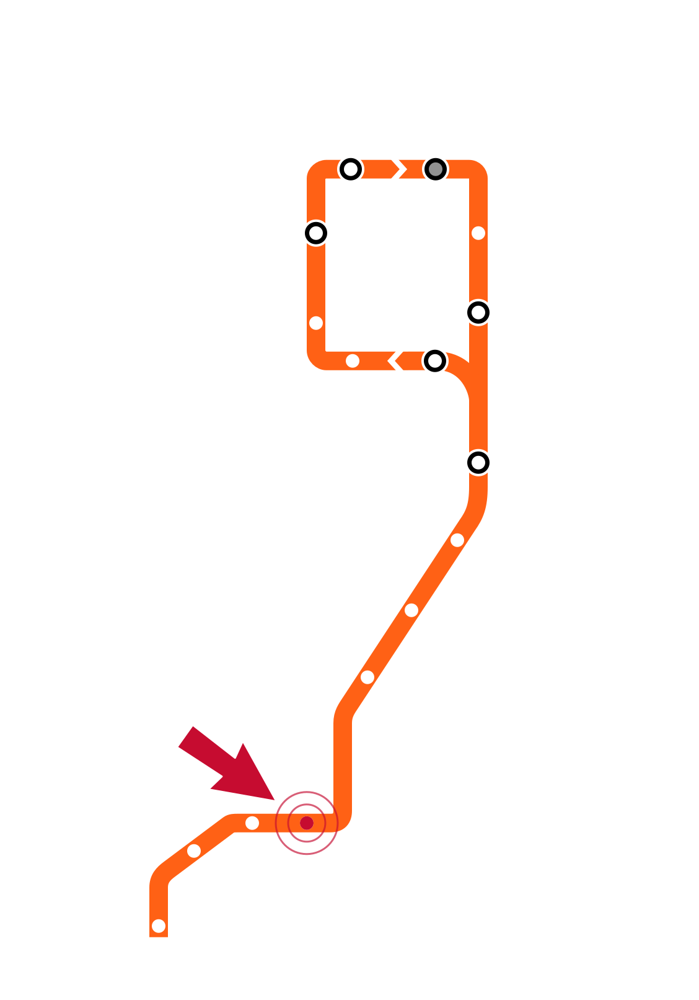{.figure alt="Orange Line map with the Western stop marked, the Week 12 stop"}

:::

---

# Presentation Days {.smaller}

| Mon, Nov 23 | Mon, Nov 30 | Wed, Dec 2 |
|---|---|---|
| 🔭1️⃣ Flock Group One | 🎣 "Phishing Phor Phun" | 💸 "Economic Trajectories" Group |
| 🏈 Football Group | 🎰 UFC Fight Analysis Group | 🔭2️⃣ Flock Group Two |
| 🤖📝 "Ed with Ed ⚕️ AI" | 🏥 "Socioeconomic Health Disparities" | 🏆 "Personal Exercise and Fitness Analytics" |
| 🕸️ "Social Media and Society" Group | ⚖️ "Everybody Votes" (Comparing Democracies) | 🏎️ F1 Group |
| ⚽️ Futbol Group | 🚦 Chicago Traffic Analytics Group | 🪾 "Family Backgrounds and Outcomes" |

---

# What do you see? {.image-frame-slide}

::: {style="position:relative; flex:0 0 auto; width:980px; height:510px; margin:0.2em auto 1.1em;"}

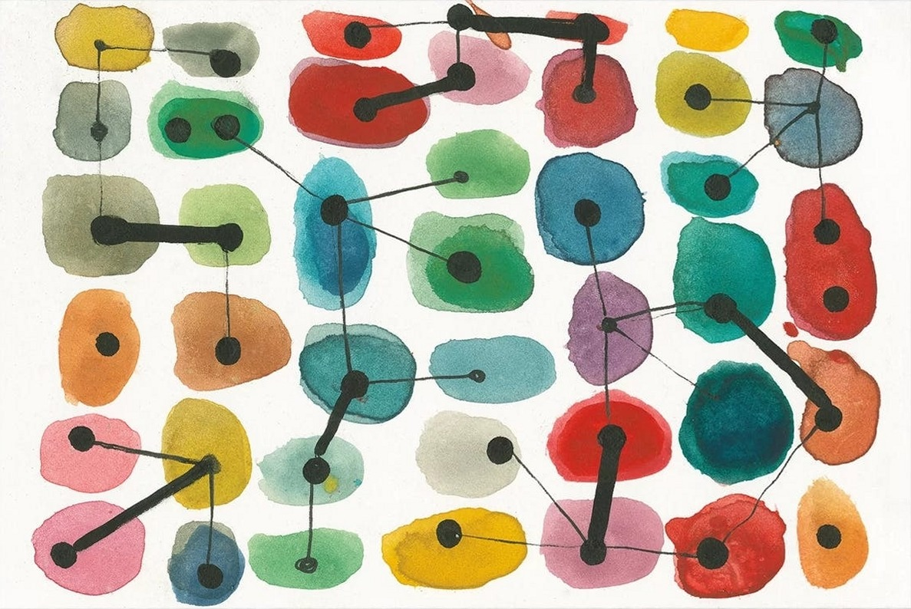

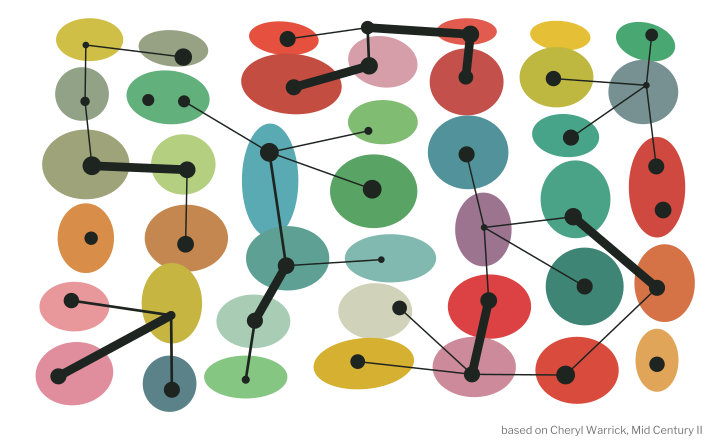

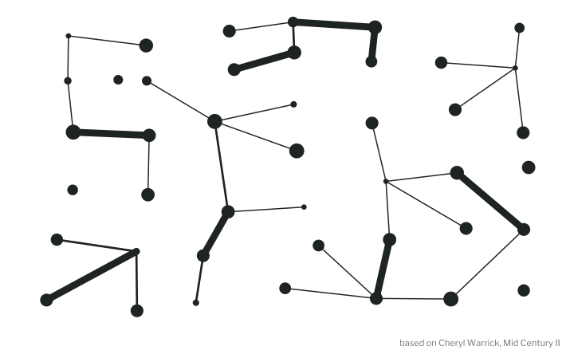

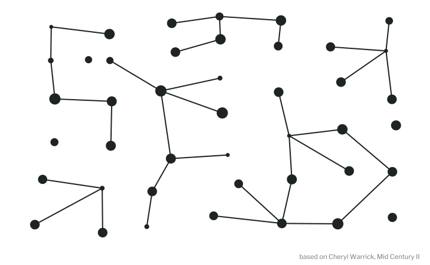

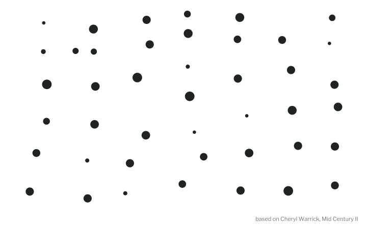

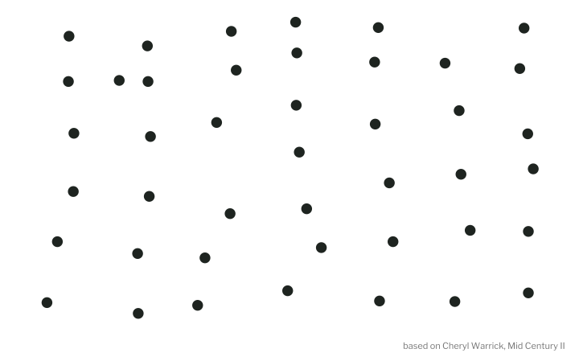

:::

::: {.caption}
Cheryl Warrick, *Mid Century II*. See [GitHub](https://github.com/jackbandy/data-science-fun/tree/main/docs/assets/art) for sources.
:::

---

# Graphs and Relationships {.section-header}

---

# Euler, 1741 {.image-frame-slide}

::: {.r-stack .peek-stack}
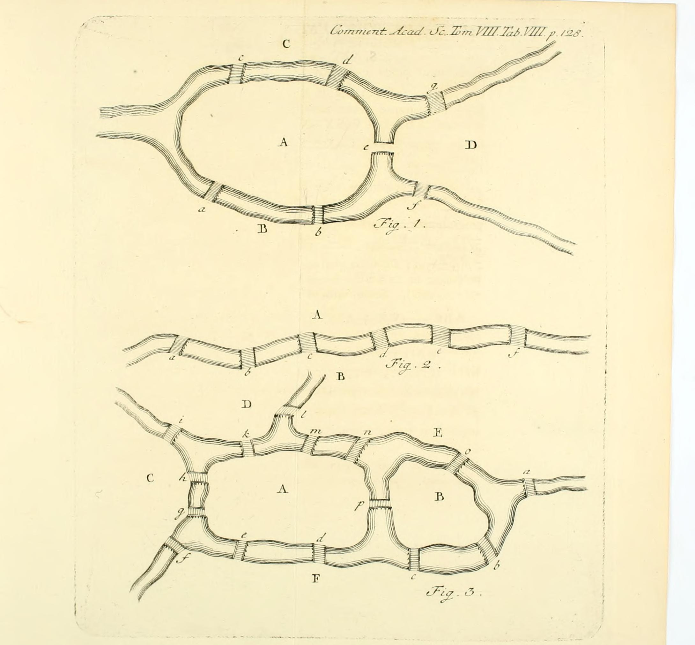

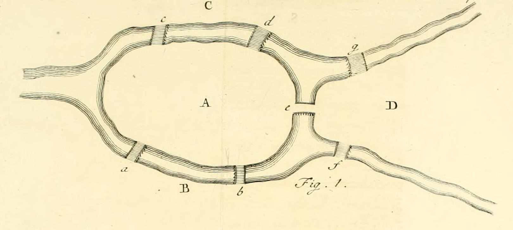
:::

::: {.caption}
@euler1741, Tab. VIII. Scan: American Museum of Natural History Library via the Biodiversity Heritage Library.
:::

---

# Bridges of Königsberg {.image-frame-slide}

::: {.r-stack .peek-stack}
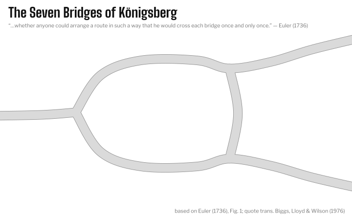

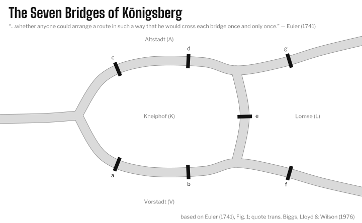

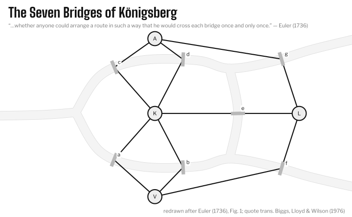

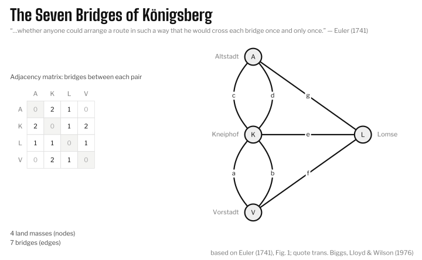

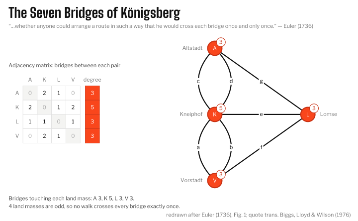
:::

::: {.caption}
Worksheet checkpoint 1: draw the graph and fill in its adjacency matrix.
:::

---

# Bridges of Shikaakwa {.image-frame-slide}

::: {.r-stack .peek-stack}
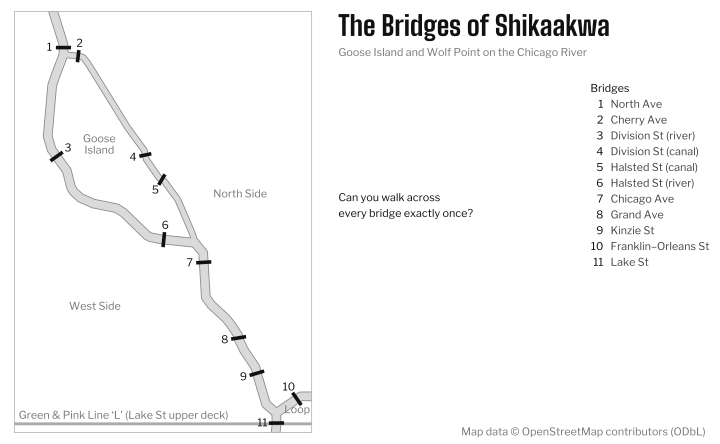

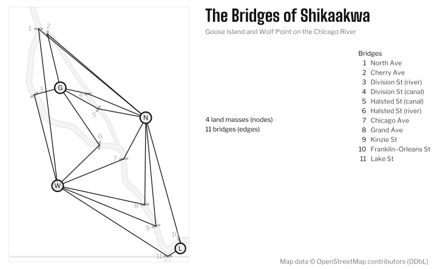

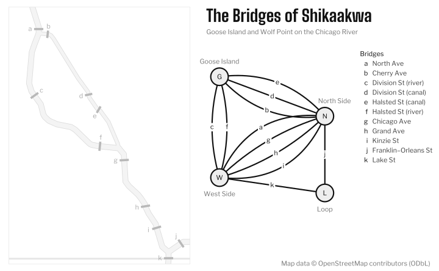

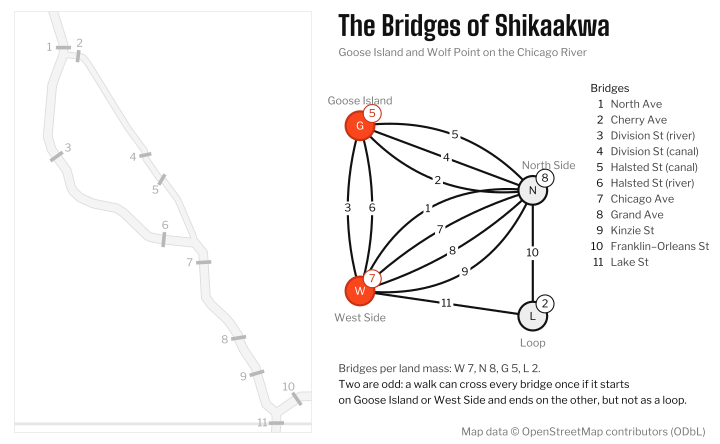

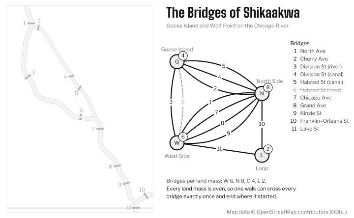
:::

::: {.caption}
Worksheet checkpoint 2: draw the graph and fill in its adjacency matrix.
:::

---

# Euler's Rule {.split}

::: {.split-content .golden-columns}

::: {.dense}
Can one walk cross every bridge exactly once?:

- "If there are more than two areas to which an odd number of bridges lead, then such a journey is impossible."
- if the number of bridges is odd for exactly two areas, then the journey is possible (if it starts in either of these areas)
- if there are no areas to which an odd number of bridges leads...
:::

::: {.captioned-figure}
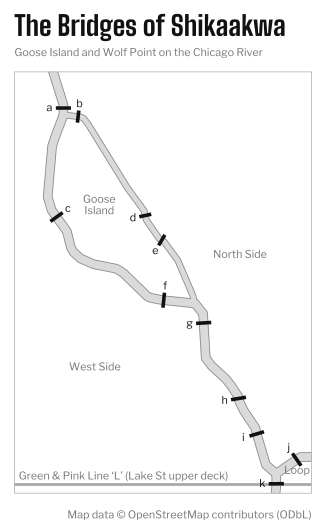

::: {.caption}
Shikaakwa: Goose Island (5 bridges) and West Side (7) are odd, so start at either. Königsberg: 4 odd, impossible. Worksheet checkpoint 2. Quotes from @euler1741, §20, trans. Biggs, Lloyd & Wilson (1976).
:::
:::

:::

---

# Vocab: Nodes, Edges, Degree {.split}

::: {.split-content .golden-figure}

::: {.dense}
- Graph $G = (V, E)$
    - a set of nodes (vertices) $V$
    - a set of edges $E$, each joining two nodes
- Degree: the number of edges at a node (D has 4)
- Self-loop: an edge from a node to itself (C has one; it adds 2 to C's degree)
:::

::: {.captioned-figure}
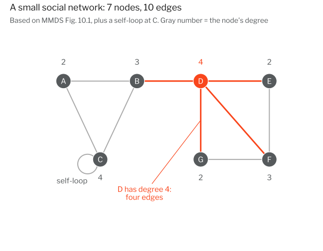

::: {.caption}
Based on @leskovec2020mmds, Fig. 10.1, with a self-loop added at C.
:::
:::

:::

---

# Vocab: Directed and Weighted {.split}

::: {.split-content .golden-figure}

::: {.dense}
- Directed: each edge has a direction, $u \to v$
- In-degree: the number of edges pointing in
- Out-degree: the number of edges pointing out
- Weighted: each edge carries a number
:::

::: {.captioned-figure}
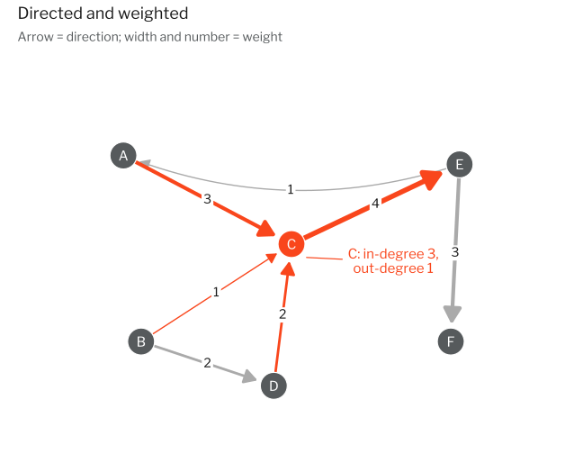

::: {.caption}
Toy example.
:::
:::

:::

---

# Vocab: Complete Bipartite Graphs {.split}

::: {.split-content .golden-figure}

::: {.dense}
- Bipartite: two groups of nodes, with edges only between groups
- Complete bipartite $K_{s,t}$: all possible edges between pairs of nodes chosen one from each group (s nodes in first group, t nodes in second group), and no edges between nodes of the same group
:::

::: {.captioned-figure}
::::: {.r-stack .peek-stack}
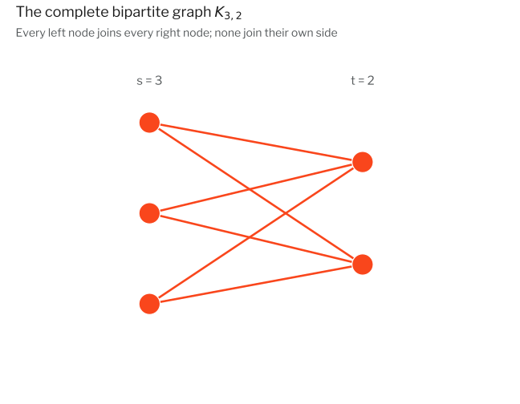

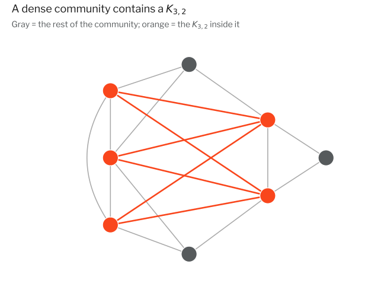
:::::

::: {.caption}
Quotes from @leskovec2020mmds, Sec. 10.9.
:::
:::

:::

---

# Vocab Check-in with Elbow Neighbors {.split}

::: {.split-content .golden-columns}

::: {.dense}
Worksheet checkpoints:

- 3: Check vocab entries.
- 4: Draw the complete bipartite graph $K_{2,3}$.
:::

<iframe src="https://dodatascience.fun/timer/" title="CTA-style countdown timer" loading="lazy" style="width: 100%; height: 420px; display: block; border: 1px solid #999; box-shadow: 0 10px 28px rgba(0,0,0,0.12); border-radius: 3px;"></iframe>

:::

---

# Triadic Closure {.split}

::: {.split-content .golden-figure}

::: {.dense}
- Locality: "if entity A is related to both B and C, then there is a higher probability than average that B and C are related."
- Triadic closure: two nodes that share a neighbor are more likely to gain an edge between them
- Worksheet checkpoint 5: which missing edge is most likely to form next?
:::

::: {.captioned-figure}
::::: {.r-stack .peek-stack}
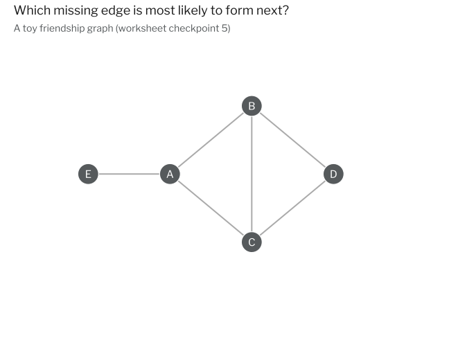

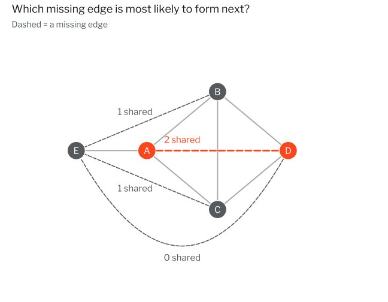
:::::

::: {.caption}
Toy example. Quote from @leskovec2020mmds, Sec. 10.1.1.
:::
:::

:::

---

# Example: Chicago Bulls {.section-header}

---

# Bulls Players, 2002–2014 {.image-frame-slide}

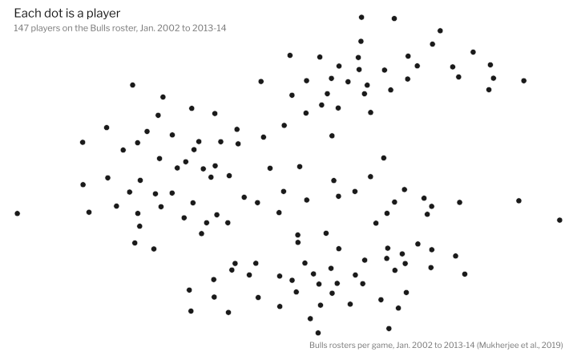

---

# Bulls Players, 2002–2014 {.image-frame-slide}

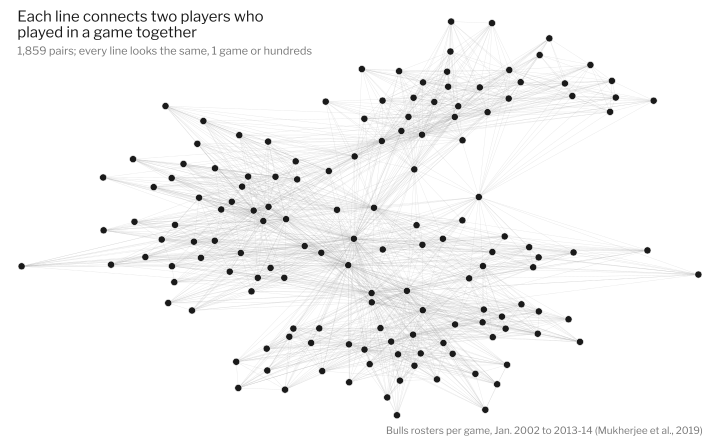

---

# Bulls Players, 2002–2014 {.image-frame-slide}

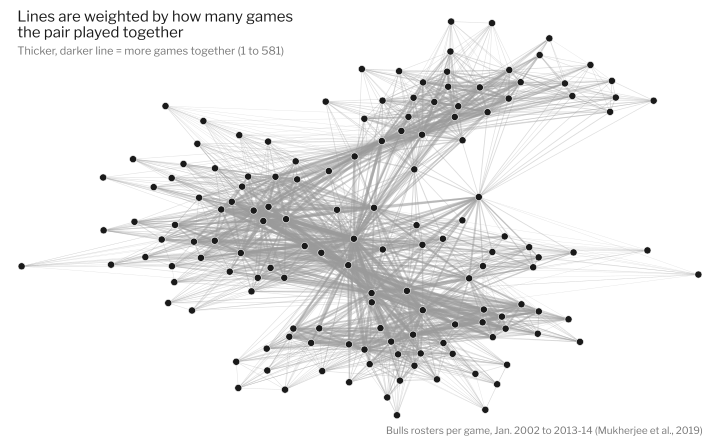

---

# Bulls Players, 2002–2014 {.image-frame-slide}

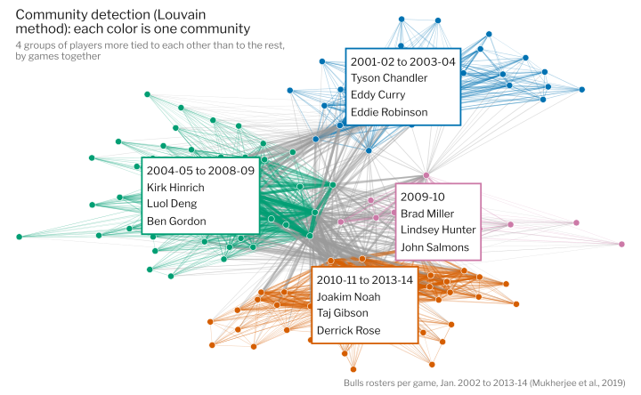

::: {.caption}
Communities found with the Louvain algorithm. More on community detection on Day 2.
:::

---

# Community 1: 2001-02 to 2003-04 {.image-frame-slide}

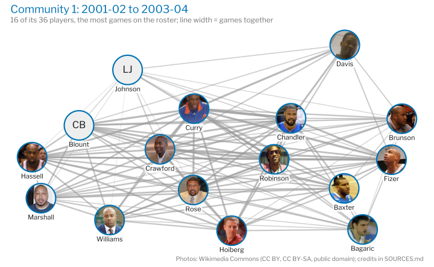

---

# Community 2: 2004-05 to 2008-09 {.image-frame-slide}

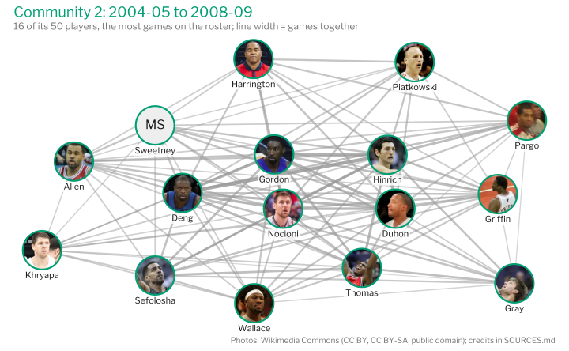

---

# Community 3: 2009-10 {.image-frame-slide}

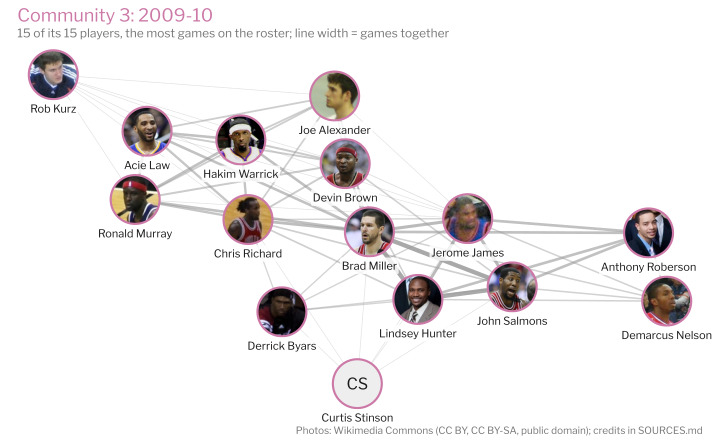

---

# Community 4: 2010-11 to 2013-14 {.image-frame-slide}

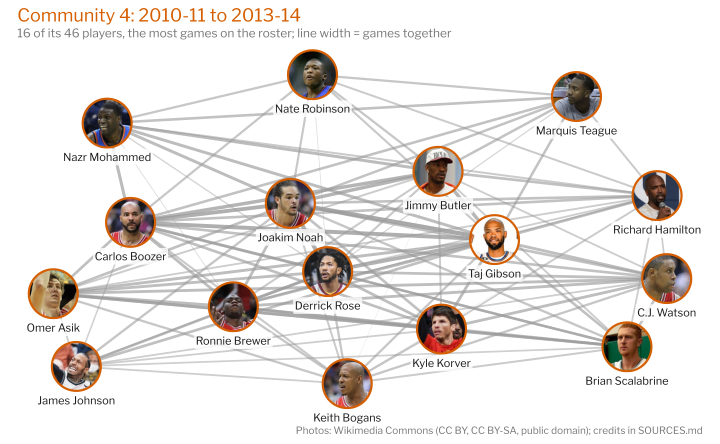

---

# Bulls Players, 1996–2023 {.image-frame-slide}

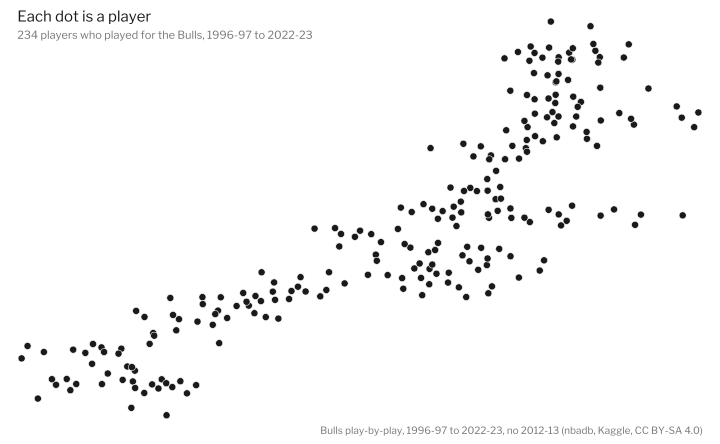

---

# Bulls Players, 1996–2023 {.image-frame-slide}

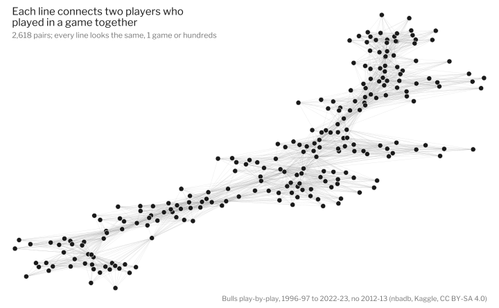

---

# Bulls Players, 1996–2023 {.image-frame-slide}

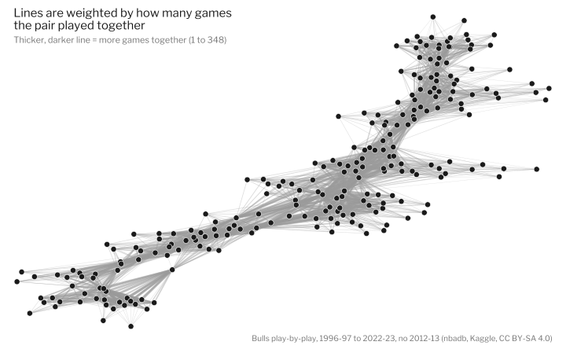

---

# Bulls Players, 1996–2023 {.image-frame-slide}

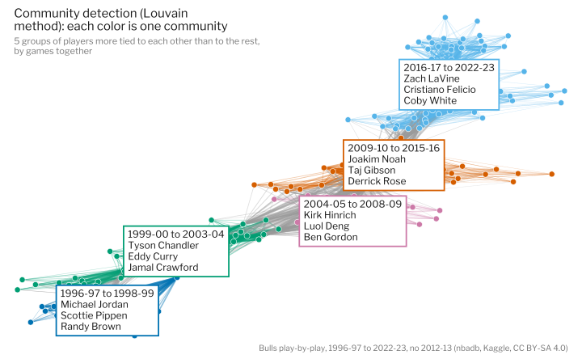

---

# Community 1: 1996-97 to 1998-99 {.image-frame-slide}

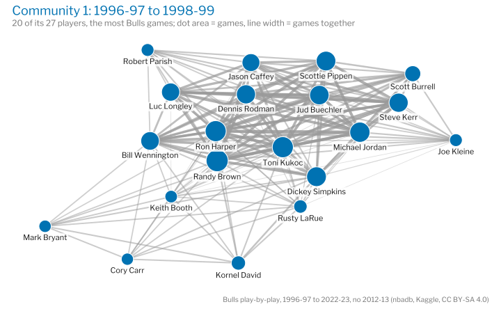

---

# Community 2: 1999-00 to 2003-04 {.image-frame-slide}

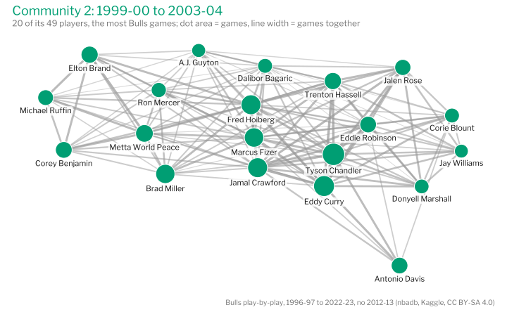

---

# Community 3: 2004-05 to 2008-09 {.image-frame-slide}

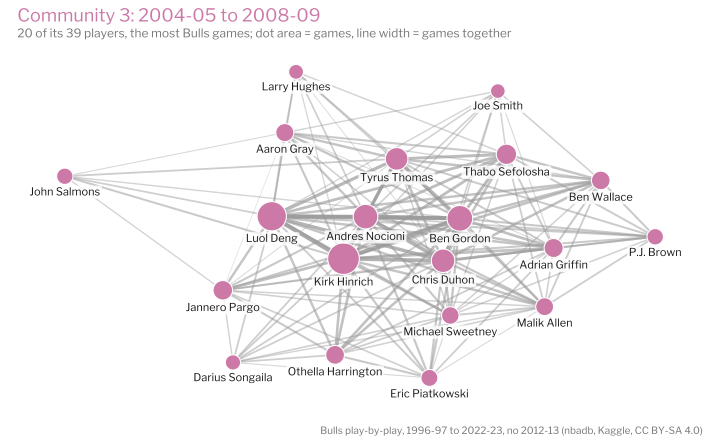

---

# Community 4: 2009-10 to 2015-16 {.image-frame-slide}

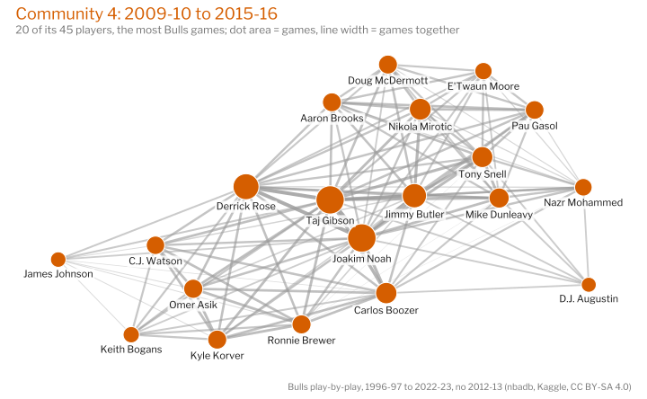

---

# Community 5: 2016-17 to 2022-23 {.image-frame-slide}

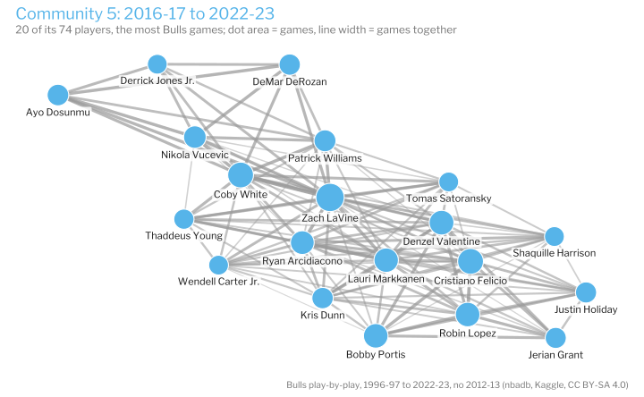

---

# Networks in Your Projects {.section-header}

---

# UFC Fight Analysis {.split}

::: {.split-content .golden-figure}

::: {.dense}
- **Node:** fighters
- **Edge:** a fight
- **RQ:** What fighter and fight traits go with winning UFC fights?
- **Analysis:** ...?
:::

::: {.captioned-figure}
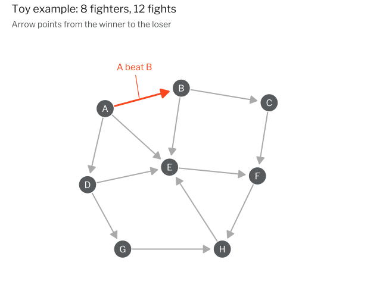
:::

:::

---

# Football (Soccer) {.split}

::: {.split-content .golden-figure}

::: {.dense}
- **Node:** national teams
- **Edge:** matches played
- **RQ:** How does playing at home affect team performance and match outcomes?
- **Analysis:** ...?
:::

::: {.captioned-figure}
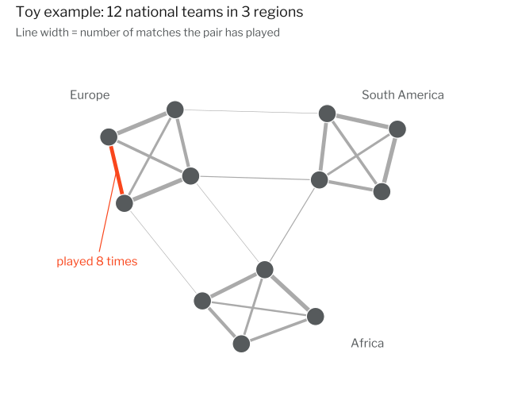
:::

:::

---

# Football (NFL) {.split}

::: {.split-content .golden-figure}

::: {.dense}
- **Node:** players
- **Edge:** pass targets
- **RQ:** How much does a receiver's separation relate to receiving yards?
- **Analysis:** ...?
:::

::: {.captioned-figure}
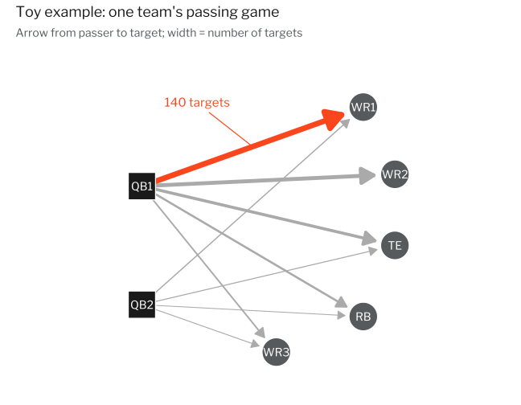
:::

:::

---

# Economic Trajectories {.split}

::: {.split-content .golden-figure}

::: {.dense}
- **Node:** reviewers, restaurants
- **Edge:** a review
- **RQ:** Which restaurant traits (ratings, review volume, competitors) predict closure?
- **Analysis:** ...?
:::

::: {.captioned-figure}
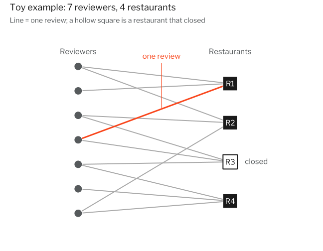
:::

:::

---

# Flock Research {.split}

::: {.split-content .golden-figure}

::: {.dense}
- **Node:** police agencies and surveillance technologies
- **Edge:** an agency uses a technology
- **RQ:** Do agencies that use license-plate readers (ALPR) also use other surveillance tech?
- **Analysis:** ...?
:::

::: {.captioned-figure}
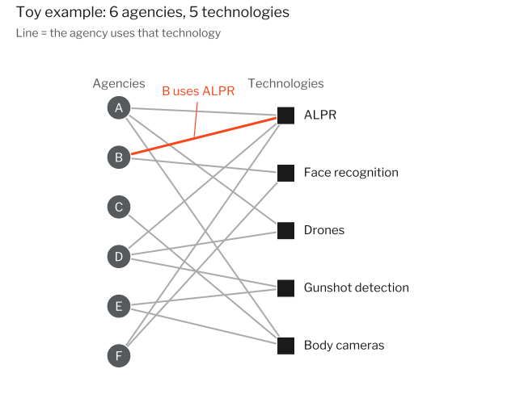
:::

:::

---

# Fake News on Social Media {.split}

::: {.split-content .golden-figure}

::: {.dense}
- **Node:** articles and tweets
- **Edge:** a tweet shares an article (or retweets a tweet)
- **RQ:** Does fake news get shared more than real news on social media?
- **Analysis:** ...?
:::

::: {.captioned-figure}
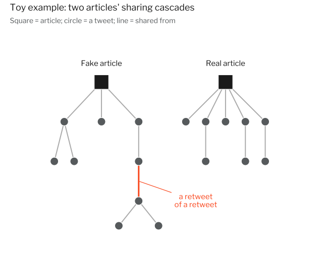
:::

:::

---

# Your Project as a Network {.split}

::: {.split-content .golden-columns}

::: {.dense}
Worksheet checkpoint 6:

- Draw a graph from your project's data or concepts.
- What is a node? What does an edge mean?
:::

<iframe src="https://dodatascience.fun/timer/" title="CTA-style countdown timer" loading="lazy" style="width: 100%; height: 420px; display: block; border: 1px solid #999; box-shadow: 0 10px 28px rgba(0,0,0,0.12); border-radius: 3px;"></iframe>

:::

---

# Any questions? {#any-questions-day-1}

- Project checkpoint 5 (narrative analysis) due Sunday, November 15
- Group presentations start Monday, November 23
- Group Projects?
- Other logistics?
- (You can also stay after class for questions)

---

# Upload your worksheet {#upload-worksheet-day-1}

Take a picture of your worksheet, upload it in Canvas

---

# That's All for Today, See You Wednesday! {.section-header .no-index}

---

# Week 12, Day 2 {.course-title .photo-title data-state="photo-title photo-title-zoom" background-image="../assets/orange-line-stops-better/stop13-western-c.jpg" background-size="cover"}

<h2>Network Immunization</h2>

Jack Bandy
2026

---

# Map {.split}

::: {.split-content .narrow-aside}

::: {}
- Week 12: Western
- Day 2
    - Community Detection
    - Network Diffusion
    - Virus Propagation
    - Network Immunization
:::

{.figure alt="Orange Line map with the Western stop marked, the Week 12 stop"}

:::

---

# Community Detection {.section-header}

---

# Community Detection

:::: {.columns}
::: {.column width="50%"}
**Finding groups in networks**

::: {.incremental}
- Communities = densely connected groups
- Sparse connections between groups
- Social groups in social networks
:::
:::
::: {.column width="50%"}
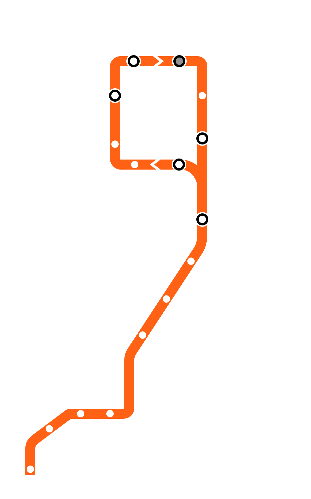{style="border: 1px solid #999; padding: 6px; max-width: 100%; max-height: 440px; object-fit: contain; display: block; margin: 0 auto;"}

::: {style="text-align: center;"}
Community detection *(placeholder)*
:::
:::
::::

---

# Vocab: Communities and Cliques {.split}

::: {.split-content .golden-figure}

::: {.dense}
- Community: a small set of nodes with "a much higher density of edges than the average density"
- Density: edges present / pairs of nodes
- Clique: every pair is joined ({A, B, C})
:::

::: {.captioned-figure}

::: {.caption}
Quotes from @leskovec2020mmds, Sec. 10.9.
:::
:::

:::

---

# A Friendship Network {.split}

::: {.split-content .golden-figure}

::: {.dense}
- Zachary (1977): friendships in a university karate club that later split in two
- No features: only who is friends with whom
- Can clustering find the split before it happened?
:::

::: {.captioned-figure}

:::

:::

---

# Vocab: Adjacency and Degree Matrices {.split}

::: {.split-content .golden-figure}

::: {.dense}
- Adjacency matrix: "The entry in row $i$ and column $j$ is 1 if there is an edge between nodes $i$ and $j$, and 0 otherwise."
- Degree matrix: "has $d$ in the $i$th diagonal entry if $d$ is the degree of the $i$th node."
:::

::: {.captioned-figure}

::: {.caption}
Based on @leskovec2020mmds, Figs. 10.13 and 10.14.
:::
:::

:::

---

# Friends as Coordinates {.split}

::: {.split-content .golden-figure}

::: {.dense}
- Spectral clustering turns the network into coordinates: eigenvectors of the graph Laplacian
- Members with many friends in common land close together

::: {.fragment fragment-index=1}
- Split at 0 on the first coordinate (the Fiedler vector): roughly, cut where few friendships cross
:::
:::

::: {.captioned-figure}
::::: {.r-stack .peek-stack}

::: {.fragment fragment-index=1}

:::
:::::
:::

:::

---

# The Result {.split}

::: {.split-content .golden-figure}

::: {.dense}
- Back on the network: shape = the side each member actually joined; fill = the clustering
- 33 of 34 land on the side they joined
- The one miss has friends on both sides (2 with Mr. Hi's group, 3 with the officer's)
:::

::: {.captioned-figure}

:::

:::

---

# Goodness Metrics

:::: {.columns}
::: {.column width="50%"}
**Measuring community quality**

**Density:** Ratio of actual to possible edges

$$\frac{2E_s}{S(S-1)}$$

**Conductance:** Fraction of edges leaving

$$\frac{O_s}{2E_s + O_s}$$
:::
::: {.column width="50%"}
{style="border: 1px solid #999; padding: 6px; max-width: 100%; max-height: 440px; object-fit: contain; display: block; margin: 0 auto;"}

::: {style="text-align: center;"}
Modularity concept *(placeholder)*
:::
:::
::::

---

# Modularity

:::: {.columns}
::: {.column width="50%"}
**Most popular community detection metric**

<!-- $$Q = \frac{1}{2m} \sum_{v,w} \left[ A_{vw} - \frac{k_v k_w}{2m} \right] \delta(v,w)$$ -->
<!-- complex formula — left commented for now -->

::: {.incremental}
- Actual edges − Expected edges
- Higher Q = better communities
- Maximizing Q is NP-complete
:::
:::
::: {.column width="50%"}
{style="border: 1px solid #999; padding: 6px; max-width: 100%; max-height: 440px; object-fit: contain; display: block; margin: 0 auto;"}

::: {style="text-align: center;"}
Modularity visualization *(placeholder)*
:::
:::
::::

---

# Louvain Method

:::: {.columns}
::: {.column width="50%"}
**Greedy modularity optimization**

::: {.incremental}
1. Start with each node as community 
2. Move nodes to maximize Q 
3. Aggregate communities into supernodes 
4. Repeat until convergence 
:::
:::
::: {.column width="50%"}
{style="border: 1px solid #999; padding: 6px; max-width: 100%; max-height: 440px; object-fit: contain; display: block; margin: 0 auto;"}

::: {style="text-align: center;"}
Community detection *(placeholder)*
:::
:::
::::

---

# Vocab: Overlapping Communities {.split}

::: {.split-content .golden-figure}

::: {.dense}
- Overlapping communities: "Typically, individuals are members of several communities."
- Some community detection algorithms put each node in exactly one community (e.g. Louvain algorithm)
:::

::: {.captioned-figure}

::: {.caption}
Based on @leskovec2020mmds, Fig. 10.19; quotes from Sec. 10.9.
:::
:::

:::

---

# Network Diffusion {.section-header}

---

# Network Diffusion

:::: {.columns}
::: {.column width="50%"}
**How events spread through networks**

**Key questions:** 

::: {.incremental}
- Will it spread?
- Which nodes to target?
- How to stop it?
:::
:::
::: {.column width="50%"}
{style="border: 1px solid #999; padding: 6px; max-width: 100%; max-height: 440px; object-fit: contain; display: block; margin: 0 auto;"}

::: {style="text-align: center;"}
Simple network *(placeholder)*
:::
:::
::::

---

# Vocab: Neighborhoods {.split}

::: {.split-content .golden-figure}

::: {.dense}
- Neighborhood of radius $r$: "the set of nodes reachable from $v$ along paths of length at most $r$"
- Diameter: "the smallest $r$ for which the neighborhood of radius $r$ for any starting node includes the entire graph"
:::

::: {.captioned-figure}
::::: {.r-stack .peek-stack}

:::::

::: {.caption}
Based on @leskovec2020mmds, Example 10.26; quotes from Sec. 10.9.
:::
:::

:::

---

# Vocab: Transitive Closure {.split}

::: {.split-content .golden-figure}

::: {.dense}
- Reachable: "A node $v$ can reach node $u$ if $u$ is in the neighborhood of $v$ for some radius."
- Transitive closure: "the set of pairs of nodes $(v, u)$ such that $v$ can reach $u$"
- Grows quickly: it "can have a number of facts equal to the square of the number of nodes"
:::

::: {.captioned-figure}
::::: {.r-stack .peek-stack}

:::::

::: {.caption}
Quotes from @leskovec2020mmds, Sec. 10.9.
:::
:::

:::

---

# Broadcast vs. Viral

:::: {.columns}
::: {.column width="50%"}
**Two ways content reaches a crowd** [@goel2016structural]

::: {.incremental}
- **Broadcast:** one source reaches many directly (e.g. a front page, the Super Bowl)
- **Viral:** person-to-person, over many generations
- Real cascades mix the two
:::
:::
::: {.column width="50%"}
{style="border: 1px solid #999; padding: 6px; max-width: 100%; max-height: 440px; object-fit: contain; display: block; margin: 0 auto;"}

::: {style="text-align: center;"}
Broadcast (shallow) vs. viral (deep) diffusion trees *(placeholder)*
:::
:::
::::

---

# Structural Virality

:::: {.columns}
::: {.column width="50%"}
**A single number for tree shape** [@goel2016structural]

Average distance between all pairs of nodes in a diffusion tree (the *Wiener index*):

$$\nu(T) = \frac{1}{n(n-1)} \sum_{i=1}^{n} \sum_{j=1}^{n} d_{ij}$$

::: {.incremental}
- $\nu(T) \approx 2$: pure broadcast (a star)
- Large $\nu(T)$: deep, multigenerational spread
:::
:::
::: {.column width="50%"}
{style="border: 1px solid #999; padding: 6px; max-width: 100%; max-height: 440px; object-fit: contain; display: block; margin: 0 auto;"}

::: {style="text-align: center;"}
Diffusion tree with pairwise distances *(placeholder)*
:::
:::
::::

---

# What Spreads Online?

:::: {.columns}
::: {.column width="50%"}
**~1 billion Twitter diffusion events** [@goel2016structural]

::: {.incremental}
- Over 99% of cascades die in one generation
- Virality varies widely (**no** "tipping point")
- Popularity is driven mostly by the largest broadcast
:::
:::
::: {.column width="50%"}
{style="border: 1px solid #999; padding: 6px; max-width: 100%; max-height: 440px; object-fit: contain; display: block; margin: 0 auto;"}

::: {style="text-align: center;"}
Distribution of cascade sizes and structural virality *(placeholder)*
:::
:::
::::

---

# Virus Propagation {.section-header}

---

# Virus Propagation Models

:::: {.columns}
::: {.column width="50%"}
**VPMs simplify disease spread**

::: {.incremental}
- How virulent?
- Recovery rate?
- Immunity?
- Immunity duration?
:::
:::
::: {.column width="50%"}
{style="border: 1px solid #999; padding: 6px; max-width: 100%; max-height: 440px; object-fit: contain; display: block; margin: 0 auto;"}

::: {style="text-align: center;"}
SIS model *(placeholder)*
:::
:::
::::

---

# $SIS$ Model

:::: {.columns}
::: {.column width="50%"}
**Susceptible → Infected → Susceptible**

::: {.incremental}
- Example: flu
- $\beta$ = transmission probability
- $\delta$ = healing probability
- No immunity
:::
:::
::: {.column width="50%"}
{style="border: 1px solid #999; padding: 6px; max-width: 100%; max-height: 440px; object-fit: contain; display: block; margin: 0 auto;"}

::: {style="text-align: center;"}
SIS model diagram *(placeholder)*
:::
:::
::::

---

# $SIR$ Model

:::: {.columns}
::: {.column width="50%"}
**Susceptible → Infected → Recovered**

::: {.incremental}
- Example: mumps
- $\beta$ = transmission probability
- $\delta$ = healing probability
- Life-time immunity
:::
:::
::: {.column width="50%"}
{style="border: 1px solid #999; padding: 6px; max-width: 100%; max-height: 440px; object-fit: contain; display: block; margin: 0 auto;"}

::: {style="text-align: center;"}
SIR model diagram *(placeholder)*
:::
:::
::::

---

# $SIRS$ Model

:::: {.columns}
::: {.column width="50%"}
**Temporary immunity**

::: {.incremental}
- Example: whooping cough
- $\gamma$ = immunity loss probability
- Immunity wears off over time
:::
:::
::: {.column width="50%"}
{style="border: 1px solid #999; padding: 6px; max-width: 100%; max-height: 440px; object-fit: contain; display: block; margin: 0 auto;"}

::: {style="text-align: center;"}
SIRS model diagram *(placeholder)*
:::
:::
::::

---

# $SEIV$ Model

:::: {.columns}
::: {.column width="50%"}
**Most complex VPM**

::: {.incremental}
- **E** = Exposed (incubation)
- **V** = Vaccinated
- $\varepsilon$ = virus maturation
- $\theta$ = vaccination rate
:::
:::
::: {.column width="50%"}
{style="border: 1px solid #999; padding: 6px; max-width: 100%; max-height: 440px; object-fit: contain; display: block; margin: 0 auto;"}

::: {style="text-align: center;"}
SEIV model diagram *(placeholder)*
:::
:::
::::

---

# Epidemic Threshold

:::: {.columns}
::: {.column width="50%"}
**Critical point for virus spread**

$$s = \lambda_1 \cdot C_{VPM}$$

::: {.incremental}
- $s < 1$: Virus dies out
- $s > 1$: Epidemic spreads
- $\lambda_1$ = network connectivity
:::
:::
::: {.column width="50%"}
{style="border: 1px solid #999; padding: 6px; max-width: 100%; max-height: 440px; object-fit: contain; display: block; margin: 0 auto;"}

::: {style="text-align: center;"}
Epidemic threshold *(placeholder)*
:::
:::
::::

---

# Network Connectivity

:::: {.columns}
::: {.column width="50%"}
**Why spectral radius matters**

::: {.incremental}
- Average degree ignores paths
- $\lambda_1$ considers all path lengths
- Better predicts spread
:::
:::
::: {.column width="50%"}
{style="border: 1px solid #999; padding: 6px; max-width: 100%; max-height: 440px; object-fit: contain; display: block; margin: 0 auto;"}

::: {style="text-align: center;"}
Network connectivity examples *(placeholder)*
:::
:::
::::

---

# Effective Strength

:::: {.columns}
::: {.column width="50%"}
**Predicting epidemic spread**

$$s = \lambda_1 \cdot C_{VPM}$$

**For SIS:** $s = \lambda_1 \cdot \frac{\beta}{\delta}$

::: {.incremental}
- Higher connectivity → more spread
- Higher transmission → more spread
- Higher healing → less spread
:::
:::
::: {.column width="50%"}
{style="border: 1px solid #999; padding: 6px; max-width: 100%; max-height: 440px; object-fit: contain; display: block; margin: 0 auto;"}

::: {style="text-align: center;"}
Epidemic threshold visualization *(placeholder)*
:::
:::
::::

---

# Network Immunization {.section-header}

---

# Immunization Problem

:::: {.columns}
::: {.column width="50%"}
**Which $k$ nodes to vaccinate?**

**Goal:** Minimize $\lambda_1$

**Approaches:** 

::: {.incremental}
- Random (poor)
- High-degree nodes (better)
- NetShield (best)
:::
:::
::: {.column width="50%"}
{style="border: 1px solid #999; padding: 6px; max-width: 100%; max-height: 440px; object-fit: contain; display: block; margin: 0 auto;"}

::: {style="text-align: center;"}
Network connectivity *(placeholder)*
:::
:::
::::

---

# NetShield Algorithm

:::: {.columns}
::: {.column width="50%"}
**Efficient immunization**

<!-- $$Sv(S) = \sum_{i \in S} 2\lambda_1 u_1(i)^2 - \sum_{i,j \in S} A(i,j) u_1(i) u_1(j)$$ -->
<!-- complex formula — left commented for now -->

::: {.incremental}
- Approximates eigen-drop
- Greedy selection
- Outperforms heuristics
:::
:::
::: {.column width="50%"}
{style="border: 1px solid #999; padding: 6px; max-width: 100%; max-height: 440px; object-fit: contain; display: block; margin: 0 auto;"}

::: {style="text-align: center;"}
Community detection showing key nodes *(placeholder)*
:::
:::
::::

---

# References & Credits {.sources}

::: {#refs}
:::

::: {.credits}
- GitHub source: <https://github.com/jackbandy/data-science-fun/blob/main/docs/slides/week12.qmd>.
- Slides developed using materials from [Elena Zheleva](https://www.cs.uic.edu/~elena/) and [Gonzalo Bello Lander](https://cs.uic.edu/profiles/gonzalo-bello/), the Berkeley DS 100 team, Marine Carpuat, and Brian Ziebart. Network analysis content heavily adapted from Gonzalo Bello's **CS 418 - Lecture Slides 20 - Network Analysis.pdf**.
- Slide deck built with [Quarto](https://quarto.org/) revealjs.
- Title font is Big Shoulders; Body font is [Libre Franklin](https://en.wikipedia.org/wiki/Franklin_Gothic#Libre_Franklin).
:::
