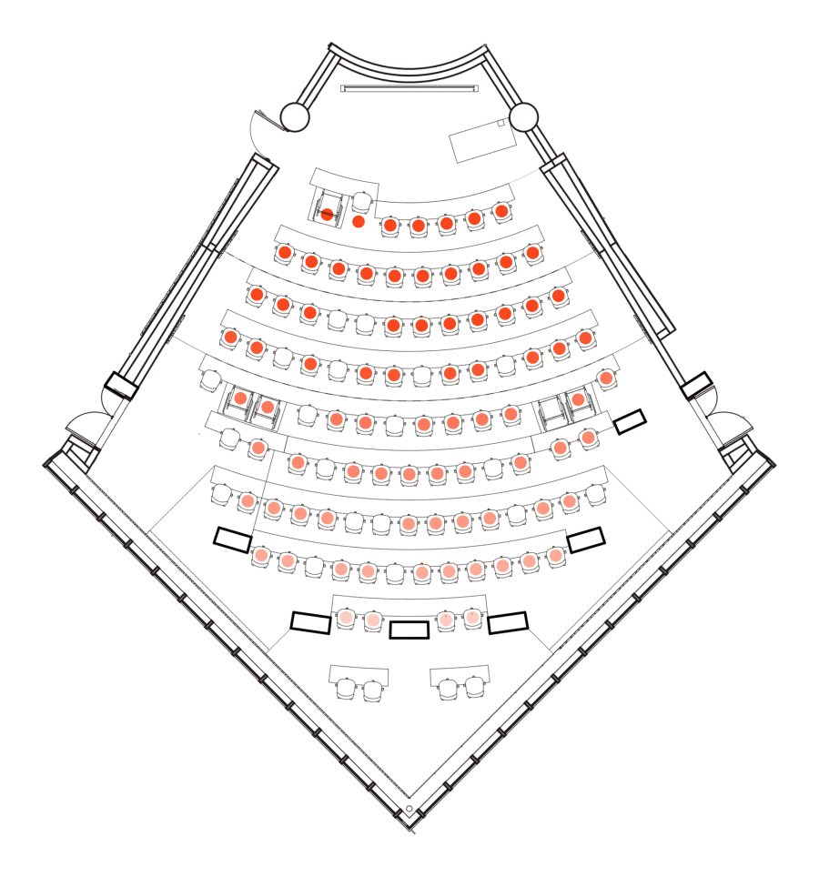
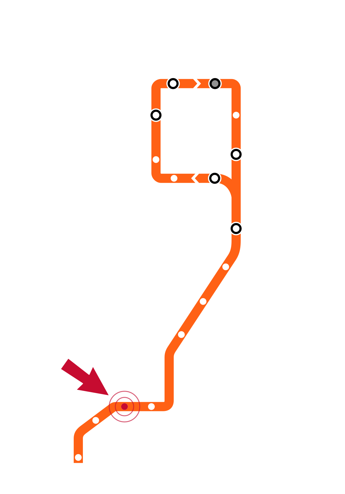

# Week 13, Day 1 {.course-title .photo-title .title-aside .title-top data-state="photo-title" background-image="../assets/orange-line-stops-better/stop14-kedzie-d.jpg" background-size="cover"}

<h2>Guest Lecture: Ward Wise</h2>

<h2>Sean MacMullan, Chi Hack Night</h2>

CS 418, Week 13 🟧 Kedzie 🟧

You are invited to sit toward the front of the classroom!

{.nostretch alt="Animated floor plan of UIC Lecture Center C001 with an orange dot on most seats, fading toward the back; every dot moves up one row toward the front while the front row's dots stay in place"}

---

## {.photo-only data-state="photo-only" background-image="../assets/orange-line-stops-better/stop14-kedzie-d.jpg" background-size="cover"}

---

## Map for Week 13, Day 1 (Kedzie) {.split}

::: {.split-content .narrow-aside}

::: {}
- Administrivia
- Guest lecture!
:::

{.figure alt="Orange Line map with the Kedzie stop marked, the Week 13 stop"}

:::

---

## Administrivia

- Homework 13 due today
- Project checkpoint 5 (narrative analysis) due tonight
- Group presentations start Monday, November 23
- Any logistical questions before we start?

# Guest Lecture: Ward Wise {.section-header}

## Today's Guest: Sean MacMullan

- Avondale-based civic technologist, works on tech that connects neighbors and drives civic engagement
- Presents [Ward Wise](https://www.wardwisechicago.org/), a project from [Chi Hack Night](https://chihacknight.org/)

::: {.caption}
Bio from the course schedule.
:::

---

## Upload your worksheet {#upload-worksheet-day-1}

Take a picture of your worksheet, upload it in Canvas

# That's All for Today, See You Wednesday! {.section-header .no-index}

# Week 13, Day 2 {.course-title .photo-title data-state="photo-title" background-image="../assets/orange-line-stops-better/stop14-kedzie-b.jpg" background-size="cover"}

<h2>A/B Testing</h2>

CS 418, Week 13 🟧 Kedzie 🟧

Jack Bandy, 2026

---

## {.photo-only data-state="photo-only" background-image="../assets/orange-line-stops-better/stop14-kedzie-b.jpg" background-size="cover"}

---

## Map for Week 13, Day 2 (Kedzie) {.split}

::: {.split-content .narrow-aside}

::: {}
- What is an A/B test?
- Randomization and comparison
- Common causes
:::

{.figure alt="Orange Line map with the Kedzie stop marked, the Week 13 stop"}

:::

---

## Checking in

- Week 13 quiz today, in the computer-based testing facility
- Group presentations start Monday, November 23
- Project checkpoint 5 (narrative analysis) is behind us
- Any questions about the group project?

::: {.caption}
How to get to the testing facility: [How to get to SELE 2254](/sele.html).
:::

# A/B Testing {.section-header}

## What Is an A/B Test?

::: {style="border:3px dashed #f9461c; border-radius:12px; padding:0.8em 1em; margin-top:0.4em;"}
[TODO]{.eyebrow .todo}

::: {.dense}
- **TK** definition, quoted from *Computational and Inferential Thinking*, Chapter 2: Causality and Experiments
- **TK** the two-group picture: treatment and control, one difference between them
:::
:::

---

## Randomization and Comparison

::: {style="border:3px dashed #f9461c; border-radius:12px; padding:0.8em 1em; margin-top:0.4em;"}
[TODO]{.eyebrow .todo}

::: {.dense}
- **TK** why random assignment licenses a causal claim, from *Computational and Inferential Thinking*, Chapter 12: Comparing Two Samples
- **TK** worked example: a difference of means, permuted a few thousand times
:::
:::

---

## Common Causes

::: {style="border:3px dashed #f9461c; border-radius:12px; padding:0.8em 1em; margin-top:0.4em;"}
[TODO]{.eyebrow .todo}

::: {.dense}
- **TK** the confounder picture, following *Calling Bullshit* 3.5: Common Causes
- **TK** one A/B test whose result had a common cause behind both arms
:::
:::

---

## Any questions? {#any-questions-day-2}

- Week 13 quiz today
- Group presentations start Monday, November 23
- Group projects?
- Other logistics?
- (You can also stay after class for questions)

---

## Upload your worksheet {#upload-worksheet-day-2}

Take a picture of your worksheet, upload it in Canvas

# That's All for Today, See You Monday! {.section-header .no-index}

# References & Credits {.sources}

::: {.credits}
- GitHub source: <https://github.com/jackbandy/data-science-fun/blob/main/docs/slides/week13.qmd>.
- Guest lecture: [Sean MacMullan](https://github.com/smacmullan), [Ward Wise](https://www.wardwisechicago.org/), a project from [Chi Hack Night](https://chihacknight.org/). Slides: [Google Slides](https://docs.google.com/presentation/d/182FkgVvSTL65wpT4vInJGkrL6LoFIGdp4Q7W_g48x1E/edit?usp=sharing).
- A/B testing follows Lau, Gonzalez & Nolan, *[Learning Data Science](https://learningds.org/)*, [Chapter 3: Simulation and Data Design](https://learningds.org/ch/03/theory_intro.html).
- Adhikari, DeNero & Wagner, *[Computational and Inferential Thinking](https://inferentialthinking.com/)*, [Chapter 2: Causality and Experiments](https://inferentialthinking.com/chapters/02/causality-and-experiments) and [Chapter 12: Comparing Two Samples](https://inferentialthinking.com/chapters/12/comparing-two-samples).
- Bergstrom & West, *Calling Bullshit*, [3.5: Common Causes](https://www.youtube.com/watch?v=5iVN13tbVNc) (video, 10 min).
- Slides developed using materials from [Elena Zheleva](https://www.cs.uic.edu/~elena/), [Gonzalo Bello Lander](https://cs.uic.edu/profiles/gonzalo-bello/), the Berkeley DS 100 team, Marine Carpuat, and Brian Ziebart.
- Orange Line photo: [Wikimedia Commons](https://commons.wikimedia.org/wiki/File:20040428_29_CTA_Orange_Line_Kedzie_Station_(7518020040).jpg), CC BY 2.0, David Wilson. See `docs/assets/orange-line-stops-better/SOURCES.md`.
- Slide deck built with [Quarto](https://quarto.org/) revealjs.
- Title font is Big Shoulders; Body font is [Libre Franklin](https://en.wikipedia.org/wiki/Franklin_Gothic#Libre_Franklin).
:::
