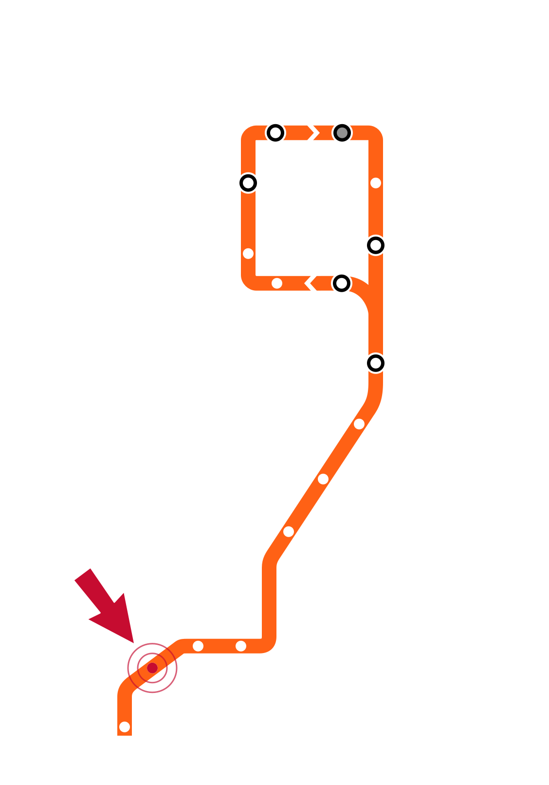

# Week 14, Day 1 {.course-title .photo-title .title-top data-state="photo-title" background-image="../assets/orange-line-stops-better/stop15-pulaski-a.jpg" background-size="cover"}

<h2>Project Presentations</h2>

CS 418, Week 14 🟧 Pulaski 🟧

Jack Bandy, 2026

---

## {.photo-only data-state="photo-only" background-image="../assets/orange-line-stops-better/stop15-pulaski-a.jpg" background-size="cover"}

# Week 14, Day 1 {#week-14-day-1-aerial .course-title .photo-title .experimental-roofline-title data-state="photo-title" data-roofline="0 905 2560 1130" data-roofline-image="2560 1920" data-roofline-inset="130" background-image="../assets/orange-line-stops-better/stop15-pulaski-b.jpg" background-size="cover"}

<h2>Project Presentations</h2>

CS 418, Week 14 🟧 Pulaski 🟧

Jack Bandy, 2026

---

## {.photo-only data-state="photo-only" background-image="../assets/orange-line-stops-better/stop15-pulaski-b.jpg" background-size="cover"}

---

## Map for Week 14, Day 1 (Pulaski) {.split}

::: {.split-content .narrow-aside}

::: {}
- Project presentations
:::

{.figure alt="Orange Line map with the Pulaski stop marked, the Week 14 stop"}

:::

# Project Presentations {.section-header}

## Today's Presentations

- 🔭1️⃣ Flock Group One
- 🏈 Football Group
- 🤖📝 "Ed with Ed ⚕️ AI"
- 🕸️ "Social Media and Society"
- ⚽️ Futbol Group

---

## Upload your worksheet {#upload-worksheet-day-1}

Take a picture of your worksheet, upload it in Canvas

# No Class Wednesday (Student Wellness Day), See You Next Monday! {.section-header .no-index}

# References & Credits {.sources}

::: {.credits}
- GitHub source: <https://github.com/jackbandy/data-science-fun/blob/main/docs/slides/week14.qmd>.
- Peng & Matsui, *The Art of Data Science*, [Chapter 10: Communication](https://bookdown.org/rdpeng/artofdatascience/chapter-communication.html).
- *Ethics in Data Science* (course mini-book), [Chapter 5: Ethics in Reporting, Decision-Making, and Problem-Solving](/ethics-in-data-science/book/05-ethics-in-reporting-decisions-solutions.html).
- Orange Line photos: [Wikimedia Commons](https://commons.wikimedia.org/wiki/File:Platform_at_Pulaski_(Orange),_looking_northeast.jpg), CC BY-SA 2.0, Jacob G.; [Wikimedia Commons](https://commons.wikimedia.org/wiki/File:20040428_33_CTA_Orange_Line_Pulaski_Rd._station_(7518020716).jpg), CC BY 2.0, David Wilson. See `docs/assets/orange-line-stops-better/SOURCES.md`.
- Slide deck built with [Quarto](https://quarto.org/) revealjs.
- Title font is Big Shoulders; Body font is [Libre Franklin](https://en.wikipedia.org/wiki/Franklin_Gothic#Libre_Franklin).
:::
