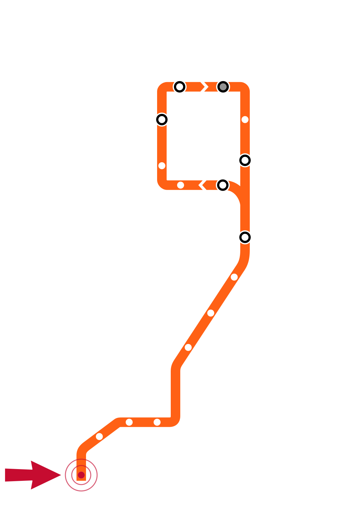

# Week 15, Day 1 {.course-title .photo-title data-state="photo-title" background-image="../assets/orange-line-stops-better/stop16-midway-d.jpg" background-size="cover"}

<h2>Project Presentations</h2>

CS 418, Week 15 🟧 Midway 🟧

Jack Bandy, 2026

---

## {.photo-only data-state="photo-only" background-image="../assets/orange-line-stops-better/stop16-midway-d.jpg" background-size="cover"}

---

## Map for Week 15, Day 1 (Midway) {.split}

::: {.split-content .narrow-aside}

::: {}
- Project presentations
:::

{.figure alt="Orange Line map with the Midway stop marked, the Week 15 stop"}

:::

# Project Presentations, Day 1 {.section-header}

## Today's Presentations {#todays-presentations-day-1}

- 🎣 "Phishing Phor Phun"
- 🎰 UFC Fight Analysis Group
- 🏥 "Socioeconomic Health Disparities"
- ⚖️ "Everybody Votes" (Comparing Democracies)
- 🚦 Chicago Traffic Analytics Group

# That's All for Today, See You Wednesday! {.section-header .no-index}

# Week 15, Day 2 {.course-title .photo-title data-state="photo-title" background-image="../assets/orange-line-stops-better/stop16-midway-d.jpg" background-size="cover"}

<h2>Project Presentations</h2>

CS 418, Week 15 🟧 Midway 🟧

Jack Bandy, 2026

---

## {.photo-only data-state="photo-only" background-image="../assets/orange-line-stops-better/stop16-midway-d.jpg" background-size="cover"}

---

## Map for Week 15, Day 2 (Midway) {.split}

::: {.split-content .narrow-aside}

::: {}
- Administrivia
- Project presentations
:::

{.figure alt="Orange Line map with the Midway stop marked, the Week 15 stop"}

:::

---

## Administrivia

- Project checkpoint: public-facing report, due Friday, December 11 (end of finals week)

# Project Presentations, Day 2 {.section-header}

## Today's Presentations {#todays-presentations-day-2}

- 💸 "Economic Trajectories" Group
- 🔭2️⃣ Flock Group Two
- 🏆 "Personal Exercise and Fitness Analytics"
- 🏎️ F1 Group
- 🪾 "Family Backgrounds and Outcomes"

# That's All for Today! {.section-header .no-index}

# References & Credits {.sources}

::: {.credits}
- GitHub source: <https://github.com/jackbandy/data-science-fun/blob/main/docs/slides/week15.qmd>.
- Peng & Matsui, *The Art of Data Science*, [Chapter 9: Interpreting Your Results](https://bookdown.org/rdpeng/artofdatascience/chapter-interpretation.html).
- *Data Science: A First Introduction*, [Chapter 11: Combining Code and Text with Jupyter](https://python.datasciencebook.ca/jupyter.html).
- Lau, Gonzalez & Nolan, *[Learning Data Science](https://learningds.org/)*, [Chapter 1: The Data Science Lifecycle](https://learningds.org/ch/01/lifecycle_intro.html).
- *Ethics in Data Science* (course mini-book), [Chapter 6: Conclusion](/ethics-in-data-science/book/06-conclusions.html).
- Orange Line photo: [Wikimedia Commons](https://commons.wikimedia.org/wiki/File:Chicago_Midway_Airport_Aerial_(50561587736).jpg), CC BY-SA 2.0, formulanone. See `docs/assets/orange-line-stops-better/SOURCES.md`.
- Slide deck built with [Quarto](https://quarto.org/) revealjs.
- Title font is Big Shoulders; Body font is [Libre Franklin](https://en.wikipedia.org/wiki/Franklin_Gothic#Libre_Franklin).
:::
