# Week 7 Slide Deck {.course-title}

## Hypothesis Testing; Estimation/Sampling/Randomness

Jack Bandy
2026

---

# Week 7, Day 1 {.course-title .photo-title data-state="photo-title" background-image="../assets/orange-line-stops-better/stop08-adams-wabash-b.jpg" background-size="cover"}

CS 418 · Week 7 · 🟠 Adams/Wabash 🟠

---

# {.photo-only data-state="photo-only" background-image="../assets/orange-line-stops-better/stop08-adams-wabash-b.jpg" background-size="cover"}

---

# Map {.split}

::: {.split-content .narrow-aside}

::: {}
- Week 7: Adams/Wabash
- Day 1 (asynchronous)
    - Hypothesis Testing
    - The Dance of the p-Values
    - The Trouble With p < .05
:::

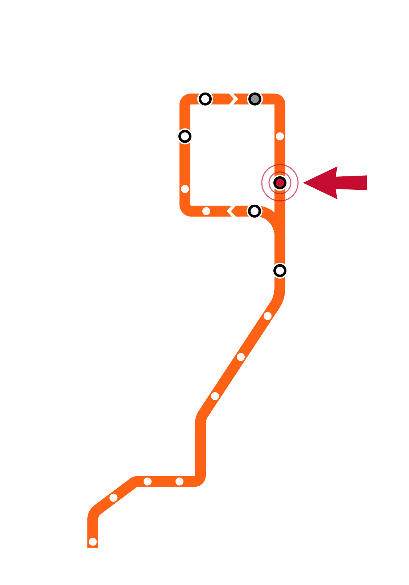{.figure alt="Orange Line map with the Adams/Wabash stop marked, the Week 7 stop"}

:::

---

# Today's Videos {.split}

::: {.split-content}

::: {.dense}
- No in-person meeting today
- Watch:
    1. StatQuest, "Hypothesis Testing and the Null Hypothesis" (14:40)
    2. Geoff Cumming, "Dance of the p Values" (11:35)
    3. Optional: *Last Week Tonight*, "Scientific Studies" (19:27)
- Then post 2-3 things you learned to the discussion
- These slides follow the same path as the videos
:::

<iframe src="https://www.youtube-nocookie.com/embed/0oc49DyA3hU?rel=0" title="StatQuest: Hypothesis Testing and The Null Hypothesis, Clearly Explained" loading="lazy" allow="accelerometer; clipboard-write; encrypted-media; gyroscope; picture-in-picture; web-share" allowfullscreen style="width: 100%; aspect-ratio: 16 / 9; border: 1px solid #999; box-shadow: 0 10px 28px rgba(0,0,0,0.12); border-radius: 3px;"></iframe>

:::


# Hypothesis Testing {.section-header}

---

# Recap: Is This Coin Fair? {.split}

::: {.split-content}

::: {}
- Week 2: 10 heads in 14 flips
- $H_0$: the coin is fair
- If $H_0$ is true, 10+ heads (or 4 or fewer) happens 18% of the time
- $p \approx 0.18 > 0.05$, so we [fail to reject]{.key} $H_0$
:::

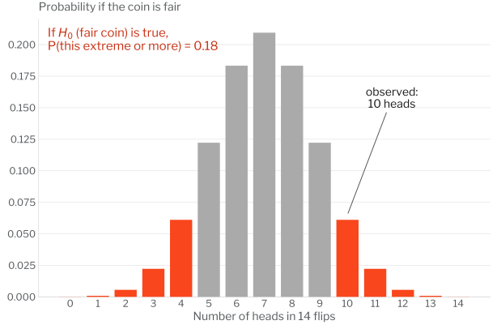{.figure alt="Bar chart of the probability of each number of heads in 14 flips of a fair coin, peaking at 7. The bars for 0 to 4 and 10 to 14 heads are orange; together they add up to 0.18."}

:::

---

# Descriptive vs. Inferential Statistics {.split}

::: {.split-content}

::: {}
- Descriptive statistics summarize the sample we have (EDA so far)
- Inferential statistics use the sample to say something about the population
- Hypothesis testing is one of the main inferential tools
- The null hypothesis $H_0$ is the default: "no difference," "no effect," "fair coin"
:::

::: {.captioned-figure}


::: {.caption}
ICMA Photos, [*Coin Toss*](https://commons.wikimedia.org/wiki/File:Coin_Toss_(3635981474).jpg), [CC BY-SA 2.0](https://creativecommons.org/licenses/by-sa/2.0/).
:::
:::

:::

---

# Seven Steps of a Hypothesis Test {.split}

::: {.split-content}

::: {.dense}
1. State $H_0$ and $H_a$
2. Choose a significance level $\alpha$ (often .05)
3. Collect the data
4. Calculate a test statistic ($z$, $t$, ...)
5. Calculate the $p$-value
6. Compare $p$ with $\alpha$
7. Reject or fail to reject $H_0$

Steps 1 and 2 come before step 3, before you look at the data
:::

::: {.captioned-figure}
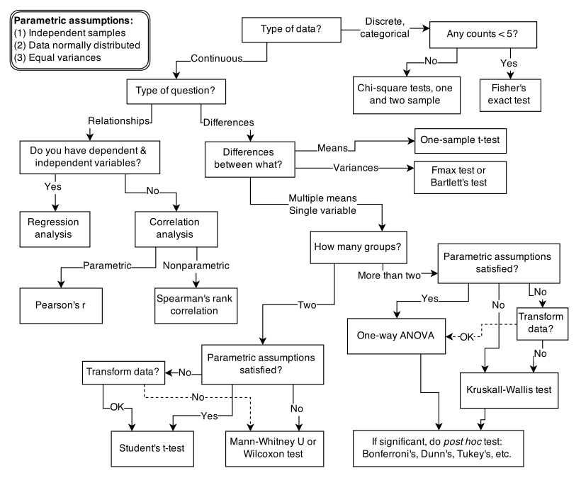

::: {.caption}
Step 4 hides many choices. Richard McElreath, *[Statistical Rethinking](https://xcelab.net/rm/statistical-rethinking/)*, 2nd ed. (2020), fig. 1.1.
:::
:::

:::

---

# Worked Example: Battery Life {.split}

::: {.split-content}

::: {.dense}
- Claim: 7.8 hours of battery life; $\sigma = 0.57$
- 10 phones average 7.7 hours. Is the battery worse than claimed?
- $H_0: \mu = 7.8$, $H_a: \mu < 7.8$ (left-tailed)
- $z = \frac{\bar{x} - \mu_0}{\sigma / \sqrt{n}} = \frac{7.7 - 7.8}{0.57 / \sqrt{10}} \approx -0.555$
- `st.norm.cdf(-0.555)` gives $p \approx 0.289$
- $0.289 > 0.05$: not enough evidence to reject the claim
- If $\sigma$ is unknown, use the sample SD $s$ and a $t$-test
:::

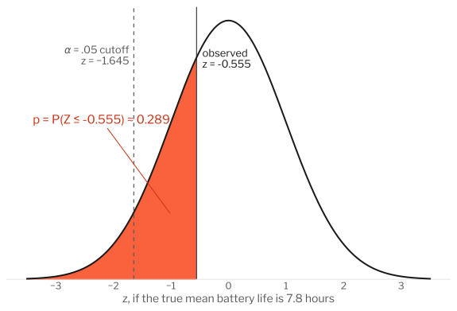{.figure alt="Standard normal curve with the left tail shaded orange up to the observed z of -0.555, an area of about 0.289. A dashed line marks the alpha = .05 cutoff at z = -1.645, much further left."}

:::

---

# Reject or Fail to Reject {.split}

::: {.split-content}

::: {}
- We never "accept" $H_0$
- Failing to reject can mean no effect, or a weak test
- A coin that lands heads 70% of the time still passes as "fair" in most runs of 14 flips
- Power ($1 - \beta$) is the chance of rejecting $H_0$ when it is false
- More data, more power
:::

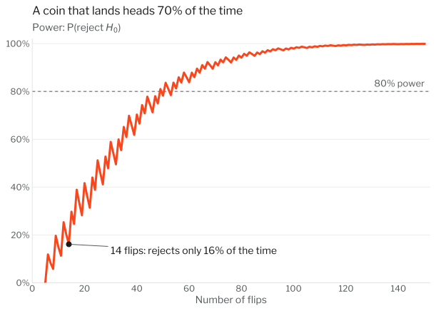{.figure alt="Line chart of power against number of flips for a coin that lands heads 70 percent of the time. At 14 flips the test rejects 'fair' only 16 percent of the time; power climbs past 80 percent at around 50 flips and nears 100 percent by 100 flips."}

:::

---

# Type I and Type II Errors {.split}

::: {.split-content}

::: {}
- Type I: a false positive (there is no wolf)
- Type II: a false negative (the wolf is real)
- Which error costs more depends on the setting: climbing gear, medical tests, college admissions... others?
:::

::: {.captioned-figure}
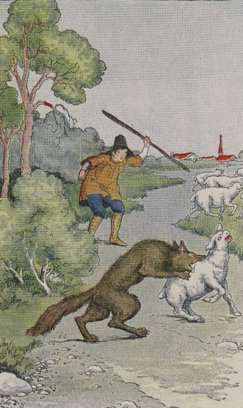

::: {.caption}
Milo Winter, "The Shepherd Boy and the Wolf," *[The Æsop for Children](https://www.gutenberg.org/ebooks/19994)*. Public domain, via [Wikimedia Commons](https://commons.wikimedia.org/wiki/File:The_Boy_Who_Cried_Wolf_-_Project_Gutenberg_etext_19994.jpg).
:::
:::

:::

---

# Real Example: A Resume Audit {.split}

::: {.split-content}

::: {.dense}
- 4,870 fictitious resumes sent to real job ads in Boston and Chicago, names randomly assigned [@bertrand2004]
- Callbacks: 9.7% for white-sounding names, 6.4% for Black-sounding names
- $H_0$: the name makes no difference
- Under $H_0$, the labels are interchangeable, so shuffle them and recompute the gap
- None of 10,000 shuffles comes close to the observed 3.2-point gap
:::

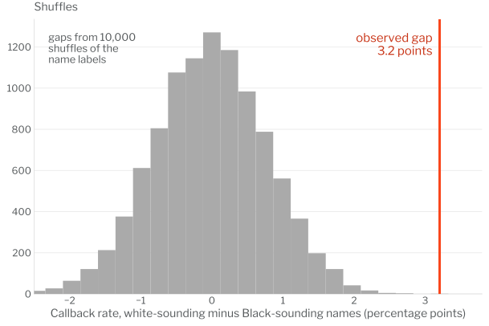{.figure alt="Histogram of callback-rate gaps from 10,000 random shuffles of the name labels, centered on zero and spanning about -2 to +2 percentage points. A vertical orange line marks the observed gap of 3.2 points, beyond every shuffled gap."}

:::

---

# Statistical vs. Practical Significance {.split}

::: {.split-content}

::: {}
- "Significant" means "unlikely under $H_0$," not "large" or "important"
- With enough data, a tiny effect gets a tiny $p$
- With little data, a large effect can miss .05
- Report the effect size and its uncertainty, not only $p$
:::

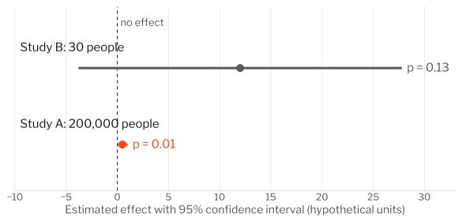{.figure alt="Two hypothetical estimates with 95 percent confidence intervals. Study A, with 200,000 people, has a tiny effect near 0.5 with a very narrow interval that excludes zero, p = 0.01. Study B, with 30 people, has an effect of 12 with a wide interval from about -4 to 28 that crosses zero, p = 0.13."}

:::


# The Dance of the p-Values {.section-header}

---

# Same Experiment, 25 Times {.split}

::: {.split-content}

::: {.dense}
- Simulate one experiment 25 times
    - two groups of 32
    - true difference of 10
- The effect is real in every run!
- 12 runs give $p < .05$, 13 do not
- $p$ ranges from below .001 to .6
- The intervals jump around too, but each one shows how much a single study can tell you
:::

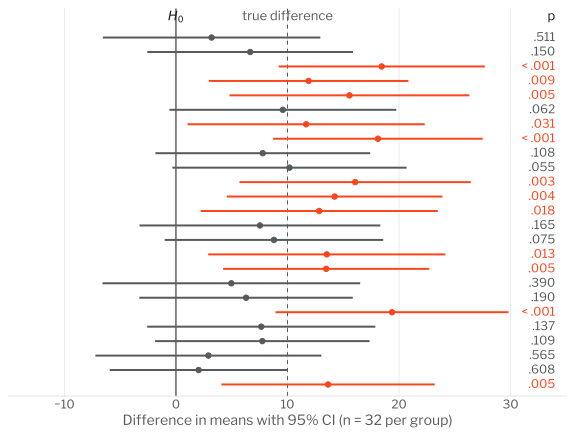{.figure alt="Twenty-five horizontal confidence intervals for the difference in means, one per simulated replication, with each p-value listed at the right. Twelve intervals are orange (p below .05) and thirteen are gray; the p-values range from under .001 to .608 even though the true difference, marked by a dashed line at 10, is the same every time."}

:::

---

# Where p-Values Land {.split}

::: {.split-content}

::: {}
- $p$ is a random variable: it changes from sample to sample
- No effect: $p$ is equally likely to land anywhere
    - 5% of runs land below .05 by chance !
- One $p$-value says little about what the next study will find
:::

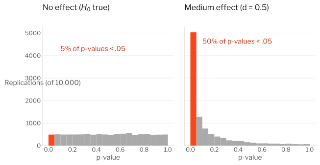{.figure alt="Two histograms of p-values from 10,000 simulated replications. With no effect the histogram is flat, and 5 percent fall below .05. With a medium effect most p-values pile up near zero, but only 50 percent fall below .05 and the rest trail out toward 1."}

:::

---

# p = .03 and p = .30 ... Did One Study Fail? {.split}

::: {.split-content}

::: {}
- Not necessarily: look at the estimates
- intervals overlap substantially
- The gap between "significant" and "not significant" is not itself significant [@gelman2006]
:::

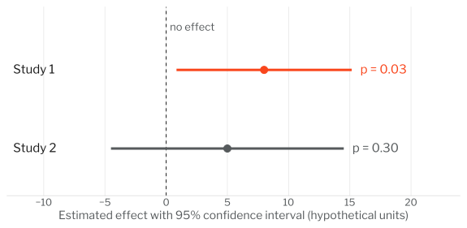{.figure alt="Two hypothetical studies with 95 percent confidence intervals. Study 1 estimates 8 with an interval from about 1 to 15, p = 0.03. Study 2 estimates 5 with an interval from about -4 to 14, p = 0.30. The intervals overlap almost completely."}

:::


# The Trouble With p < .05 {.section-header}

---

# Many Tests, One Fluke {.split}

::: {.split-content}

::: {}
- Each test of a true $H_0$ has a 5% chance of $p < .05$
- Test 20 things with no real effects: a 64% chance that at least one "works"
- Report only that one, and it looks like a discovery
- Testing many hypotheses until one is significant is called [$p$-hacking]{.key}
:::

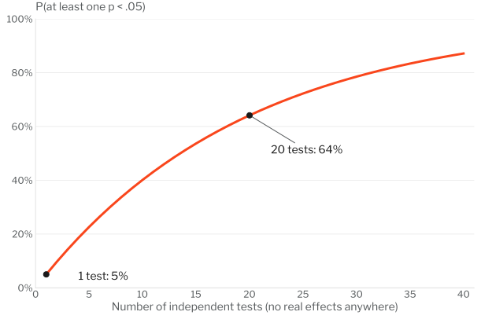{.figure alt="Line chart of the chance of at least one p-value below .05 against the number of independent tests when no effects are real. It starts at 5 percent for one test, reaches 64 percent at 20 tests, and keeps rising toward 1."}

:::

---

# p-Hacking: A Peculiar Prevalence {.split}

::: {.split-content}

::: {.dense}
- In three psychology journals, $p$-values were "much more common immediately below .05" than expected [@masicampo2012]
- Gelman and Loken call this "the garden of forking paths" [@gelman2014]
- One fix: pre-register hypotheses and analysis before seeing the data
:::

::: {.captioned-figure}


::: {.caption}
Andrew Gelman. Photo by Schutz (2012), [CC BY-SA 4.0](https://creativecommons.org/licenses/by-sa/4.0/), via [Wikimedia Commons](https://commons.wikimedia.org/wiki/File:Andrew_Gelman_2012.jpg).
:::
:::

:::

---

# Many Analysts, One Data Set {.split}

::: {.split-content}

::: {.dense}
- 29 teams (61 analysts), same data, same question: are dark-skin-toned soccer players more likely to get red cards? [@silberzahn2018]
- Estimates ranged from 0.89 to 2.93 in odds-ratio units
- 20 teams found a significant positive effect; 9 did not
- 29 analyses used 21 different combinations of covariates
- Remember the elephant(s)?
:::

::: {.captioned-figure}
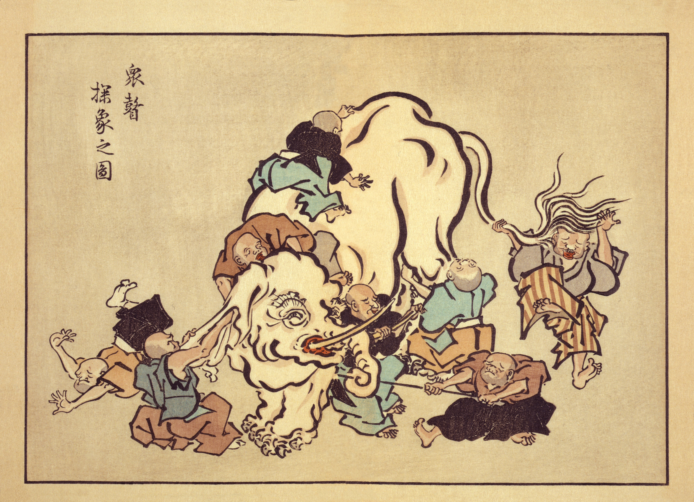

::: {.caption}
Hanabusa Itchō, *Blind Monks Examining an Elephant* (1888 woodblock print reproduction), public domain. [Wikimedia Commons](https://commons.wikimedia.org/wiki/File:Blind_monks_examining_an_elephant.jpg).
:::
:::

:::

---

# Is p < .05 Still Useful? {.split}

::: {.split-content}

::: {.dense}
- A threshold turns a smooth measure into a coin flip
    - $p = .049$ and $p = .051$ get opposite verdicts
- The American Statistical Association [@wasserstein2016]:
    - "Scientific conclusions and business or policy decisions should not be based only on whether a p-value passes a specific threshold."
    - "A p-value, or statistical significance, does not measure the size of an effect or the importance of a result."
:::

::: {.captioned-figure}


::: {.caption}
*The Dark Knight* (dir. Christopher Nolan, Warner Bros., 2008).
:::
:::

:::

---

# A News Story Says p = .04 {.split}

::: {.split-content}

::: {.dense}
Questions to ask:

- How large is the effect size, and how wide is its interval?
- How many people (or mice) were in the sample?
- How many outcomes or subgroups were tested?
- Were the hypotheses registered in advance?
- Has anyone replicated it?
:::

::: {.captioned-figure}
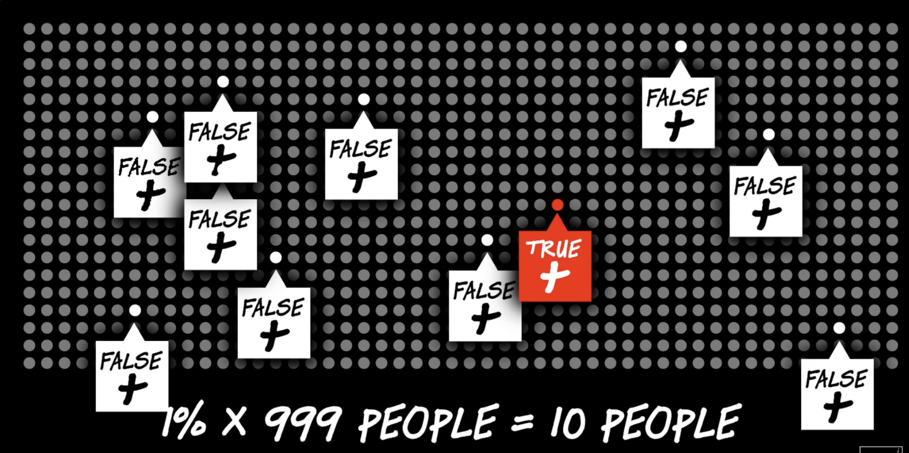

::: {.caption}
Adapted from Veritasium, ["The Bayesian Trap"](https://www.youtube.com/watch?v=R13BD8qKeTg) (2017).
:::
:::

:::

---

# Discussion

Post 2-3 things you learned from the videos, or respond to one of these:

::: {.dense}
- Why does StatQuest say "reject" or "fail to reject" instead of "accept" or "prove"? What would be wrong with saying a study "proved the null hypothesis"?
- If one replication gives $p < .05$ and another gives $p = .3$, did one "find" the effect and the other "fail"? How would you explain this to a friend or family member who is not in CS 418?
- StatQuest presents a clear decision rule, while Cumming shows how much $p$ depends on chance. How do you reconcile the two views? Is $p < .05$ still useful?
- A news story covers a single study with $p = .04$. What questions would you want answered?
:::


# Week 7, Day 2 {.course-title .photo-title data-state="photo-title photo-title-zoom" background-image="../assets/orange-line-stops-better/stop08-adams-wabash-b.jpg" background-size="cover"}

<h2>Estimation, Sampling, and Randomness</h2>

Jack Bandy
2026

---

# Map {.split}

::: {.split-content .narrow-aside}

::: {}
- Week 7: Adams/Wabash
- Day 2
    - Estimation
    - Sampling
    - Randomness
:::

{.figure alt="Orange Line map with the Adams/Wabash stop marked, the Week 7 stop"}

:::


# Estimation {.section-header}

---

# Parameters and Statistics {.split}

::: {.split-content}

::: {.dense}
- A parameter describes the population: $\mu$, $\sigma$, a share $p$. Usually unknown
- A statistic is computed from a sample: $\bar{x}$, $s$, $\hat{p}$
- An estimator is a rule for turning a sample into a guess at a parameter
- Example: treat all 24,775 single-family sales in Cook County (2025) as the population
- One random sample of 50 gives $\bar{x} = \$434\text{k}$; the true $\mu = \$465\text{k}$
:::

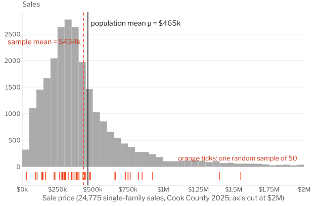{.figure alt="Right-skewed histogram of single-family sale prices in Cook County in 2025, peaking around $300k with a long tail past $1.5M. A black line marks the population mean of $465k; orange tick marks below the axis show one random sample of 50 sales, whose mean of $434k is marked with a dashed orange line."}

:::

---

# Vox Populi: Guessing an Ox {.split}

::: {.split-content}

::: {}
- 1906 livestock fair in Plymouth, England: 787 people guessed an ox's dressed weight [@galton1907]
- Actual weight: 1,198 lb
- Median guess: 1,207 lb (!)
- Galton reported the median as the "vox populi"
:::

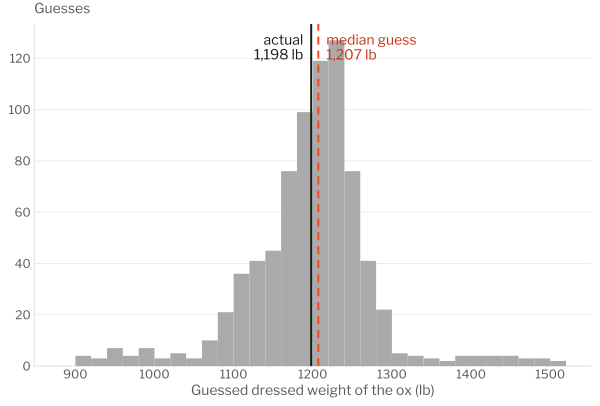{.figure alt="Histogram of 787 guesses of the ox's weight, from about 900 to 1,500 pounds, peaked near 1,200. A black line marks the actual weight, 1,198 pounds, and a dashed orange line just to its right marks the median guess, 1,207 pounds."}

:::

---

# Which Estimator Is Best? {.split}

::: {.split-content}

::: {.dense}
- Estimate a typical tip percentage $\theta^*$ from receipts
- Candidates: one random receipt, the mode, the mean, the median
- Squared error favors the mean; absolute error favors the median
- More on loss functions in Week 8
:::

::: {.captioned-figure}
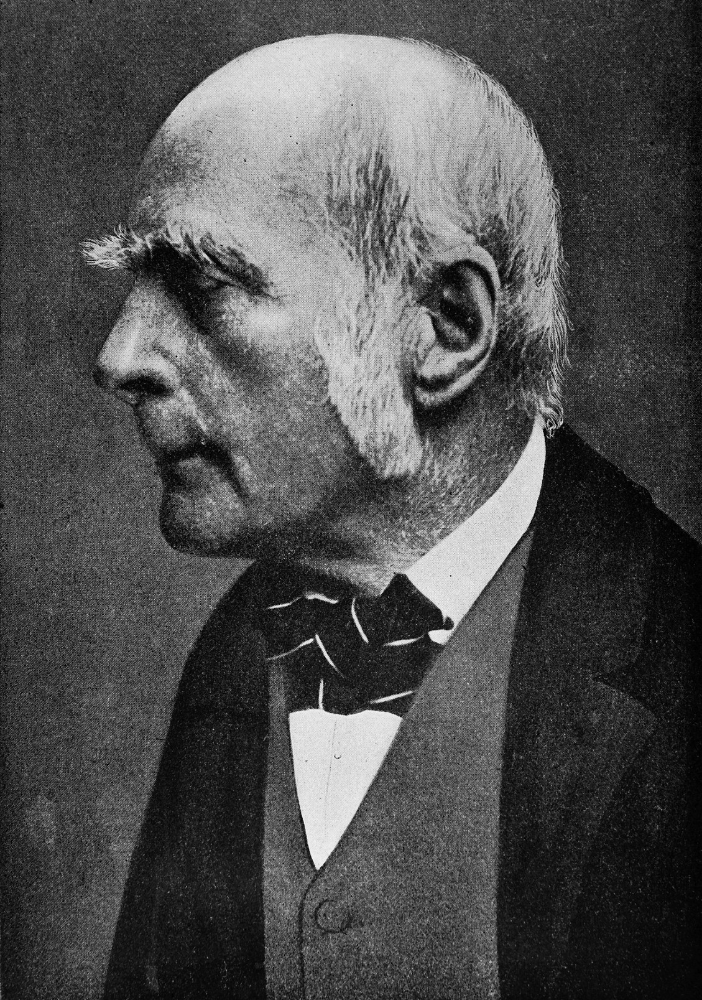

::: {.caption}
Francis Galton. Wellcome Collection, [CC BY 4.0](https://creativecommons.org/licenses/by/4.0/), via [Wikimedia Commons](https://commons.wikimedia.org/wiki/File:Portrait_of_Francis_Galton._Wellcome_M0002305.jpg).
:::
:::

:::

---

# Bias and Variance of an Estimator {.split}

::: {.split-content}

::: {}
- Imagine repeating the whole study many times
    - each dot is one estimate
- Bias: how far the average estimate is from the target
- Variance: how much the estimates scatter
:::

::: {.captioned-figure}


::: {.caption}
Redrawn after Scott Fortmann-Roe, ["Understanding the Bias-Variance Tradeoff"](http://scott.fortmann-roe.com/docs/BiasVariance.html) (2012).
:::
:::

:::


# Sampling {.section-header}

---

# Recap: Where Data Come From {.split}

::: {.split-content}

::: {.dense}
- Probability samples: every unit has a known chance of selection
- Non-probability samples:
    - convenience: whoever is easy to reach
    - voluntary: whoever opts in
    - snowball: participants recruit more participants
- Non-probability samples can be useful, but sampling theory says little about them
:::

<svg viewBox="0 0 640 250" width="100%" height="auto" style="display:block; margin:0.2em auto 0;" role="img" aria-label="Three nested ellipses: the target population contains the access frame, which contains the sample. The ring between the target population and the access frame is the coverage gap, who cannot be reached; the ring between the access frame and the sample is the sampling gap, who could be reached but was not measured.">
  <ellipse cx="210" cy="122" rx="200" ry="115" fill="#f4f4f4" stroke="#9a9a9a" stroke-width="1.6"/>
  <ellipse cx="210" cy="142" rx="136" ry="86" fill="#fde3da" stroke="#f9461c" stroke-width="1.6"/>
  <ellipse cx="210" cy="160" rx="72" ry="50" fill="#f9461c" stroke="#c83214" stroke-width="1.6"/>
  <g font-family="inherit" text-anchor="middle" font-weight="600" font-size="19">
    <text x="210" y="40" fill="#1a1a1a">Target population</text>
    <text x="210" y="92" fill="#c83214">Access frame</text>
    <text x="210" y="166" fill="#ffffff" font-weight="700">Sample</text>
  </g>
  <g stroke="#565a5c" stroke-width="1.4" fill="none">
    <path d="M324 87 V103 M404 87 V103 M324 95 H404"/>
    <path d="M404 95 L436 78"/>
    <path d="M282 152 V168 M343 152 V168 M282 160 H343"/>
    <path d="M343 160 L436 194"/>
  </g>
  <g font-family="inherit" font-size="15">
    <text x="444" y="72" font-weight="700" fill="#c83214">coverage gap</text>
    <text x="444" y="90" fill="#565a5c">can't be reached</text>
    <text x="444" y="188" font-weight="700" fill="#c83214">sampling gap</text>
    <text x="444" y="206" fill="#565a5c">reachable, not measured</text>
  </g>
</svg>

:::

---

# Four Probability Sampling Designs {.split}

::: {.split-content}

::: {.dense}
- Simple random: every subset of size $n$ is equally likely
- Stratified: split into groups (strata), sample within each; guarantees every group appears
- Cluster: sample whole groups (blocks, schools, train cars); cheaper, but members of a cluster tend to be alike
- Systematic: every $k$th unit from a random start; watch for periodic patterns in the list
:::

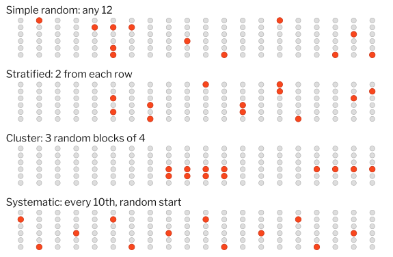{.figure alt="Four grids of 120 gray dots, each with 12 dots highlighted in orange. Simple random: 12 scattered dots. Stratified: two dots in each of the six rows. Cluster: three runs of four adjacent dots. Systematic: every tenth dot counting down the columns, forming an evenly spaced diagonal pattern."}

:::

---

# Sampling Distributions and the CLT {.split}

::: {.split-content}

::: {.dense}
- Draw a sample, compute $\bar{x}$, repeat 5,000 times
- The spread of those $\bar{x}$'s is the sampling distribution
- Central Limit Theorem: for large enough $n$, the sampling distribution of the mean is approximately normal, whatever the population's shape
- It centers on $\mu$ and narrows as $n$ grows
:::

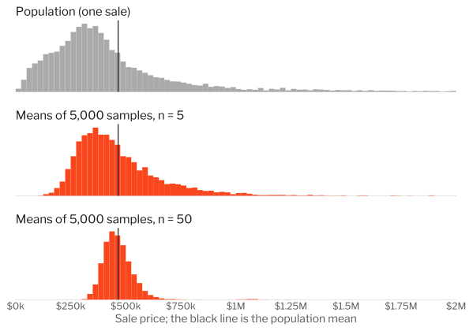{.figure alt="Three stacked histograms on one price axis. Top: the right-skewed population of single-family sale prices. Middle: means of 5,000 samples of size 5, still somewhat skewed and wide. Bottom: means of 5,000 samples of size 50, narrow, roughly bell-shaped, and centered on the population mean."}

:::

---

# Standard Error {.split}

::: {.split-content}

::: {}
- Standard error: the standard deviation of the sampling distribution
- For the mean: $SE = \sigma / \sqrt{n}$
- Quadruple the sample, halve the error
- In practice, estimate it with the sample SD: $s / \sqrt{n}$
:::

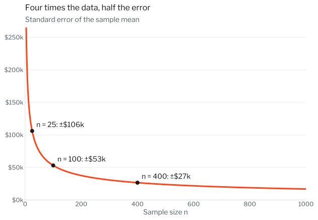{.figure alt="Curve of the standard error of the mean home price against sample size, falling steeply and then flattening. Marked points: about $106k at n = 25, $53k at n = 100, and $27k at n = 400."}

:::

---

# Confidence Intervals {.split}

::: {.split-content}

::: {.dense}
- 95% CI: roughly estimate $\pm$ 2 standard errors
- "95%" describes the procedure: in the long run, 95% of intervals built this way cover $\mu$
- Any one interval either covers $\mu$ or it does not
- Here 44 of 50 cover it; skewed prices and $n = 50$ run a little under 95%
- These are the intervals from Cumming's dance
:::

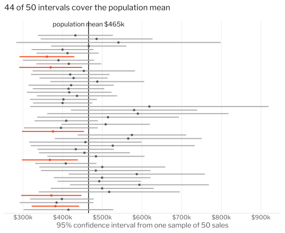{.figure alt="Fifty horizontal 95 percent confidence intervals for mean sale price, each from one random sample of 50 sales, stacked vertically around a black line at the population mean of $465k. Forty-four intervals in gray cross the line; six in orange miss it, all falling to the left."}

:::

---

# More Data, Same Bias {.split}

::: {.split-content}

::: {.dense}
- More data shrinks variance, not bias
- May 2021: the Delphi-Facebook survey (about 250,000 responses per week) overestimated US vaccine uptake by 17 points; an Axios-Ipsos panel (about 1,000 per week) was reliable [@bradley2021]
- "Our central message is that data quality matters more than data quantity"
- Simulated, right: a self-selected sample converges on the wrong answer
:::

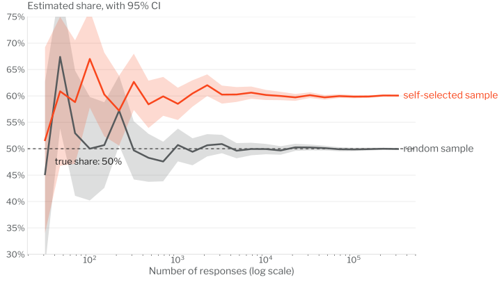{.figure alt="Hypothetical poll estimates against number of responses on a log scale, with shaded 95 percent intervals. The random sample's estimate wobbles and then settles on the true 50 percent. The self-selected sample settles on 60 percent, and its interval shrinks to a thin band that excludes the truth."}

:::


# Randomness {.section-header}

---

# Which Sequence Is Random? {.split}

::: {.split-content}

::: {}
- Each square is a coin flip (orange = heads)
- One is 100 fair flips; one is made up, the way people write "random" flips
- Which is which?

::: {.fragment fragment-index=1}
- B is fair: real randomness has more streaks than people expect
:::
:::

::: {.captioned-figure}
::::: {.r-stack}
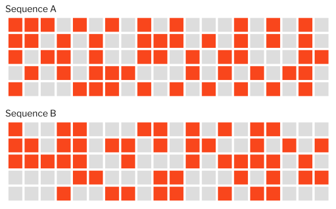

::: {.fragment fragment-index=1}
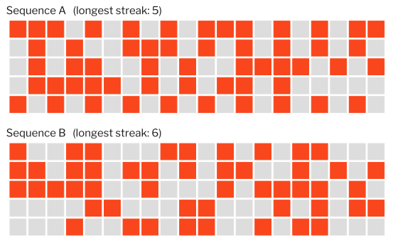
:::
:::::
:::

:::

---

# Pseudorandom Numbers and Seeds {.split}

::: {.split-content}

::: {.dense}
- Computers generate pseudorandom numbers: a deterministic sequence that looks random
- A seed picks the starting point, so a seeded analysis can be rerun exactly

```python
rng = np.random.default_rng(418)
rng.integers(1, 7, size=10)
# array([4, 2, 3, 6, 4, 2, 1, 2, 5, 6])
```

- Same seed, same rolls
    - no seed, new rolls every run
- Every simulation on these slides uses seed 418 :-)
:::

::: {.captioned-figure}
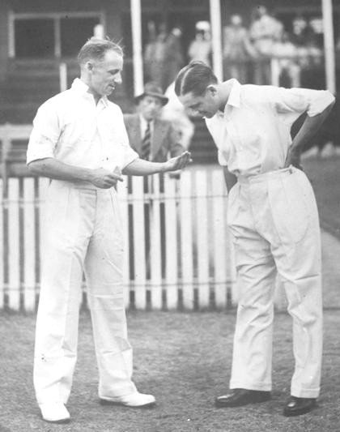

::: {.caption}
Don Bradman and Gubby Allen toss for innings, Brisbane, 1936. Public domain, via [Wikimedia Commons](https://commons.wikimedia.org/wiki/File:BradmanAllenToss.jpg).
:::
:::

:::

---

# Randomness as a Tool {.split}

::: {.split-content}

::: {.dense}
- Random sampling: decides who gets measured, so the sample resembles the population
- Random assignment: decides who gets which treatment, so groups differ only by chance (the resume audit)
- Random worlds: MusicLab ran 8 parallel "worlds" of the same songs; hits differed from world to world [@salganik2006]
- Random noise: the Census Bureau added noise to 2020 Census data using differential privacy
:::

::: {.captioned-figure}
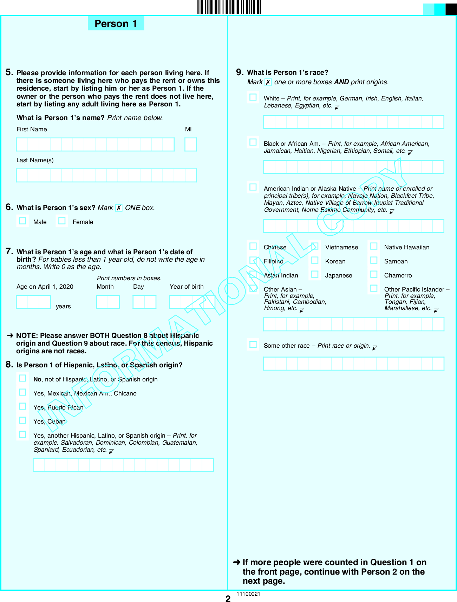

::: {.caption}
U.S. Census Bureau, 2020 Census informational questionnaire. Public domain.
:::
:::

:::

---

# Fermi Estimate: Adams/Wabash {.split}

::: {.split-content .golden-columns}

::: {}
How many people enter the Adams/Wabash station on a typical weekday?

- No looking it up
- Break it into pieces you can guess: commuters, students, shoppers, theater-goers, ...
- Write down your estimate and a range
:::

<iframe src="https://dodatascience.fun/timer/" title="CTA-style countdown timer" loading="lazy" style="width: 100%; height: 420px; display: block; border: 1px solid #999; box-shadow: 0 10px 28px rgba(0,0,0,0.12); border-radius: 3px;"></iframe>

:::

---

# Fermi Estimate: The Answer {.split}

::: {.split-content}

::: {}
- 2025 median: about 4,600 entries per weekday
- Most weekdays fell between 3,500 and 6,000
- Did your range cover it?
- Entries only count people entering; transfers and exits are not counted
:::

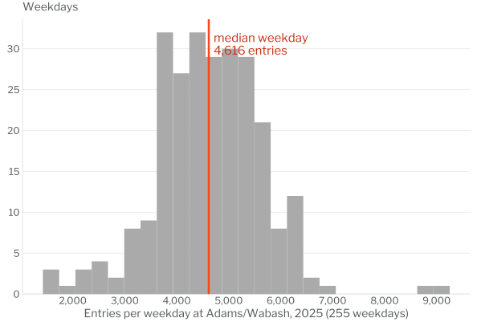{.figure alt="Histogram of entries per weekday at Adams/Wabash in 2025 across 255 weekdays, mostly between 3,500 and 6,000, with a few low days near 1,500 and one outlier above 9,000. An orange line marks the median of 4,616 entries."}

:::

---

# Quiz Time!

- PrairieLearn
- Week 7 Quiz
- It should give you your score instantly
- You can leave when finished!


# Sources {.sources}

::: {#refs}
:::

::: {.credits}
- GitHub source: <https://github.com/jackbandy/data-science-fun/blob/main/docs/slides/week7.qmd>.
- Videos: StatQuest with Josh Starmer, ["Hypothesis Testing and The Null Hypothesis, Clearly Explained"](https://www.youtube.com/watch?v=0oc49DyA3hU); Geoff Cumming, ["Dance of the p Values"](https://www.youtube.com/watch?v=5OL1RqHrZQ8); *Last Week Tonight with John Oliver*, ["Scientific Studies"](https://www.youtube.com/watch?v=0Rnq1NpHdmw).
- Statistical figures drawn by the scripts in the [p-value-visuals](https://github.com/jackbandy/data-science-fun/tree/main/docs/assets/p-value-visuals), [coin-flip-worldviews](https://github.com/jackbandy/data-science-fun/tree/main/docs/assets/coin-flip-worldviews), [sampling-visuals](https://github.com/jackbandy/data-science-fun/tree/main/docs/assets/sampling-visuals), and [estimation-visuals](https://github.com/jackbandy/data-science-fun/tree/main/docs/assets/estimation-visuals) asset folders, each with a SOURCES file for its data and simulation details. Home prices from the [Cook County home sales 2025](https://github.com/jackbandy/data-science-fun/tree/main/datasets/cook-county-home-sales-2025) dataset in this repo; ridership from [CTA Ridership, 'L' Station Entries, Daily Totals](https://data.cityofchicago.org/Transportation/CTA-Ridership-L-Station-Entries-Daily-Totals/5neh-572f), City of Chicago Data Portal.
- Battery-life example and tip-percentage estimators adapted from Elena Zheleva's CS 418 slides on hypothesis testing and estimation (2026), which use materials from the Berkeley DS 100 team and Gonzalo Bello.
- 2020 Census differential privacy: U.S. Census Bureau, ["Understanding Differential Privacy"](https://www.census.gov/programs-surveys/decennial-census/decade/2020/planning-management/process/disclosure-avoidance/differential-privacy.html).
- Slides developed using materials from [Elena Zheleva](https://www.cs.uic.edu/~elena/) and [Gonzalo Bello Lander](https://cs.uic.edu/profiles/gonzalo-bello/), the Berkeley DS 100 team, Marine Carpuat, and Brian Ziebart.
- Slide deck built with [Quarto](https://quarto.org/) revealjs.
- Title font is Big Shoulders; Body font is [Libre Franklin](https://en.wikipedia.org/wiki/Franklin_Gothic#Libre_Franklin).
:::
