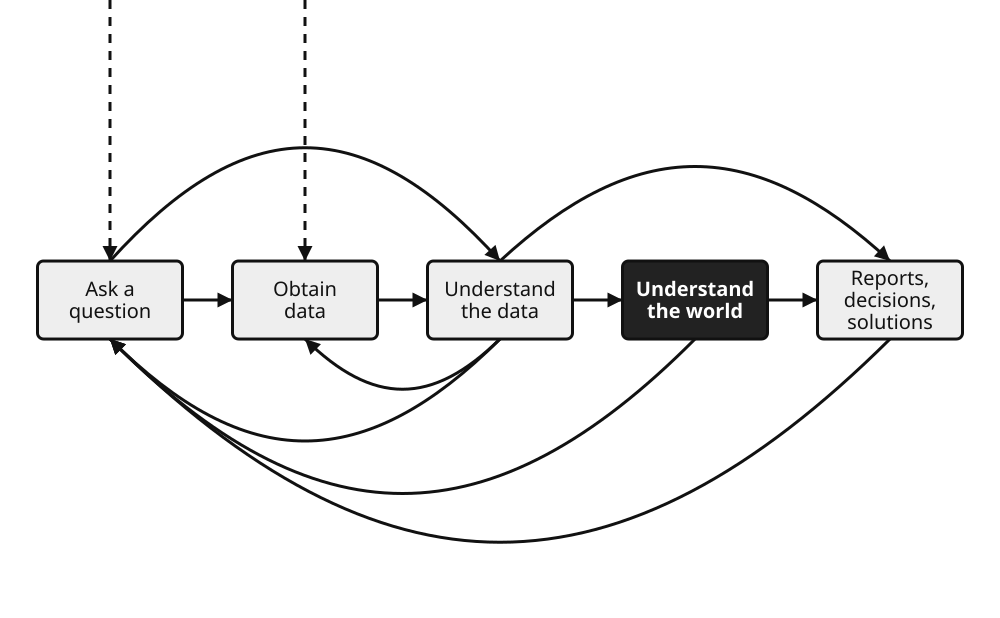
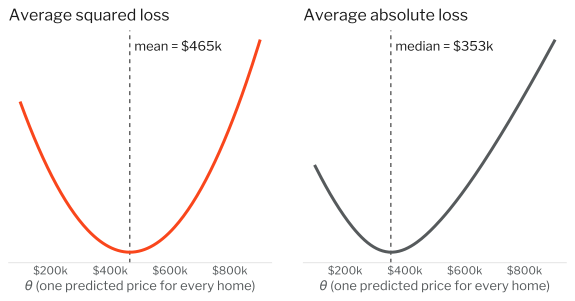

```{python}
#| include: false
import matplotlib
matplotlib.use("Agg")
```

```{python}
#| echo: false
# Shared setup for every figure in this deck.
import numpy as np
import polars as pl
from plotnine import *

ORANGE = "#f9461c"
```

# Week 8 Slide Deck {.course-title}

## Linear Regression; Intro to Classification

Jack Bandy
2026

---

# Week 8, Day 1 {.course-title .photo-title data-state="photo-title" background-image="../assets/orange-line-stops-better/stop09-roosevelt-c.jpg" background-size="cover"}

CS 418 · Week 8 · 🟠 Roosevelt 🟠

---

# {.photo-only data-state="photo-only" background-image="../assets/orange-line-stops-better/stop09-roosevelt-c.jpg" background-size="cover"}

---

# Map {.split}

::: {.split-content .narrow-aside}

::: {}
- Week 8: Roosevelt
- Day 1
    - Intro to Modeling
    - Linear Models
:::

{.figure alt="Orange Line map with the Roosevelt stop marked, the Week 8 stop"}

:::

---

# Intro to Modeling {.section-header}

---

# The Data Science Lifecycle {.image-frame-slide}

::: {.caption}
Source: Sam Lau, Joey Gonzalez, and Deb Nolan, ["Linear Models"](https://learningds.org/ch/15/linear_intro.html), ch. 15 of *[Learning Data Science](https://learningds.org/)*.
:::



"Linear models are a popular tool in the last stage of the lifecycle: understanding the world."

::: {.notes}
Review: weeks 1–3 asked questions and obtained data; weeks 4–6 were about understanding the data (EDA, visualization); week 7 started inference. Models are how we move from describing *this* data to saying something about the world it came from.
:::

---

# What is a model?

::: {.caption}
Sources: Data 100 course notes, UC Berkeley, ["Modeling & SLR"](https://ds100.org/course-notes/modeling-slr); Lau, Gonzalez, and Nolan, [*Learning Data Science*](https://learningds.org/ch/04/modeling_intro.html), ch. 4.
:::

::: {.incremental}
- "A model is an idealized representation of a system. A system is a set of principles or procedures according to which something functions." (Data 100)
- "We use models to approximate the signal, with the simplest of these being the constant model, where the signal is approximated by a single number, like the mean or median." (Lau, Gonzalez, and Nolan)
- We **build** (or **fit**, or **train**) a model by estimating parameters from data
    - then use it to predict or to explain a phenomenon
:::

---

# George Box {.quote-slide}

> Essentially, all models are wrong, but some are useful.

::: {.attribution}
George E. P. Box, statistician (1919–2013)
:::

::: {.quote-source}
George E. P. Box and Norman R. Draper, *Empirical Model-Building and Response Surfaces* (Wiley, 1987), p. 424.
:::

---

# Physical vs. Statistical Models: Car MPG {.smaller}

::: {.caption}
Sources: Data 100 course notes, UC Berkeley, ["Modeling & SLR"](https://ds100.org/course-notes/modeling-slr) ("Common Types of Models"); David J. C. MacKay, ["Cars II"](https://www.withouthotair.com/cA/page_254.shtml), technical ch. A of *Sustainable Energy — Without the Hot Air* (UIT Cambridge, 2009); R. Quinlan, [Auto MPG](https://doi.org/10.24432/C5859H) [Dataset], UCI Machine Learning Repository (1993).
:::

How many miles per gallon will a car get?

:::: {.columns}

::: {.column width="50%"}
**Physical (mechanistic) model**

- Based on how the system works
- braking, air resistance, rolling resistance, heat
- can use equations based on real physics / measurements
    - e.g. mass, frontal area, drag coefficient
:::

::: {.column width="50%"}
**Statistical model**

- Start from data about many cars.
- Auto MPG data: 398 cars
- no physics
- Choose a form, e.g. $\text{mpg} \approx \theta_0 + \theta_1 \cdot \text{weight}$, and let the data estimate $\theta_0, \theta_1$.
:::

::::


---

# Mechanistic or Statistical?

::: {.caption}
Sources: R. Quinlan, [Auto MPG](https://doi.org/10.24432/C5859H) [Dataset], UCI Machine Learning Repository (1993), whose variables include `model_year` and `weight`; NASA Space Place, ["What Causes the Seasons?"](https://spaceplace.nasa.gov/seasons/en/).
:::

Which kind of model is each one? Why? Discuss with a neighbor.

- **A.** Car mpg based on the year the car was manufactured
- **B.** Car mpg based on the car's weight
- **C.** Temperature based on the day of the year
- **D.** Temperature based on distance from the Sun and the tilt of Earth's axis

::: {.notes}
A: statistical. The model year does not burn fuel; it stands in for changes in engines and regulation, so the relationship comes from data. B: either. Fitting mpg to weight across cars is statistical, but physics also says mass matters (MacKay: energy goes into braking, and kinetic energy is ½mv²), so a mechanistic model would include it too. C: statistical. The day of the year is a stand-in for the season; you would fit a seasonal curve to past temperatures. D: mechanistic, built from the physics of sunlight. Good follow-up: which input actually matters? NASA: "Earth's tilted axis causes the seasons," and in the Northern Hemisphere "we are having winter when Earth is closest to the Sun." The change in distance "does not make much difference to our weather." A mechanistic model makes you say which inputs matter and why.
:::

---

# Setup: Cook County Home Sales, 2025

Back to our running example: what does a home cost in Cook County?

```{python}
#| echo: true
sales = pl.read_csv("../../datasets/cook-county-home-sales-2025/cook-county-home-sales-2025.csv",
                    ignore_errors=True)
homes = sales.filter(
    (pl.col("property_group") == "Single-Family")   # condos have no sqft
    & (pl.col("is_multisale") == False)             # one price per home
    & (pl.col("sale_price") > 10_000)               # drop nominal transfers
    & pl.col("building_sqft").is_not_null()
)
homes.height
```

---

# The Parameter to Estimate: $\theta$

::: {.caption}
Source: Lau, Gonzalez, and Nolan, *Learning Data Science*, ["The Constant Model"](https://learningds.org/ch/04/modeling_simple.html) (§4.1) and ["Minimizing Loss"](https://learningds.org/ch/04/modeling_loss_functions.html) (§4.2).
:::

A simple model: every sale price is one number.

$$\text{sale price} \approx \theta$$

::: {.incremental}
- "In modeling, $\theta$ is often referred to as a **parameter**." (Lau, Gonzalez, and Nolan)
- $\hat{\theta}$ ("theta hat") is our **estimate**, computed from data: "of all the possible $\theta$ values, $\hat{\theta}$ is the one that produces the smallest average loss for our data." (Lau, Gonzalez, and Nolan)
:::

---

# Which $\hat{\theta}$ would you pick?

::: {.caption}
Adapted from Lau, Gonzalez, and Nolan, ["The Constant Model"](https://learningds.org/ch/04/modeling_simple.html), *Learning Data Science*, §4.1, which compares the mode, median, and mean of bus lateness.
:::

Choose $\hat{\theta}$ as:

- **A.** the price of one randomly selected sale
- **B.** the mode of the prices
- **C.** the mean of the prices
- **D.** the median of the prices

. . .

```{python}
#| echo: true
prices = homes["sale_price"]
print(f"mean = ${prices.mean():,.0f}   median = ${prices.median():,.0f}")
```

Which is "best"?

---

# Loss Functions

::: {.caption}
Source: Lau, Gonzalez, and Nolan, ["Minimizing Loss"](https://learningds.org/ch/04/modeling_loss_functions.html), *Learning Data Science*, §4.2.
:::

"A loss function is a mathematical function that takes in $\theta$ and a data value $y$. It outputs a single number, the loss, that measures how far away $\theta$ is from $y$."

::: {.incremental}
- Loss for one point: $\ell(\theta, y)$
    - Lower is better.
- Average loss over all $n$ points:

$$L(\theta, \mathbf{y}) = \frac{1}{n} \sum_{i=1}^{n} \ell(\theta, y_i)$$

- **Fitting** the model means finding the $\hat{\theta}$ with the smallest average loss.
:::

---

# Squared Loss vs. Absolute Loss (vs. ...) {.text-figure-slide}

::: {.caption}
Sources: Lau, Gonzalez, and Nolan, *Learning Data Science*, [§4.2](https://learningds.org/ch/04/modeling_loss_functions.html), [§19.4](https://learningds.org/ch/19/class_loss.html), and [§20.2](https://learningds.org/ch/20/gd_example.html); Data 100 course notes, UC Berkeley, ["Constant Model, Loss, and Transformations"](https://ds100.org/course-notes/loss-transformations).
:::

::: {.columns}
::: {.column width="45%"}
::: {.dense}
- **Squared (L2)**: $(y - \theta)^2$, averaged = MSE
- **Absolute (L1)**: $|y - \theta|$, averaged = MAE
- Squared loss punishes big misses more.
- Others: Huber (a blend); log loss for classification (Day 2).
- Do outliers matter? Are all errors equally costly?
:::
:::
::: {.column width="55%"}

:::
:::

---


# Minimizing Loss on Home Prices {.image-frame-slide}

::: {.caption}
Sources: Lau, Gonzalez, and Nolan, [*Learning Data Science*](https://learningds.org/ch/04/modeling_loss_functions.html), §4.2; Data 100 course notes, UC Berkeley, ["Constant Model, Loss, and Transformations"](https://ds100.org/course-notes/loss-transformations). Data: Cook County single-family sales, 2025.
:::



Squared loss → **mean**; absolute loss → **median**. Skewed prices pull them \$100k apart: "the MSE is sensitive to outliers, while the MAE is robust to outliers." (Data 100)


---

# Bias and Variance {.figure-aside}

::: {.caption}
Source: Scott Fortmann-Roe, ["Understanding the Bias-Variance Tradeoff"](http://scott.fortmann-roe.com/docs/BiasVariance.html) (2012). Figure redrawn after his bulls-eye diagram.
:::

::: {.columns}
::: {.column}
::: {.dense}
- "[I]magine you could repeat the whole model building process more than once." Each dot is one model.
- **Bias**: "the difference between the expected (or average) prediction of our model and the correct value which we are trying to predict."
- **Variance**: "the variability of a model prediction for a given data point."
:::
:::
::: {.column}

:::
:::

---

# The Bias-Variance Tradeoff

::: {.caption}
Source: Scott Fortmann-Roe, ["Understanding the Bias-Variance Tradeoff"](http://scott.fortmann-roe.com/docs/BiasVariance.html) (2012), after Hastie, Tibshirani, and Friedman, *The Elements of Statistical Learning* (2009); Lau, Gonzalez, and Nolan, ["Model Bias and Variance"](https://learningds.org/ch/16/ms_risk.html), *Learning Data Science*, §16.6.
:::

$$\text{Err}(x) = \text{Bias}^2 + \text{Variance} + \text{Irreducible Error}$$

::: {.incremental}
- Irreducible error: "the noise term in the true relationship that cannot fundamentally be reduced by any model."
- "Underfitting with too simple a model can lead to high model bias ..., and overfitting with too complex a model can result in high model variance." (Lau, Gonzalez, and Nolan)
- common tradeoff between minimizing the bias and minimizing the variance
:::

---

# The Big Data Paradox

::: {.caption}
Source: Valerie C. Bradley, Shiro Kuriwaki, Michael Isakov, Dino Sejdinovic, Xiao-Li Meng, and Seth Flaxman, ["Unrepresentative Big Surveys Significantly Overestimated US Vaccine Uptake"](https://doi.org/10.1038/s41586-021-04198-4), *Nature* 600 (2021): 695–700. Via [Stephen Wild on Bluesky](https://bsky.app/profile/stephenjwild.bsky.social/post/3mxlur7jeo22c).
:::

::: {style="border:3px dashed #f9461c; border-radius:12px; padding:0.8em 1em; margin-top:0.4em;"}
[TODO]{.eyebrow .todo}

::: {.dense}
- **Discuss the big data paradox**: more data shrinks variance, not bias.
- "Increasing data size shrinks confidence intervals but magnifies the effect of survey bias: an instance of the Big Data Paradox."
- Delphi–Facebook (about 250,000 responses per week) overestimated May 2021 vaccine uptake by 17 percentage points; an Axios–Ipsos panel with about 1,000 per week was reliable.
- "Our central message is that data quality matters more than data quantity."
:::
:::

---

# Which model would you choose? {.image-frame-slide}

::: {.caption}
Idea after Lau, Gonzalez, and Nolan, ["Overfitting"](https://learningds.org/ch/16/ms_overfitting.html), *Learning Data Science*, §16.1, which fits polynomials of degree 1 to 12 to one data set. Data: 14 Cook County single-family sales, 2025.
:::

Which of the following models would you choose to represent this data? Why?


---

# Underfitting and Overfitting {.image-frame-slide}

::: {.caption}
Sources: Lau, Gonzalez, and Nolan, ["Overfitting"](https://learningds.org/ch/16/ms_overfitting.html), *Learning Data Science*, §16.1.
:::


"Overfitting happens when the model follows the data too closely and picks up the variability in the random noise in the outcome. When this happens, new observations are not well-predicted."


---

# Summary (So Far)

::: {.caption}
Source: Data 100 course notes, UC Berkeley, ["Modeling & SLR"](https://ds100.org/course-notes/modeling-slr), which calls this "the modeling process": choose a model, choose a loss function, fit the model, evaluate model performance.
:::

::: {.incremental}
1. **Define the model**: a simplified representation of the world.
    - Use domain knowledge
    - keep it simple!"
2. **Define the loss function**: how well one instance of the model "fits" the data (e.g. squared or absolute loss, averaged over the data).
3. **Minimize the loss**: find $\hat{\theta}$, the parameter values with the smallest loss.
    - does it generalize? Or did we under- or overfit?
:::

---

# Linear Models {.section-header}

---

# Linear Models

::: {.caption}
Source: Lau, Gonzalez, and Nolan, ["Simple Linear Model"](https://learningds.org/ch/15/linear_simple.html) and ["Overfitting"](https://learningds.org/ch/16/ms_overfitting.html), *Learning Data Science*, §15.1 and §16.1.
:::

"We want to use information from a second feature to make a better model than the constant model."

::: {.incremental}
- Constant model: $y \approx \theta$
- Simple linear model: $y \approx \theta_0 + \theta_1 x$
- Multiple linear model: $y \approx \theta_0 + \theta_1 x_1 + \theta_2 x_2 + \cdots + \theta_p x_p$
- "Linear" means linear in the parameters $\theta$. "Polynomials are still considered linear models." (Model C two slides ago was a linear model!)
:::

---

# Example: House Cost {.figure-aside}

::: {.columns}
::: {.column}
- From Week 5: the correlation matrix for Cook County home sales
- Goal is to predict **price**
- Building square footage strongly correlated with price
- Recall the "cone shape," though
    - (the scatter fans out for larger homes)
:::
::: {.column}


::: {.caption}
Data: Cook County single-family sales, 2025.
:::
:::
:::

---

# Vocabulary for Simple Linear Regression {.smaller}

::: {.caption}
Source: Lau, Gonzalez, and Nolan, *Learning Data Science*, [§15.1](https://learningds.org/ch/15/linear_simple.html).
:::

Simple linear regression models a linear relationship between two variables.

:::: {.columns}

::: {.column width="55%"}

- The variable being modeled or predicted is called the **response** (or outcome) variable.
- The variable used to predict the response is called the **predictor** (or explanatory) variable.
- Lau, Gonzalez, and Nolan recommend avoiding "independent/dependent": these names "connote a causal relationship."
- One predictor gives a line

:::

::: {.column width="45%"}


:::

::::

---

# Linear regression equation {.smaller}
A fitted model uses this regression line equation:

$$\hat{y} = b_0 + b_1 x$$

where

::: {.incremental}
- $\hat{y}$: the response variable, which we are trying to predict based on $x$
- $x$: the predictor variable
- $b_0$: the intercept, the predicted value of $y$ when $x$ is zero
- $b_1$: the slope, how much the predicted value of $y$ changes for every one-unit increase in the value of $x$
- Same line, other names: $\hat{\theta}_0 + \hat{\theta}_1 x$ (Lau, Gonzalez, and Nolan)
:::

---

# Least Squares: Pick the Line with the Smallest Loss

::: {.caption}
Source: Lau, Gonzalez, and Nolan, *Learning Data Science*, [§15.1](https://learningds.org/ch/15/linear_simple.html) and [§15.3](https://learningds.org/ch/15/linear_simple_fit.html).
:::

Same three steps as before, now with two parameters:

::: {.incremental}
1. Model: $\hat{y}_i = \theta_0 + \theta_1 x_i$
2. Loss: average squared **residual** (MSE)

$$L(\theta_0, \theta_1) = \frac{1}{n} \sum_{i=1}^{n} \big(y_i - (\theta_0 + \theta_1 x_i)\big)^2$$

3. Minimize: take partial derivatives with respect to $\theta_0$ and $\theta_1$, set them to zero, solve.
- The errors are measured **vertically**, from each point to the line.
:::

---

# Correlation coefficient {.smaller}

The correlation coefficient $r$ measures the strength and direction of a linear relationship.

:::: {.columns}

::: {.column width="55%"}

::: {.incremental}
- $r$ always falls between $-1$ and $+1$.
- The sign gives the direction: positive rises, negative falls.
- The closer $|r|$ is to 1, the tighter the points hug the line.
- $r$ near 0 means no linear pattern — a curved one may still exist.
:::

:::

::: {.column width="45%"}


<p class="code-caption" style="margin-top:0.5em;">Same idea at four strengths</p>

:::

::::


---

# Correlation coefficient example {.smaller}

::: {style="font-size:1.5em;"}
$$r = \frac{\sum (x_i-\bar{x})(y_i-\bar{y})}{\sqrt{\sum (x_i-\bar{x})^2 \; \sum (y_i-\bar{y})^2}}$$
:::

::: {.incremental}
- Each term pairs how far a point sits from $\bar{x}$ with how far it sits from $\bar{y}$.
- That product is positive when both deviate the same way, negative when they deviate oppositely.
- The denominator rescales the total so the result always lands between $-1$ and $+1$.
:::


::: {.notes}
Walk the numerator first: it is a sum of products of deviations, so it grows when x and y move together. The denominator is just normalization — it is what forces the range, and it is why r has no units.
:::

---

# The Least Squares Solution

::: {.caption}
Sources: Lau, Gonzalez, and Nolan, ["Fitting the Simple Linear Model"](https://learningds.org/ch/15/linear_simple_fit.html), *Learning Data Science*, §15.3; Data 100 course notes, UC Berkeley, ["Modeling & SLR"](https://ds100.org/course-notes/modeling-slr).
:::

Solving the minimization gives:

::: {style="font-size:1.3em;"}
$$\hat{\theta}_1 = r \, \frac{s_y}{s_x} \qquad \hat{\theta}_0 = \bar{y} - \hat{\theta}_1 \bar{x}$$
:::

::: {.incremental}
- $\bar{x}, \bar{y}$: sample means. $s_x, s_y$: sample standard deviations. $r$: correlation coefficient.
- The slope is the correlation, converted into the units of $y$ per unit of $x$.
- The line always passes through the point $(\bar{x}, \bar{y})$.
:::

---

# Fitting the House Model

```{python}
#| echo: true
# Pull the two columns out as NumPy arrays: x = predictor, y = response
x = homes["building_sqft"].to_numpy()
y = homes["sale_price"].to_numpy()

# corrcoef returns a 2x2 matrix; the off-diagonal [0, 1] entry is r(x, y)
r = np.corrcoef(x, y)[0, 1]
# Slope: r rescaled into dollars per square foot (ddof=1: sample SD)
theta_1 = r * y.std(ddof=1) / x.std(ddof=1)
# Intercept: makes the line pass through the point (mean of x, mean of y)
theta_0 = y.mean() - theta_1 * x.mean()
print(f"r = {r:.3f}   slope = {theta_1:,.0f}   intercept = {theta_0:,.0f}")
```

. . .

- How would you interpret the slope? The intercept?

::: {.notes}
Slope: each additional square foot is associated with roughly $426 more in sale price, on average. Intercept: the predicted price of a 0 sq ft home is negative, which is meaningless; the intercept is an extrapolation far outside the data. "Associated with": this is not a causal claim (Week 7).
:::

---

# The Fitted Line {.code-figure-slide}

```{python}
#| echo: true
#| fig-alt: "Scatter plot of about 24,800 Cook County single-family home sales, building square footage against sale price up to two million dollars, with the least squares line rising through the cloud from lower left to upper right; the points fan out above and below the line as homes get larger"
(ggplot(homes, aes("building_sqft", "sale_price"))
 + geom_point(color="#777777", alpha=0.08, size=0.8, raster=True)
 + geom_abline(intercept=theta_0, slope=theta_1, color=ORANGE, size=1.2)
 + scale_y_continuous(limits=(0, 2_000_000),
                      labels=lambda v: [f"${x/1e6:g}M" for x in v])
 + scale_x_continuous(limits=(0, 6000))
 + labs(x="Building square footage", y="Sale price")
 + theme_minimal())
```

---

# Assumptions / Criteria

::: {.caption}
Source: Mine Çetinkaya-Rundel and Johanna Hardin, ["Inference for Linear Regression with a Single Predictor"](https://openintro-ims.netlify.app/inf-model-slr.html), §24.6 of *Introduction to Modern Statistics*, 2nd ed. (OpenIntro).
:::

"When fitting a least squares line, we generally require the following" (the **LINE** mnemonic):

::: {.incremental}
- **Linearity.** "The data should show a linear trend."
- **Independent observations.** "Be cautious about applying regression to data that are sequential observations in time such as a stock price each day."
- **Nearly normal residuals.** "Generally, the residuals should be nearly normal."
- **Equal variability** (homoscedasticity). "The variability of points around the least squares line remains roughly constant."
- "The linearity, normality, and equality of variance conditions usually can be assessed through residual plots," using residuals $y_i - \hat{y}_i$.
:::

---

# Residuals for the House Model {.code-figure-slide}

```{python}
#| echo: true
#| fig-alt: "Residual plot for the house price model: building square footage on the x-axis against residual, actual minus predicted price, on the y-axis, with a horizontal line at zero. The residuals spread out into a widening fan as square footage grows."
predicted = theta_0 + theta_1 * pl.col("building_sqft")
homes = homes.with_columns((pl.col("sale_price") - predicted).alias("residual"))
(ggplot(homes, aes("building_sqft", "residual"))
 + geom_point(color="#777777", alpha=0.08, size=0.8, raster=True)
 + geom_hline(yintercept=0, color=ORANGE, size=1)
 + scale_y_continuous(limits=(-1_500_000, 1_500_000),
                      labels=lambda v: [f"${x/1e6:g}M" for x in v])
 + scale_x_continuous(limits=(0, 6000))
 + labs(x="Building square footage", y="Residual (actual − predicted)")
 + theme_minimal())
```

---

# Which Assumptions Hold?

Look back at the residual plot.

::: {.incremental}
- Does the spread of the residuals stay constant? (**Equal variability**)
- Is there a curve left over that a line missed? (**Linearity**)
- Could two sales be related, e.g. neighbors on the same block? (**Independence**)
- What could we change: a log transformation (Week 5), more predictors, a different model?
:::

::: {.notes}
The fan is the Week 5 "cone shape" again, and the pattern OpenIntro (IMS §24.6) calls "the most common pattern observed when this condition fails: the variability of y is larger when x is larger." So equal variability fails. A log transform of price (Week 5 log-linearize slide) often stabilizes this. Independence is about the data design: sales in the same neighborhood share unmeasured factors.
:::

---

# Week 8, Day 2 {.course-title .photo-title data-state="photo-title photo-title-zoom" background-image="../assets/orange-line-stops-better/stop09-roosevelt-c.jpg" background-size="cover"}

<h2>Intro to Classification</h2>

Jack Bandy
2026

---

# Map {.split}

::: {.split-content .narrow-aside}

::: {}
- Week 8: Roosevelt
- Day 2
    - Intro to Classification
:::

{.figure alt="Orange Line map with the Roosevelt stop marked, the Week 8 stop"}

:::

---


# Intro to Classification {.section-header}

---

# What is classification? {.smaller}
Classification is the task of predicting the class label of an observation from a set of predictor variables.

:::: {.columns}

::: {.column width="55%"}

::: {.incremental}
- The response variable is categorical rather than continuous.
- Predictor variables may be numeric, categorical, or a mixture.
- The model is fitted on training observations with known labels.
- Each new observation is assigned to one of the defined classes.
:::

:::

::: {.column width="45%"}


<p class="code-caption" style="margin-top:0.5em;">Two features from a labelled set of emails</p>

:::

::::

::: {.notes}
Anchor this against regression, which the class has just seen: the same structure of predictors and a response, but the response is now categorical. Fitting to known examples and predicting for new ones carries over unchanged.
:::

---

# Sources {.sources}

1. GitHub source: <https://github.com/jackbandy/data-science-fun/blob/main/docs/slides/week8.qmd>.
2. Slides developed using materials from [Elena Zheleva](https://www.cs.uic.edu/~elena/) and [Gonzalo Bello Lander](https://cs.uic.edu/profiles/gonzalo-bello/), the Berkeley DS 100 team, Marine Carpuat, and Brian Ziebart.
3. Slide deck built with [Quarto](https://quarto.org/) revealjs.
4. Title font is Big Shoulders; Body font is [Libre Franklin](https://en.wikipedia.org/wiki/Franklin_Gothic#Libre_Franklin).
5. Sam Lau, Joey Gonzalez, and Deb Nolan, *[Learning Data Science](https://learningds.org/)* (O'Reilly, 2023), ch. 4 ("Modeling with Summary Statistics"), ch. 15 ("Linear Models"), and §16.1 ("Overfitting").
6. Scott Fortmann-Roe, ["Understanding the Bias-Variance Tradeoff"](http://scott.fortmann-roe.com/docs/BiasVariance.html) (June 2012). The bulls-eye figure is redrawn after his.
7. George E. P. Box and Norman R. Draper, *Empirical Model-Building and Response Surfaces* (Wiley, 1987), p. 424.
8. David J. C. MacKay, *[Sustainable Energy — Without the Hot Air](https://www.withouthotair.com/)* (UIT Cambridge, 2009), technical ch. A, ["Cars II"](https://www.withouthotair.com/cA/page_254.shtml).
9. R. Quinlan, [Auto MPG](https://doi.org/10.24432/C5859H) [Dataset], UCI Machine Learning Repository (1993), CC BY 4.0.
10. Data 100 course notes, *[Principles and Techniques of Data Science](https://ds100.org/course-notes/)*, UC Berkeley: ["Modeling & SLR"](https://ds100.org/course-notes/modeling-slr) and ["Constant Model, Loss, and Transformations"](https://ds100.org/course-notes/loss-transformations).
11. Mine Çetinkaya-Rundel and Johanna Hardin, *[Introduction to Modern Statistics](https://openintro-ims.netlify.app/)*, 2nd ed. (OpenIntro), §24.6.
12. Gonzalo Bello Lander, CS 418 Lecture 09 ("Introduction to Data Modeling") and Lecture 10 ("Regression (I): Simple Linear Regression"), 2026; Elena Zheleva, CS 418 lecture slides, Feb. 12 and 17, 2026.
