# Week 9 Slide Deck {.course-title}

<h2>Decision Trees and KNNs; SVMs and Kernels</h2>

Jack Bandy
2026

# Week 9, Day 1 {.course-title .photo-title .experimental-roofline-title data-state="photo-title" data-roofline="890 952 4032 786" data-roofline-image="4032 3024" data-roofline-inset="160" background-image="../assets/orange-line-stops-better/stop10-halsted-b.jpg" background-size="cover"}

CS 418 · Week 9 · 🟠 Halsted 🟠

---

## {.photo-only data-state="photo-only" background-image="../assets/orange-line-stops-better/stop10-halsted-b.jpg" background-size="cover"}

---

## Map for Week 9, Day 1 {.split}

::: {.split-content .narrow-aside}

::: {}
- Data From Neighbors
- Similarity Metrics
- Distance Metrics
- k-NN Details
- Decision Tree Examples
- Decision Tree Details
:::

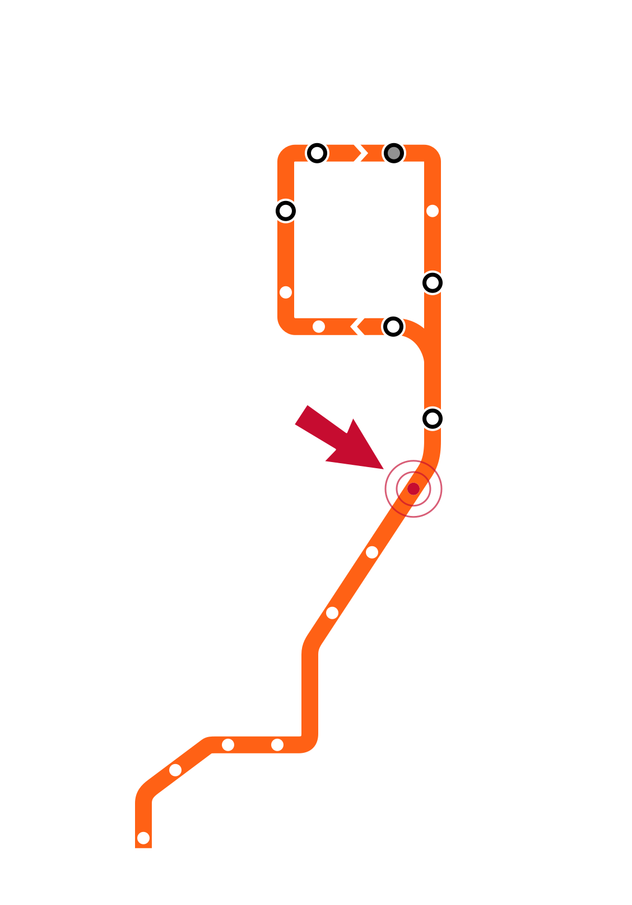{.figure alt="Orange Line map with the Halsted stop marked, the Week 9 stop"}

:::

---

## Any questions? {#any-questions-day-1}

- PrairieLearn Homeworks?
- Group Projects?
- Week 9 Quiz is Wednesday, in class
- Other logistics?
- (You can also stay after class for questions)


# Collect Data From Neighbors {.section-header}

---

## The Self

---

## Find Your Neighbors {.split}

::: {.split-content .golden-columns}

::: {}
Worksheet checkpoint 1:

- Fill in the **Self** column: 1 if you have taken the course, 0 if not.
- Talk to five classmates and fill in a column for each one.
    - Only one of the five can be in your project group.
:::

<iframe src="https://dodatascience.fun/timer/" title="CTA-style countdown timer" loading="lazy" style="width: 100%; height: 420px; display: block; border: 1px solid #999; box-shadow: 0 10px 28px rgba(0,0,0,0.12); border-radius: 3px;"></iframe>

:::

---

## Predict Alice From Her Classmates

::: {.caption}
Source: Hal Daumé III, *[A Course in Machine Learning](http://ciml.info/)* (CIML), v0.99, [ch. 3](http://ciml.info/dl/v0_99/ciml-v0_99-ch03.pdf) ("Geometry and Nearest Neighbors").
:::

suppose you need to predict whether Alice will like [a class]. Perhaps we can try to find another student who is most 'similar' to Alice, in terms of favorite courses.

::: {.incremental}
- Our version: did Alice take **CS 412** (Intro to Machine Learning)?
    - **predictors $X$**: the other 11 courses, took it (1) or not (0)
    - **class label $y$**: took CS 412 (▲) or not (●)
- "If it walks like a duck, quacks like a duck, and looks like a duck..."
- A $k$-nearest neighbors classifier assigns class labels to observations based on the class labels of the $k$ 'most similar' observations
:::

---

## Synthetic Class Survey {.image-frame-slide}

:::: {.r-stack}

::: {.fragment .fade-out fragment-index=1}
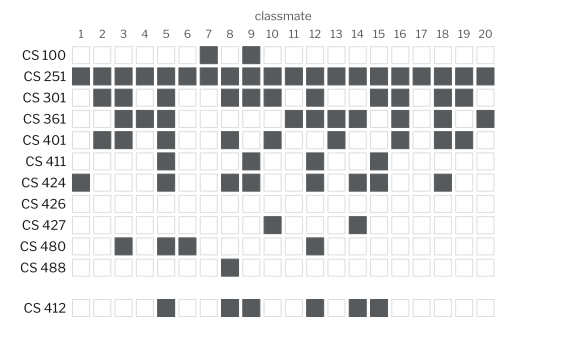
:::

::: {.fragment .fade-in-then-out fragment-index=1}
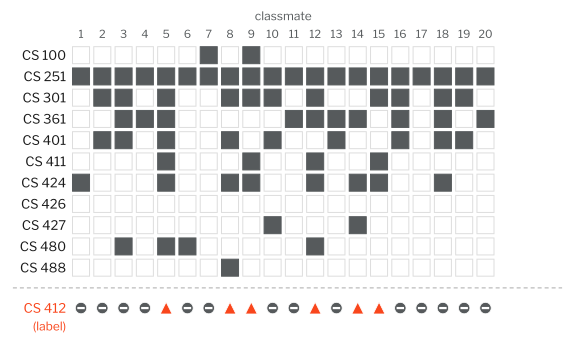
:::

::: {.fragment fragment-index=2}
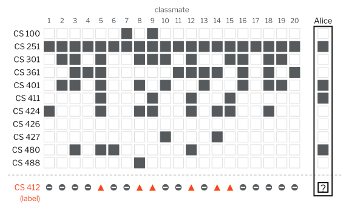
:::

::::

::: {.caption}
Synthetic: 20 classmates and Alice, from the code demo's generator.
:::

---

## Each Student as a Vector

::: {.caption}
Source: Hal Daumé III, *[A Course in Machine Learning](http://ciml.info/)* (CIML), v0.99, [ch. 3](http://ciml.info/dl/v0_99/ciml-v0_99-ch03.pdf), §3.1 ("From Data to Feature Vectors").
:::

- Obviously a student is much more than a vector
- Example: Alice $= (0, 1, 0, 0, 1, 1, 0, 0, 0, 1, 0)$
    - one entry per course

::: {.incremental}
- prediction tasks as mapping inputs to outputs
    - each input is "nothing more than lists of feature values." (CIML)
- Binary features become 0 (for false) or 1 (for true)
- Categorical features (say, major: CS, DS, or CE)
    - map to V-many binary indicator features.
    - Why not CS = 0, DS = 1, CE = 2?
    - That model suggests that CS is closer to DS than to CE
:::

# Similarity Metrics {.section-header}

---

## Similarity Metrics for Binary Features {.smaller}

$N_{11}$: attributes where both $a$ and $b$ are 1; $N_{00}$: both 0; $N_{10}$, $N_{01}$: they disagree.

:::: {.columns}

::: {.column width="45%"}
- **Jaccard**: $S(a, b) = \dfrac{N_{11}}{N_{01} + N_{10} + N_{11}}$
    - (or [`sklearn.metrics.jaccard_score`](https://scikit-learn.org/stable/modules/generated/sklearn.metrics.jaccard_score.html) 🙂)
- **Simple matching (SMC)**: $S(a, b) = \dfrac{N_{00} + N_{11}}{N_{00} + N_{01} + N_{10} + N_{11}}$
    - (or 1 − [`scipy.spatial.distance.hamming`](https://docs.scipy.org/doc/scipy/reference/generated/scipy.spatial.distance.hamming.html) 🙂)
:::

::: {.column width="55%"}
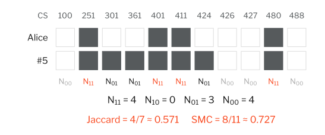
:::

::::

::: {.incremental}
- difference: does a shared 0 count as agreement?
:::

---

## Who Is Alice's Nearest Neighbor? {.image-frame-slide}

:::: {.r-stack}

::: {.fragment .fade-out fragment-index=1}
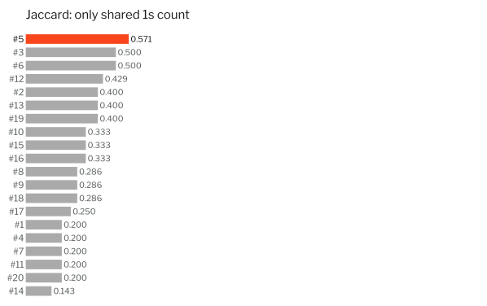
:::

::: {.fragment fragment-index=1}
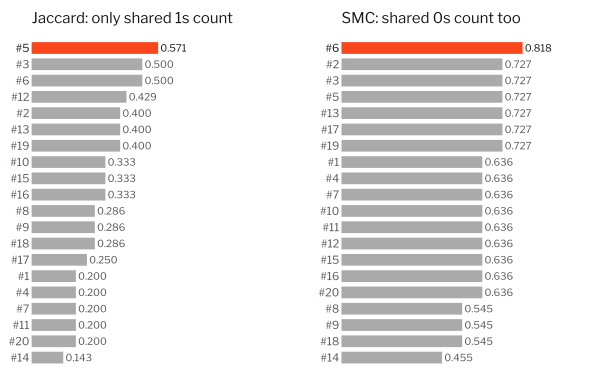
:::

::::

::: {.caption}
#6 took only CS 251 and CS 480, so they match Alice mostly on shared 0s, which SMC counts and Jaccard ignores.
:::

# Distance Metrics {.section-header}

---

## Distance Metrics {.smaller}


Used to measure the dissimilarity between two observations. For continuous attributes, with $p$ attributes:

::: {.incremental}
- **Euclidean**: $d(a, b) = \sqrt{\sum_{i=1}^{p} (a_i - b_i)^2}$
    - (or [`sklearn.metrics.pairwise.euclidean_distances`](https://scikit-learn.org/stable/modules/generated/sklearn.metrics.pairwise.euclidean_distances.html) 🙂)
- **Manhattan**: $d(a, b) = \sum_{i=1}^{p} |a_i - b_i|$
    - (or [`sklearn.metrics.pairwise.manhattan_distances`](https://scikit-learn.org/stable/modules/generated/sklearn.metrics.pairwise.manhattan_distances.html) 🙂)
:::

---

## Worked Example: $a = (3, 4)$ and $b = (2, 2)$

::: {.caption}
Source: Gonzalo Bello Lander, CS 418 Lecture 13, "Classification (II)" (2026), slide 5.
:::

:::: {.columns}

::: {.column width="50%"}

::: {.fragment fragment-index=1}
**Euclidean** (straight line)

$\sqrt{(3-2)^2 + (4-2)^2} = \sqrt{1 + 4} = \sqrt{5} \approx 2.24$
:::

::: {.fragment fragment-index=2}
**Manhattan** (city blocks)

$|3 - 2| + |4 - 2| = 1 + 2 = 3$
:::

:::

::: {.column width="50%"}

:::: {.r-stack}

::: {.fragment .fade-out fragment-index=1}
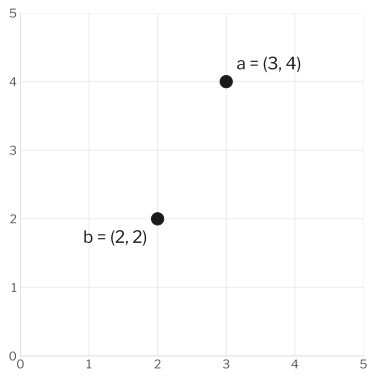
:::

::: {.fragment .fade-in-then-out fragment-index=1}
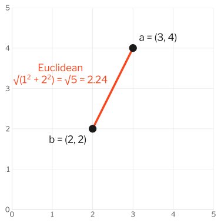
:::

::: {.fragment fragment-index=2}
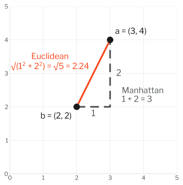
:::

::::

:::

::::

---

## Distance on 0/1 Data {.image-frame-slide}

:::: {.r-stack}

::: {.fragment .fade-out fragment-index=1}
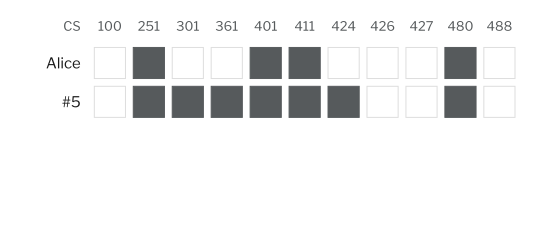
:::

::: {.fragment fragment-index=1}
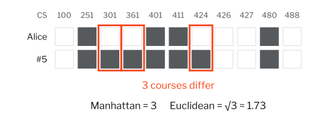
:::

::::

::: {.incremental}
- Each $|a_i - b_i|$ is 1 where they differ and 0 where they agree
    - Manhattan distance just counts the courses that differ
- Euclidean distance is the square root of that same count
    - both metrics rank classmates the same way
:::

# k-NN Details {.section-header}

---

## The k-NN Algorithm {.smaller}

::: {.caption}
Hal Daumé III, *[A Course in Machine Learning](http://ciml.info/)* (CIML), v0.99, [ch. 3](http://ciml.info/dl/v0_99/ciml-v0_99-ch03.pdf), §3.2 and Algorithm 3.
:::

1. Choose a proximity metric and a number of nearest neighbors $k$.
2. For each observation $z$ in the test set:
    1. Compute the distance or similarity between $z$ and every observation in the training set.
    2. Select the $k$ observations most similar to $z$ ($k$ nearest neighbors).
    3. Assign a class label to $z$ based on the class labels of its $k$ nearest neighbors. (majority vote)

::: {.incremental}
- Note there actually is no 'training' phase for K-nearest neighbors
    - **lazy learner**.
- What about ties?
- Why is it a good idea to use an odd number for K?
:::

---

## k-NN for Alice, One Step at a Time {.image-frame-slide}

:::: {.r-stack}

::: {.fragment .fade-out fragment-index=1}
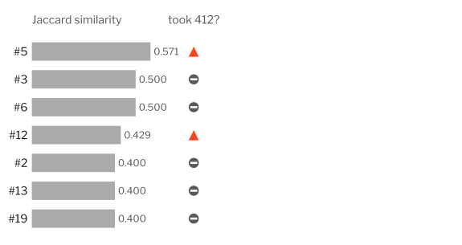
:::

::: {.fragment .fade-in-then-out fragment-index=1}
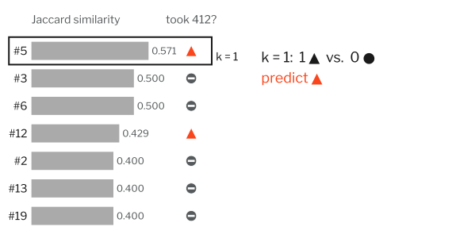
:::

::: {.fragment .fade-in-then-out fragment-index=2}
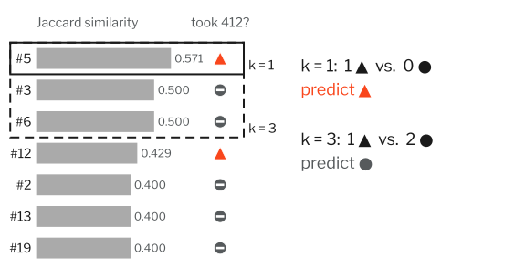
:::

::: {.fragment fragment-index=3}
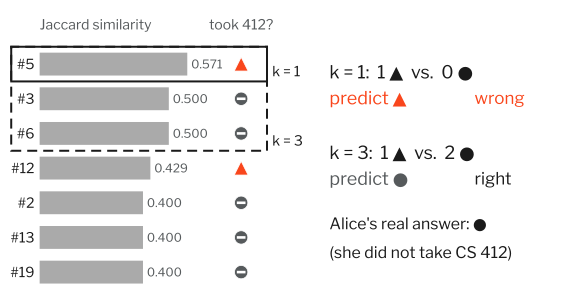
:::

::::

::: {.caption}
One neighbor "cannot consider the 'preponderance of evidence'." (CIML Fig. 3.4). What would $k = 2$ do?
:::

---

## Memorizing vs. Generalizing

::: {.caption}
Source: Hal Daumé III, *[A Course in Machine Learning](http://ciml.info/)* (CIML), v0.99, [ch. 1](http://ciml.info/dl/v0_99/ciml-v0_99-ch01.pdf), §1.1 ("What Does it Mean to Learn?").
:::

Alice is taking a machine learning course, and her teacher Bob writes the exam. What makes a reasonable exam?

::: {.incremental}
- **Unfair**: "If Bob spends the entire semester talking about machine learning, and then gives Alice an exam on History of Pottery, then Alice's performance on this exam will not be representative of her learning."
- **Memorization**: "if the exam only asks questions that Bob has answered exactly during lectures, then this is also a bad test of Alice's learning, especially if it's an 'open notes' exam."
- **Generalization**: "What is desired is that Alice observes specific examples from the course, and then has to answer new, but related questions on the exam. This tests whether Alice has the ability to generalize."
:::

---

## Generalization {.quote-slide}

> Generalization is perhaps the most central concept in machine learning.

::: {.attribution}
Hal Daumé III
:::

::: {.quote-source}
Hal Daumé III, *[A Course in Machine Learning](http://ciml.info/)*, v0.99, [ch. 1](http://ciml.info/dl/v0_99/ciml-v0_99-ch01.pdf), §1.1.
:::

---

## Memorizing or Generalizing? {.split}

::: {.split-content .golden-columns}

::: {}
Worksheet checkpoint 5:

- In your own words, what is the difference between memorizing and generalizing?
- With $k = 1$, every training point's nearest neighbor is itself. Is that memorizing or generalizing? Why?
:::

<iframe src="https://dodatascience.fun/timer/" title="CTA-style countdown timer" loading="lazy" style="width: 100%; height: 420px; display: block; border: 1px solid #999; box-shadow: 0 10px 28px rgba(0,0,0,0.12); border-radius: 3px;"></iframe>

:::

---

## Choosing k: Overfitting vs. Underfitting

::: {.incremental}
- with K = 1, risk of overfitting
- if K is large (for instance, K = N), then KNN-Predict will always predict the majority class (underfitting)
- K is a **hyperparameter** of the KNN algorithm
    - trade-off between overfitting (small value of K) and underfitting (large value of K).
- "a learned model with a decision boundary that is really jagged (like the coastline of Norway) is really complex and prone to overfitting."
- "A learned model with a decision boundary that is really simple (like the bounary [*sic*] between Arizona and Utah) is potentially underfit." (CIML)
:::

---

## Choosing k on a Bigger Class {.image-frame-slide}

:::: {.r-stack}

::: {.fragment .fade-out fragment-index=1}
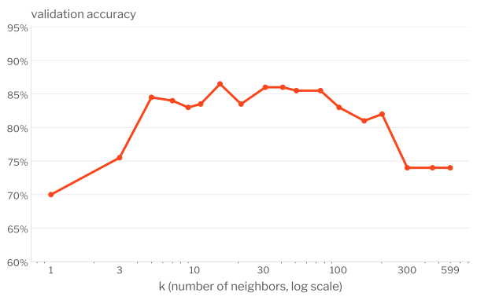
:::

::: {.fragment .fade-in-then-out fragment-index=1}
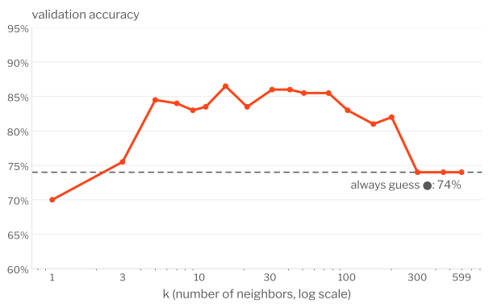
:::

::: {.fragment fragment-index=2}
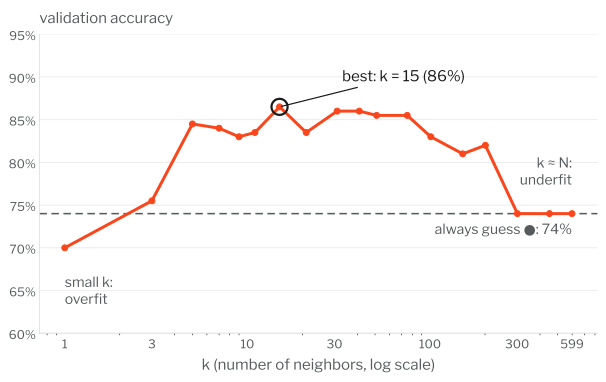
:::

::::

::: {.caption}
The code demo's 1,000 synthetic students: 600 training, 200 validation, Jaccard similarity.
:::

---

## k Is a Hyperparameter {.image-frame-slide}

:::: {.r-stack}

::: {.fragment .fade-out fragment-index=1}
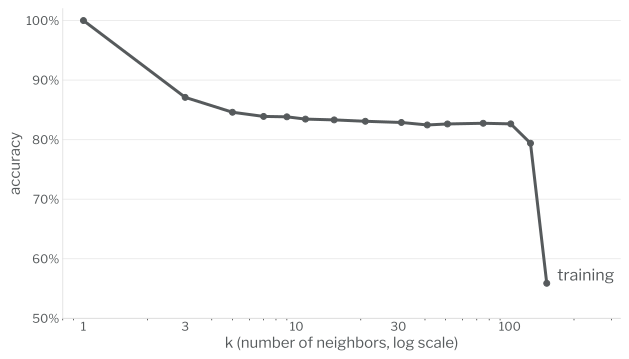
:::

::: {.fragment .fade-in-then-out fragment-index=1}
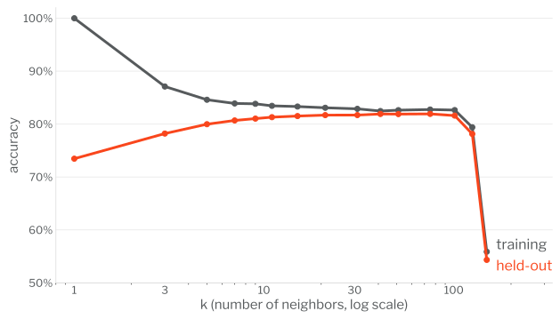
:::

::: {.fragment fragment-index=2}
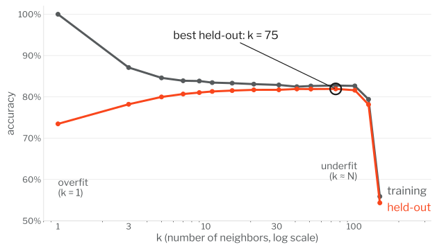
:::

::::

::: {.caption}
"So, K is a hyperparameter of the KNN algorithm that allows us to trade-off between overfitting (small value of K) and underfitting (large value of K)." (CIML). Synthetic data, 10% labels flipped; average of 40 draws of 150 training and 1,500 held-out points.
:::

---

## Example: Choosing k in Two Dimensions {.image-frame-slide}

:::: {.r-stack}

::: {.fragment .fade-out fragment-index=1}
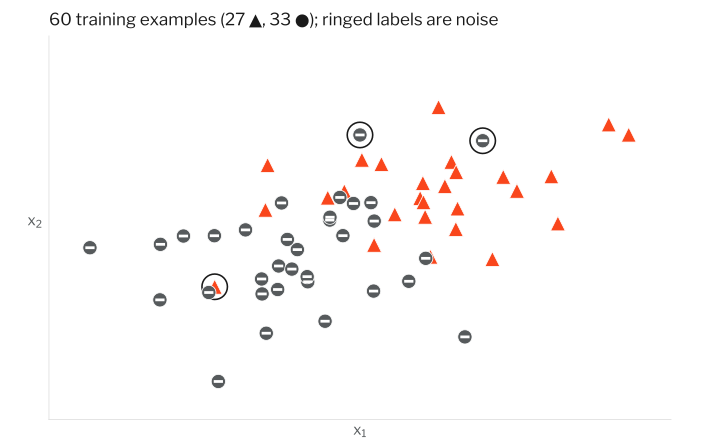
:::

::: {.fragment .fade-in-then-out fragment-index=1}
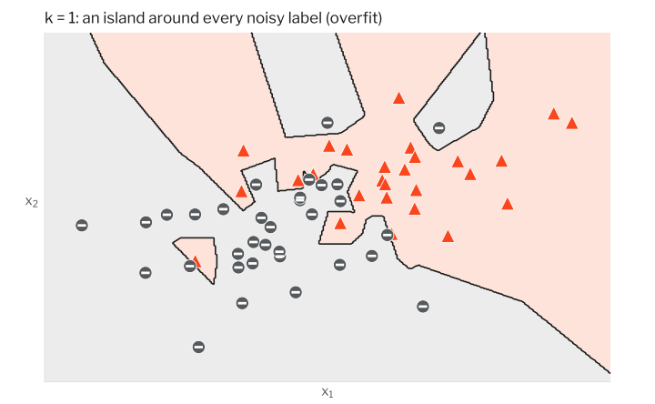
:::

::: {.fragment .fade-in-then-out fragment-index=2}
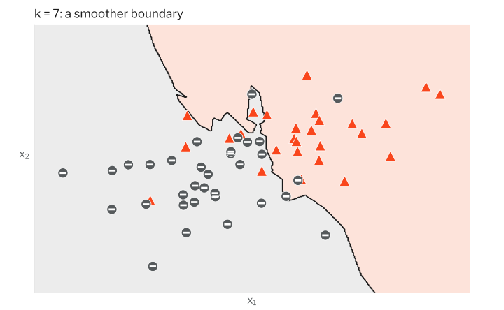
:::

::: {.fragment fragment-index=3}
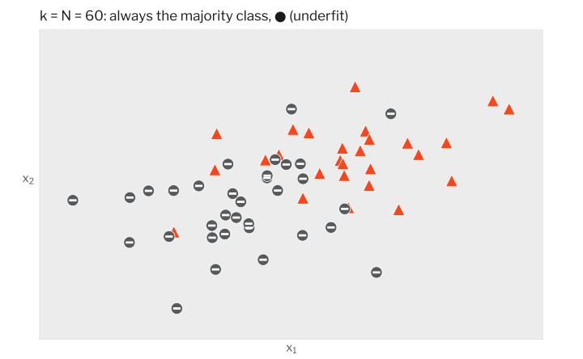
:::

::::

::: {.caption}
The decision boundary is "the line with positive land on one side and negative land on the other side." (CIML §3.3). Synthetic; three labels flipped on purpose.
:::

---

## Pitfall: Irrelevant Features {.image-frame-slide}

:::: {.r-stack}

::: {.fragment .fade-out fragment-index=1}
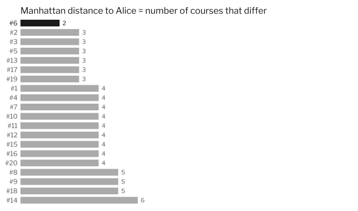
:::

::: {.fragment fragment-index=1}
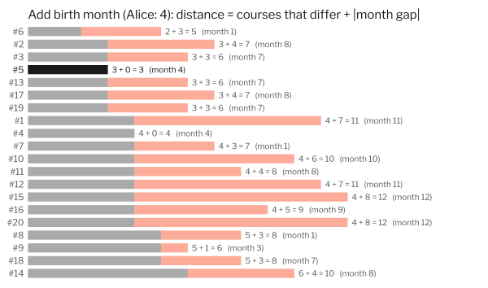
:::

::::

::: {.caption}
Add a synthetic birth month (1 to 12): one month counts as much as one course. "every feature is used, and they are all used the same amount." (CIML §3.2)
:::

---

## Example: Hours Studied and Day of Birth {.image-frame-slide}

:::: {.r-stack}

::: {.fragment .fade-out fragment-index=1}
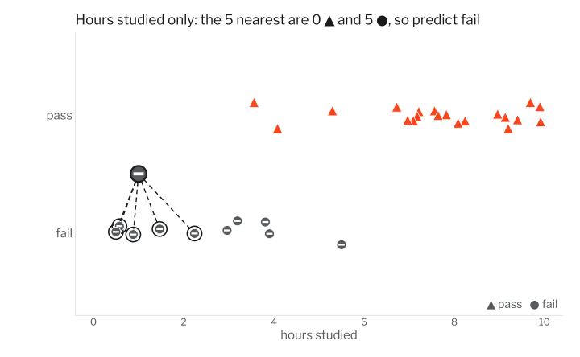
:::

::: {.fragment fragment-index=1}
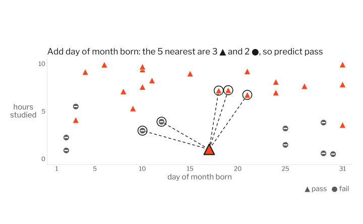
:::

::::

::: {.caption}
Day of birth is noise, but its range (1 to 31) dwarfs hours (0 to 10), so it decides who is "near."
:::

---

## k-NN: Pros and Cons {.smaller}

:::: {.columns}

::: {.column width="50%"}
**Advantages**

- Does not require training a model (lazy learner)
- Applicable to categorical and numeric attributes.
- no assumptions/criterion about the probability distribution of the data
- can produce decision boundaries of any shape
:::

::: {.column width="50%"}
**Disadvantages**

- can be computationally expensive.
- Easy to overfit (due to noise or high dimensionality)
- Sensitive to redundant or irrelevant attributes
- sensitive to the scale of the data
- No descriptive value, i.e. no meaningful relationship between the class label and the attributes, other than "looks similar to other examples"
:::

::::

# Decision Tree Examples {.section-header}

---

## Example Tree: Tax Avoidance {.image-frame-slide}

:::: {.r-stack}

::: {.fragment .fade-out fragment-index=1}
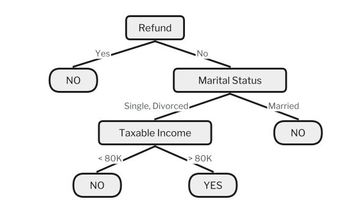
:::

::: {.fragment .fade-in-then-out fragment-index=1}
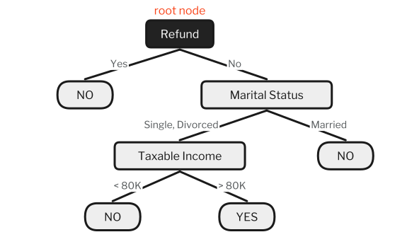
:::

::: {.fragment .fade-in-then-out fragment-index=2}
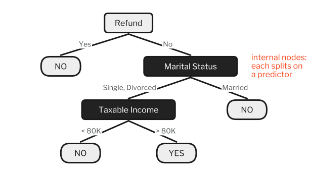
:::

::: {.fragment .fade-in-then-out fragment-index=3}
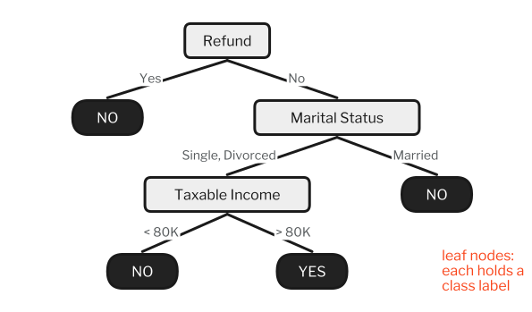
:::

::: {.fragment .fade-in-then-out fragment-index=4}
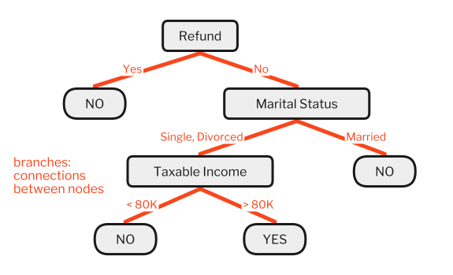
:::

::: {.fragment fragment-index=5}
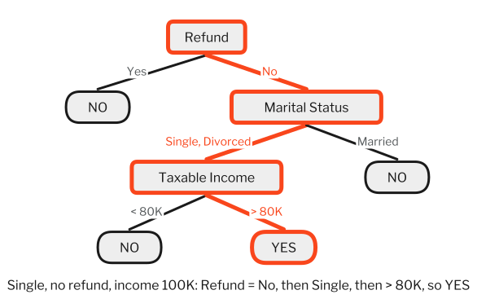
:::

::::

::: {.caption}
To classify, "follow the decision tree from the root node to a leaf node." ([Bello](https://cs.uic.edu/profiles/gonzalo-bello/), Lecture 12, slides 8–11)
:::

---


## Example Tree: Hours Studied {.image-frame-slide}

:::: {.r-stack}

::: {.fragment .fade-out fragment-index=1}
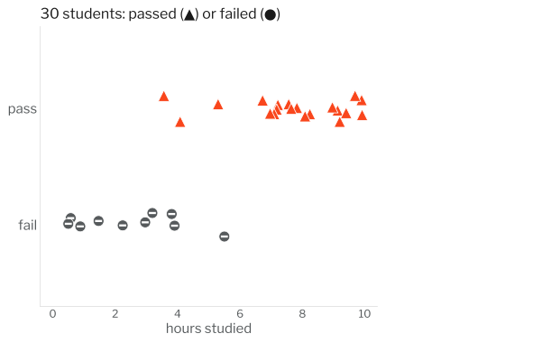
:::

::: {.fragment .fade-in-then-out fragment-index=1}
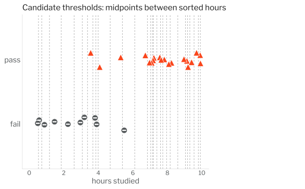
:::

::: {.fragment fragment-index=2}
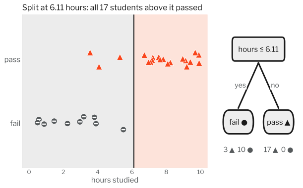
:::

::::

::: {.caption}
"for real-valued features, the decision tree nodes are parameterized by a feature and a threshold for that feature." (CIML §3.3). 6.11 is scikit-learn's pick.
:::

---

## Is This a Good Split? (1 of 4) {.image-frame-slide}

:::: {.r-stack}

::: {.fragment .fade-out fragment-index=1}
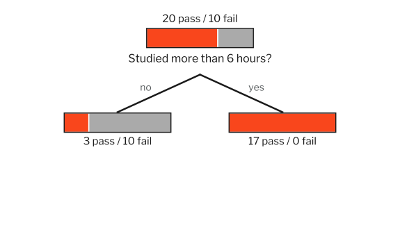
:::

::: {.fragment fragment-index=1}
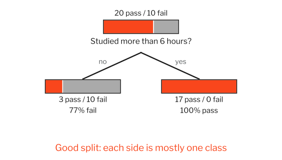
:::

::::

::: {.caption}
The split from the last slide.
:::

---

## Is This a Good Split? (2 of 4) {.image-frame-slide}

:::: {.r-stack}

::: {.fragment .fade-out fragment-index=1}
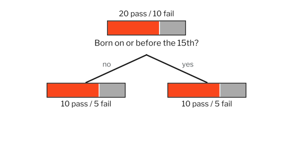
:::

::: {.fragment fragment-index=1}

:::

::::

::: {.caption}
Day of birth is random noise.
:::

---

## Is This a Good Split? (3 of 4) {.image-frame-slide}

:::: {.r-stack}

::: {.fragment .fade-out fragment-index=1}

:::

::: {.fragment fragment-index=1}
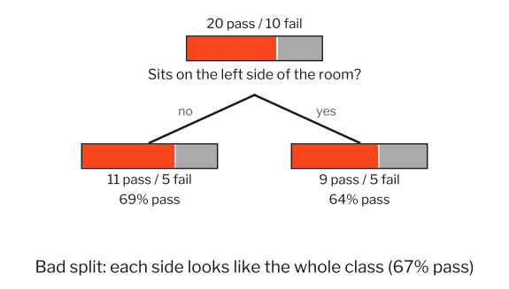
:::

::::

::: {.caption}
Synthetic data.
:::

---

## Is This a Good Split? (4 of 4) {.image-frame-slide}

:::: {.r-stack}

::: {.fragment .fade-out fragment-index=1}
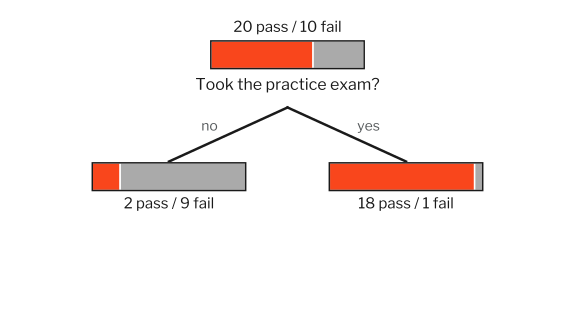
:::

::: {.fragment fragment-index=1}
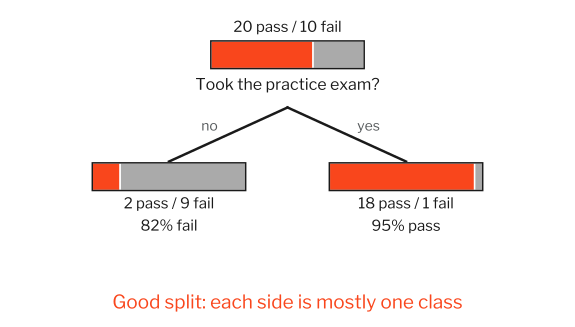
:::

::::

::: {.caption}
Synthetic data.
:::

# Decision Tree Details {.section-header}

---

## Which Tree?

::: {.caption}
Sources: Hal Daumé III, *[A Course in Machine Learning](http://ciml.info/)* (CIML), v0.99, [ch. 1](http://ciml.info/dl/v0_99/ciml-v0_99-ch01.pdf), §1.3; Gonzalo Bello Lander, CS 418 Lecture 12 (2026), slide 12; Elena Zheleva, CS 418 lecture slides, Feb. 19, 2026.
:::

::: {.incremental}
- "It is computationally infeasible to consider all of these to try to choose the 'best' one." (CIML)
    - NP-Hard! (according to Prof. Zheleva)
- Instead, "we will build our decision tree greedily. We will begin by asking: If I could only ask one question, what question would I ask?"
-  greedy strategy:
    1. Start with a single node containing all observations in the training set (root node).
    2. Split node into sub-nodes based on an attribute that optimizes certain splitting criterion.
    3. Repeat on each sub-node until reaching certain stopping criterion.
:::

---

## Scoring a Split: Majority Vote {.image-frame-slide}

:::: {.r-stack}

::: {.fragment .fade-out fragment-index=1}
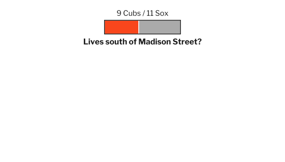
:::

::: {.fragment .fade-in-then-out fragment-index=1}
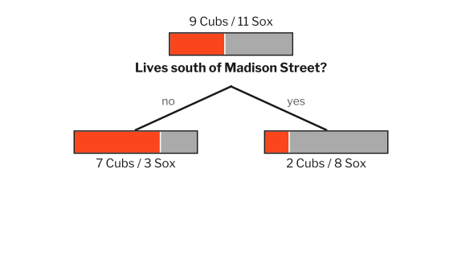
:::

::: {.fragment fragment-index=2}
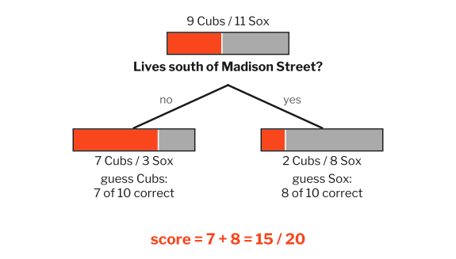
:::

::::

::: {.caption}
Synthetic data. CIML §1.3: "if I made that guess on the training data, how well would I have done?"
:::

---

## Majority Vote on the Survey {.image-frame-slide}

:::: {.r-stack}

::: {.fragment .fade-out fragment-index=1}
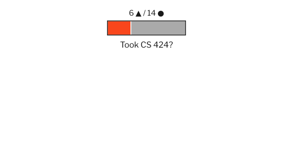
:::

::: {.fragment .fade-in-then-out fragment-index=1}

:::

::: {.fragment fragment-index=2}
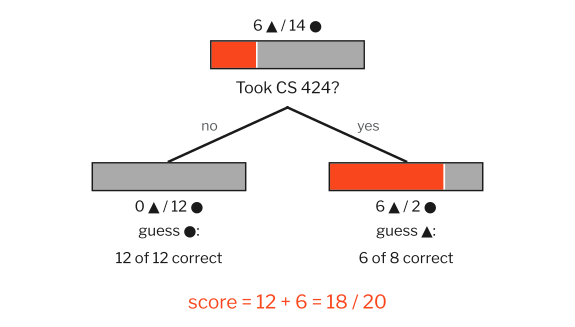
:::

::::

::: {.caption}
"Took CS 424?" (Visualization) is one of the 11 questions we could ask first.
:::

---

## If You Could Ask Only One Question {.image-frame-slide}


::: {.caption}
CS 251 splits no one: all 20 took it (it's the CS 418 prerequisite).
:::

---

## When Majority Vote Can't Decide {.image-frame-slide}

:::: {.r-stack}

::: {.fragment .fade-out fragment-index=1}

:::

::: {.fragment fragment-index=1}

:::

::::

::: {.caption}
"Both have the same error rate!!! Which is 'progressing more' towards a lower error?" Elena Zheleva, CS 418 lecture slides, Feb. 19, 2026 (based on Marine Carpuat).
:::

---

## How Much Does a Split Help?

::: {.caption}
See also scikit-learn user guide, ["Classification criteria"](https://scikit-learn.org/stable/modules/tree.html#classification-criteria).
:::


- **Majority vote**: guess the majority class on each side and count how many are right; higher is better. (CIML §1.3)
- **Information gain**: the drop in entropy from the split, parent entropy minus the size-weighted entropy of the children; higher is better.
    - $H = -\sum_k p_k \log_2 p_k$. The parent, 20 pass and 10 fail, has $H \approx 0.918$.
- **Gini impurity**: $G = 1 - \sum_k p_k^2$, scikit-learn's default criterion; lower in the children is better.
- We'll talk about these metrics more soon.

---

## Upload your worksheet {#upload-worksheet-day-1}

Take a picture of your worksheet, upload it in Canvas

# That's All for Today, See You Wednesday! {.section-header .no-index}

# Week 9, Day 2 {.course-title .photo-title .experimental-roofline-title data-state="photo-title" data-roofline="890 952 4032 786" data-roofline-image="4032 3024" data-roofline-inset="160" background-image="../assets/orange-line-stops-better/stop10-halsted-b.jpg" background-size="cover"}

CS 418 · Week 9 · 🟠 Halsted 🟠

---

## Map for Week 9, Day 2 {.split}

::: {.split-content .narrow-aside}

::: {}
- k-NN Review
- Decision Trees for Movie Reviews
- Support Vector Machines
- Kernels
- Quiz
:::

{.figure alt="Orange Line map with the Halsted stop marked, the Week 9 stop"}

:::

# k-NN Review {.section-header}

---

## Similarity as a Fraction {.image-frame-slide}


::: {.incremental}
- Jaccard: shared 1s out of everything either one has
- SMC: all agreements (shared 1s and shared 0s) out of everything
- Does a shared 0 count?
- TODO make this incremental reveal
:::


---

## k-NN Basic Steps {.image-frame-slide}

::: {.caption}
Sources: Timbers et al., [*Data Science: A First Introduction*, §5.5](https://python.datasciencebook.ca/classification1.html); Bello, Lecture 13. Data: [Palmer Penguins](https://doi.org/10.5281/zenodo.3960218), Week 8's training penguins.
:::

:::: {.r-stack}

::: {.fragment .fade-out fragment-index=1}

:::

::: {.fragment fragment-index=1}

:::

::::

- Choose a distance and $k$
- find the $k$ nearest training points
- Check the majority vote


---

## Choosing $k$ {.image-frame-slide}

::: {.caption}
Source: Timbers et al., [*Data Science: A First Introduction*, §6.6](https://python.datasciencebook.ca/classification2.html). Data: Week 8's 28 validation penguins.
:::


- In general, small $k$ overfits and large $k$ underfits
    - $k = N$ will always...
- Pick $k$ on validation data, never the test set


# Decision Trees and Movie Reviews {.section-header}

---

## Decision Trees in One Slide

::: {.caption}
Source: Hal Daumé III, *[A Course in Machine Learning](http://ciml.info/)*, [ch. 1](http://ciml.info/dl/v0_99/ciml-v0_99-ch01.pdf), §1.3.
:::

- Each node asks about one feature; each leaf is a label
- Tree grows greedily: "If I could only ask one question, what question would I ask?"
- Best question as highest information gain
- `max_depth`: too shallow underfits, too deep overfits

---

## Demo: Negative, Meh, or Positive?

::: {.caption}
Data: Hou et al., [Amazon Reviews 2023](https://amazon-reviews-2023.github.io/), `Movies_and_TV`; sample in [`datasets/movie-reviews`](https://github.com/jackbandy/data-science-fun/tree/main/datasets/movie-reviews).
:::

- 4,500 Amazon movie and TV reviews, 1,500 per label
- Labels from stars: 1–2 negative, 3 meh, 4–5 positive
- Each review a vector (of 82 counts)
    - word lists: *bad*, *horrible*, … *ok*, *but*, … *great*, *love*, …
    - negations, length, ALL CAPS, `!`, `?`, `...`

::: {.fragment}
Provenance of the labels: each one comes from the reviewer's star rating, not from someone reading the review. Could some be wrong?
:::

::: {.notes}
Worksheet checkpoint 3 asks this. Yes, some are wrong: per the dataset README, some 3-star reviews read as glowing, some 1-star reviews are jokes or mistakes, and some reviews are about the disc or the streaming service ("arrived scratched").
:::


---

## Train the Tree

- Depth 5: 55% train, 51% test
    - guessing?
- Root question: any *not / no / never*?
    - no: mostly positive
    - yes: mostly negative
- Uses only 9 of the 82 clues

::: {.notes}
DecisionTreeClassifier(max_depth=5, min_samples_leaf=25). Root split: 1,769 training reviews without negation (49% positive), 1,831 with (45% negative). The 9 clues: not/no/never, but, !, great, love, length, waste, ok, okay.
:::

---

## A Review, From Root to Leaf (1 of 3) {.split}

::: {.split-content .golden-figure}

::: {}
> Absolutely LOVED it!!! Best movie of the year.

- No negation → has `!` → short
- Predicts positive
:::


:::

---

## A Review, From Root to Leaf (2 of 3) {.split}

::: {.split-content .golden-figure}

::: {}
> It was ok. Some good parts, but way too long...

- No negation → no `!` → has *but* → short
- Predicts meh
:::


:::

---

## A Review, From Root to Leaf (3 of 3) {.split}

::: {.split-content .golden-figure}

::: {}
> Horrible. A total waste of two hours.

- No negation → no `!` → no *but* → no *great* → no *love*
- Predicts positive?!

::: {.fragment}
- The tree never asks about *horrible*
:::
:::


:::

::: {.notes}
Few reviews use "horrible", so the greedy splits pick broader clues; "waste" is only asked on the negation side. Same lesson as Monday's CS 424 vs. CS 411 split.
:::

---

## Try the Demo in the Python Yard {.split}

::: {.split-content .golden-columns}

::: {}
Worksheet checkpoint:

- Open [`movie-reviews.ipynb`](https://dodatascience.fun/yard/notebooks/index.html?path=movie-reviews.ipynb)
- Add three words to a list and rerun
    - new root question?
    - new test accuracy?
- You can also try testing on your own review
:::

<iframe src="https://dodatascience.fun/timer/" title="CTA-style countdown timer" loading="lazy" style="width: 100%; height: 420px; display: block; border: 1px solid #999; box-shadow: 0 10px 28px rgba(0,0,0,0.12); border-radius: 3px;"></iframe>

:::

---

## Same Clues, Other Classifiers

Test accuracy on the same 82 clues:

- decision tree: 51%
- $k$-NN ($k = 15$, standardized): 60%
- linear SVM: 64%

::: {.fragment}
What is an SVM?
:::

# Support Vector Machines {.section-header}

---

## Which Line Would You Pick? {.image-frame-slide}

::: {.caption}
Based on Bello, Lecture 13, Exercise 13.3, and [VanderPlas](https://jakevdp.github.io/PythonDataScienceHandbook/05.07-support-vector-machines.html). Data: [Palmer Penguins](https://doi.org/10.5281/zenodo.3960218), 28 of Week 8's penguins.
:::

:::: {.r-stack}

::: {.fragment .fade-out fragment-index=1}

:::

::: {.fragment fragment-index=1}

:::

::::

::: {.notes}
Homework 10 (`svm-pick-max-margin-line`) is this question.
:::

---

## SVM Goal: Maximize the Margin {.image-frame-slide}

::: {.caption}
Sources: [VanderPlas](https://jakevdp.github.io/PythonDataScienceHandbook/05.07-support-vector-machines.html); Daumé, CIML [ch. 7](http://ciml.info/dl/v0_99/ciml-v0_99-ch07.pdf), §7.7. Axes are standardized and drawn at equal scale.
:::


- Margin: the empty band around the line; the SVM picks the widest
- Predict by which side a point falls on: $\text{sign}(\mathbf{w}^T\mathbf{x} + b)$

---

## Support Vectors {.image-frame-slide}

::: {.caption}
Source: [VanderPlas](https://jakevdp.github.io/PythonDataScienceHandbook/05.07-support-vector-machines.html).
:::


- The points touching the margin; only they decide where the line goes
- k-NN keeps every training point; an SVM keeps only these

---

## Hard and Soft Margins: $C$ {.image-frame-slide}

::: {.caption}
Sources: Daumé, CIML [§7.7](http://ciml.info/dl/v0_99/ciml-v0_99-ch07.pdf); scikit-learn, ["RBF SVM parameters"](https://scikit-learn.org/stable/auto_examples/svm/plot_rbf_parameters.html). Data: [Palmer Penguins](https://doi.org/10.5281/zenodo.3960218), all 274 Adélie and Gentoo penguins from Week 8.
:::

:::: {.r-stack}

::: {.fragment .fade-out fragment-index=1}

:::

::: {.fragment fragment-index=1}

:::

::::

- Soft margin: points may sit inside the margin, for a price
- Large $C$: narrow margin, fits training data closely; small $C$: wide margin

# Kernels {.section-header}

---

## What if a does not work? {.image-frame-slide}


:::: {.r-stack}

::: {.fragment .fade-out fragment-index=1}

:::

::: {.fragment fragment-index=1}

:::

::::

- One feature: no single cut separates the classes

---

## Kernels {.image-frame-slide}

::: {.caption}
Based on [VanderPlas](https://jakevdp.github.io/PythonDataScienceHandbook/05.07-support-vector-machines.html); see also Daumé, CIML [ch. 11](http://ciml.info/dl/v0_99/ciml-v0_99-ch11.pdf). Data: [Palmer Penguins](https://doi.org/10.5281/zenodo.3960218), all 342 measured penguins.
:::

:::: {.r-stack}

::: {.fragment .fade-out fragment-index=1}

:::

::: {.fragment .fade-in-then-out fragment-index=1}

:::

::: {.fragment fragment-index=2}

:::

::::

- Chinstraps sit between the other two species
- no straight line to fence them off
- Kernel trick: the benefit of new features without computing them; `SVC(kernel="rbf")`

---

## Common Kernels {.image-frame-slide}

::: {.caption}
Sources: Bello, Lecture 13, slide 27 ("Kernel Trick"); scikit-learn user guide, [§1.4, "Kernel functions"](https://scikit-learn.org/stable/modules/svm.html). Data: [Palmer Penguins](https://doi.org/10.5281/zenodo.3960218), Chinstrap vs. the rest; training accuracy above each panel.
:::


::: {.dense}
<!-- Raw HTML so each row can be a fragment; processing is off so Quarto keeps the row classes. -->
<table data-quarto-disable-processing="true">
<thead><tr><th>Kernel</th><th><i>K</i>(<b>u</b>, <b>v</b>)</th><th>Boundary</th><th>scikit-learn</th></tr></thead>
<tbody>
<tr class="fragment"><td>linear</td><td><b>u</b><sup><i>T</i></sup><b>v</b></td><td>a straight line</td><td><code>SVC(kernel=&quot;linear&quot;)</code></td></tr>
<tr class="fragment"><td>polynomial</td><td>(<i>γ</i> <b>u</b><sup><i>T</i></sup><b>v</b> + <i>r</i>)<sup><i>d</i></sup></td><td>curves of degree <i>d</i></td><td><code>SVC(kernel=&quot;poly&quot;, degree=3)</code></td></tr>
<tr class="fragment"><td>RBF</td><td>exp(−<i>γ</i> ‖<b>u</b> − <b>v</b>‖<sup>2</sup>)</td><td>any shape; similarity drops with distance</td><td><code>SVC(kernel=&quot;rbf&quot;)</code>, the default</td></tr>
<tr class="fragment"><td>sigmoid</td><td>tanh(<i>γ</i> <b>u</b><sup><i>T</i></sup><b>v</b> + <i>r</i>)</td><td>rarely the best choice</td><td><code>SVC(kernel=&quot;sigmoid&quot;)</code></td></tr>
</tbody>
</table>
:::

::: {.notes}
The polynomial panel is degree 3 with coef0 = 1 (the r in the formula). RBF is scikit-learn's default and the usual first choice.
:::

---

## Linear or Kernel? (1 of 5) {.image-frame-slide}

:::: {.r-stack}

::: {.fragment .fade-out fragment-index=1}

:::

::: {.fragment fragment-index=1}

:::

::::

::: {.notes}
Show of hands before each reveal. Homework 10 (`kernel-needed`) uses these five shape kinds.
:::

---

## Linear or Kernel? (2 of 5) {.image-frame-slide}

:::: {.r-stack}

::: {.fragment .fade-out fragment-index=1}

:::

::: {.fragment fragment-index=1}

:::

::::

---

## Linear or Kernel? (3 of 5) {.image-frame-slide}

:::: {.r-stack}

::: {.fragment .fade-out fragment-index=1}

:::

::: {.fragment fragment-index=1}

:::

::::

---

## Linear or Kernel? (4 of 5) {.image-frame-slide}

:::: {.r-stack}

::: {.fragment .fade-out fragment-index=1}

:::

::: {.fragment fragment-index=1}

:::

::::

---

## Linear or Kernel? (5 of 5) {.image-frame-slide}

:::: {.r-stack}

::: {.fragment .fade-out fragment-index=1}

:::

::: {.fragment fragment-index=1}

:::

::::

---

## $\gamma$: How Far Each Point Reaches {.image-frame-slide}

::: {.caption}
Source: scikit-learn, ["RBF SVM parameters"](https://scikit-learn.org/stable/auto_examples/svm/plot_rbf_parameters.html). Data: [Palmer Penguins](https://doi.org/10.5281/zenodo.3960218); half the penguins train, half are held out.
:::

:::: {.r-stack}

::: {.fragment .fade-out fragment-index=1}

:::

::: {.fragment .fade-in-then-out fragment-index=1}

:::

::: {.fragment fragment-index=2}

:::

::::

- $\gamma$ sets how fast RBF similarity, $\exp(-\gamma \cdot \text{distance}^2)$, fades
- Small $\gamma$: each penguin's influence reaches far → smooth boundary (underfit)
- Large $\gamma$: influence stays local → islands around single penguins (overfit)
- Tune $C$ and $\gamma$ on validation data, like $k$ and `max_depth`

---

## SVMs on the Movie Reviews

```python
model = make_pipeline(StandardScaler(), LinearSVC())
```

- 64% test (tree: 51%)
- Biggest weights: *not/no/never*, *horrible* (negative); *great*, *love* (positive)
- Unlike the tree, it uses *horrible*

::: {.notes}
Scale first, as with k-NN: scikit-learn's user guide (§1.4) says SVMs "are not scale invariant." Negative vs. positive only: tree 76%, linear SVM 81%.
:::

---

## SVMs: Pros and Cons

::: {.caption}
Sources: [VanderPlas](https://jakevdp.github.io/PythonDataScienceHandbook/05.07-support-vector-machines.html); Bello, Lecture 13.
:::

- Pros: compact (support vectors only), fast predictions, kernels handle curved boundaries
- Cons: slow to train on big data, sensitive to $C$ and $\gamma$, no probabilities

# Wrap-Up {.section-header}

---

## Four Classifiers in Brief {#four-classifiers-in-brief-day-2}

::: {.dense}
<!-- Raw HTML so each row can be a fragment; processing is off so Quarto keeps the row classes. -->
<table data-quarto-disable-processing="true">
<thead><tr><th>Classifier</th><th>Boundary</th><th>Hyperparameters</th><th>Strength</th><th>Weakness</th></tr></thead>
<tbody>
<tr class="fragment"><td><i>k</i>-NN</td><td>any shape</td><td><i>k</i></td><td>no training; flexible</td><td>slow to predict; scale-sensitive</td></tr>
<tr class="fragment"><td>Decision tree</td><td>rectilinear</td><td>max depth</td><td>interpretable</td><td>easy to overfit</td></tr>
<tr class="fragment"><td>SVM</td><td>linear, or curved with a kernel</td><td><i>C</i>, kernel, <i>γ</i></td><td>maximum margin</td><td>slow to train</td></tr>
<tr class="fragment"><td>Naive Bayes</td><td>follows the class distributions</td><td>(few)</td><td>probabilities</td><td>assumes independence</td></tr>
</tbody>
</table>
:::

Same `fit` / `predict` / `score` for all four.

::: {.notes}
From Week 8. Keep the Naive Bayes column: Homework 10's `classifier-identify-description` describes Naive Bayes one time in four.
:::

---

## Upload your worksheet {#upload-worksheet-day-2}

Take a picture of your worksheet, upload it in Canvas

---

## Quiz Time

Week 9 Quiz: the last 30 minutes of class

# That's All for Today, See You Monday! {.section-header .no-index}

# Appendix: Entropy and Information Gain {.section-header}

---

## Entropy: How Much Does a Split Help Distinguish Classes? {.smaller}

::: {.caption}
Source: Gonzalo Bello Lander, CS 418 Lecture 12, "Classification (I)" (2026), slides 14–16. Figure based on Sebastian Raschka, "[Why are we growing decision trees via entropy instead of the classification error?](https://sebastianraschka.com/faq/docs/decisiontree-error-vs-entropy.html)": "if we have 2 entropy values (left and right child node), the average will fall onto the straight, connecting line."
:::

:::: {.columns}

::: {.column width="40%"}
"Entropy measures the impurity of a node of the tree."

$$H(v_m) = -\sum_k p(y_k \mid v_m) \log_2 p(y_k \mid v_m)$$

"where $p(y_k \mid v_m)$ is the proportion of observations from class $y_k$ at node $v_m$."

- (or [`scipy.stats.entropy`](https://docs.scipy.org/doc/scipy/reference/generated/scipy.stats.entropy.html), with `base=2` 🙂)

::: {.incremental}
- "Minimum value: 0. When all observations belong to the same class."
- "Maximum value: $\log_2 k$ where $k$ is the number of classes. When observations are equally distributed among all classes."
:::

:::

::: {.column width="60%"}
:::: {.r-stack}

::: {.fragment .fade-out fragment-index=1}

:::

::: {.fragment .fade-in-then-out fragment-index=1}

:::

::: {.fragment .fade-in-then-out fragment-index=2}

:::

::: {.fragment fragment-index=3}

:::

::::
:::

::::

---

## Information Gain {.smaller}

"Information gain measures the difference in entropy resulting from splitting a node of the tree on a given attribute."

$$IG(X_i, v_m) = H(v_m) - \sum_{h=1}^{M} \frac{N_h}{N} H(v_h)$$

"where $N_h$ is the number of observations at node $v_h$."

- (or [`sklearn.metrics.mutual_info_score`](https://scikit-learn.org/stable/modules/generated/sklearn.metrics.mutual_info_score.html), which reports it in nats, not bits 🙂)

::: {.incremental}
- Parent entropy minus the size-weighted average entropy of the children.
- "The best attribute to split on is the one that maximizes the information gain."
- "Information gain is the splitting criterion function used by the ID3 and the C4.5 algorithms."
:::

---

## How Much Does This Question Help Us Distinguish Between Classes? {.image-frame-slide}

:::: {.r-stack}

::: {.fragment .fade-out fragment-index=1}

:::

::: {.fragment .fade-in-then-out fragment-index=1}

:::

::: {.fragment .fade-in-then-out fragment-index=2}

:::

::: {.fragment fragment-index=3}

:::

::::

---

## How Much Does This Question Help Us Distinguish Between Classes? {.smaller}

**Parent**, 9 Cubs / 11 Sox:

$$H = -\tfrac{9}{20}\log_2\tfrac{9}{20} - \tfrac{11}{20}\log_2\tfrac{11}{20} \approx 0.993$$

::: {.incremental}
- **No** (north of Madison), 7 Cubs / 3 Sox: $H = -\tfrac{7}{10}\log_2\tfrac{7}{10} - \tfrac{3}{10}\log_2\tfrac{3}{10} \approx 0.881$
- **Yes** (south of Madison), 2 Cubs / 8 Sox: $H = -\tfrac{2}{10}\log_2\tfrac{2}{10} - \tfrac{8}{10}\log_2\tfrac{8}{10} \approx 0.722$
- **Weighted average** of the children, 10 of 20 fans each: $\tfrac{10}{20}(0.881) + \tfrac{10}{20}(0.722) \approx 0.802$
- **Information gain**: $0.993 - 0.802 \approx 0.191$
:::

---

## Information Gain for "Took CS 424?" {.image-frame-slide}

:::: {.r-stack}

::: {.fragment .fade-out fragment-index=1}

:::

::: {.fragment .fade-in-then-out fragment-index=1}

:::

::: {.fragment .fade-in-then-out fragment-index=2}

:::

::: {.fragment fragment-index=3}

:::

::::

::: {.caption}
Unequal children (12 and 8), so the weights are $\tfrac{12}{20}$ and $\tfrac{8}{20}$.
:::

---

## The Greedy Choice {.image-frame-slide}

:::: {.r-stack}

::: {.fragment .fade-out fragment-index=1}

:::

::: {.fragment fragment-index=1}

:::

::::

::: {.caption}
The root asks "Took CS 424?"; the same search then repeats inside each child.
:::

---

## Worked Example {.image-frame-slide}

:::: {.r-stack}

::: {.fragment .fade-out fragment-index=1}

:::

::: {.fragment .fade-in-then-out fragment-index=1}

:::

::: {.fragment fragment-index=2}

:::

::::

::: {.caption}
Source: Gonzalo Bello Lander, CS 418 Lecture 12, "Classification (I)" (2026), slides 16–18. Parent: $H(v_0) = -\frac{5}{10}\log_2\frac{5}{10} - \frac{5}{10}\log_2\frac{5}{10} = 1$. "Splitting on $X_b$ is better than splitting on $X_a$."
:::

# Appendix: Growing and Tuning a Tree {.section-header}

---

## Growing the Tree, One Level at a Time {.image-frame-slide}

:::: {.r-stack}

::: {.fragment .fade-out fragment-index=1}

:::

::: {.fragment .fade-in-then-out fragment-index=1}

:::

::: {.fragment .fade-in-then-out fragment-index=2}

:::

::: {.fragment fragment-index=3}

:::

::::

::: {.caption}
To separate the last four classmates, the full tree asks about CS 427 and CS 488 (tied at that node; scikit-learn picked CS 427).
:::

---

## Classify Alice: Walk From Root to Leaf {.image-frame-slide}


::: {.incremental}
- One question, and Alice lands in a leaf where none of the 12 classmates took CS 412. Correct!
- Had the root been "Took CS 411?", Alice (who took CS 411) would land in the 4 ▲ / 0 ● leaf, and the tree would predict ▲.
:::

---

## Empty Tree vs. Full Tree

::: {.caption}
Source: Hal Daumé III, *[A Course in Machine Learning](http://ciml.info/)* (CIML), v0.99, [ch. 2](http://ciml.info/dl/v0_99/ciml-v0_99-ch02.pdf)
:::

::: {.incremental}
- **Empty tree**: make the same prediction regardless of input
    - not allowed to ask any questions about input
- **Full tree**: For the leaves corresponding to training points, the full decision tree will always make the correct prediction
- "Of course our goal is not to build a model that gets 0% error on the training data. This would be easy! Our goal is a model that will do well on future, unseen data."
:::

---

## Max Depth Is a Hyperparameter {.image-frame-slide}

:::: {.r-stack}

::: {.fragment .fade-out fragment-index=1}

:::

::: {.fragment .fade-in-then-out fragment-index=1}

:::

::: {.fragment fragment-index=2}

:::

::::

::: {.caption}
"By playing with this depth knob, we can adjust between underfitting (the empty tree, depth = 0) and overfitting (the full tree, depth = ∞). Such a knob is called a hyperparameter." (CIML §2.6). Synthetic data, 10% labels flipped; average of 40 draws of 150 training and 1,500 held-out points.
:::

---

## Choosing Depth on a Bigger Class {.image-frame-slide}

:::: {.r-stack}

::: {.fragment .fade-out fragment-index=1}

:::

::: {.fragment .fade-in-then-out fragment-index=1}

:::

::: {.fragment fragment-index=2}

:::

::::

::: {.caption}
The code demo's 1,000 synthetic students: 600 training, 200 validation, entropy splits.
:::

---

## Tuning Max Depth Without Cheating

::: {.incremental}
- Tune on training data?
- Tune on test data?
    - "it breaks our cardinal rule about test data: that you should never touch your test data." (CIML)
- Instead: "Split your data into 70% training data, 10% development data and 20% test data." Pick the depth that does best on the development (validation) data. (CIML)
- "Never ever touch your test data during learning!" (Zheleva)
:::

---

## Occam's Razor {.quote-slide}

> Among competing hypotheses, the one that makes the fewest assumptions should be selected.

::: {.attribution}
A common paraphrase of William of Ockham (c. 1287–1347)
:::

---

## R2D3: A Visual Introduction to Machine Learning {.iframe-slide}

<iframe src="https://r2d3.us/visual-intro-to-machine-learning-part-1/" title="R2D3, A Visual Introduction to Machine Learning, Part 1" loading="lazy" style="border: 1px solid #999; box-shadow: 0 10px 28px rgba(0,0,0,0.12); border-radius: 3px;"></iframe>

::: {.iframe-caption}
Stephanie Yee and Tony Chu, "A Visual Introduction to Machine Learning, Part 1," R2D3: <https://r2d3.us/visual-intro-to-machine-learning-part-1/>
:::

---

## Decision Trees: Pros and Cons {.smaller}

::: {.caption}
Jake VanderPlas, *[Python Data Science Handbook](https://jakevdp.github.io/PythonDataScienceHandbook/05.08-random-forests.html)*, "In-Depth: Decision Trees and Random Forests."
:::

:::: {.columns}

::: {.column width="55%"}
**Advantages**

- Decision trees are very easy to understand and interpret.
- Algorithms for decision tree induction are very efficient, esp. greedy algorithms
- Usually robust to irrelevant / redundant attributes.

**Disadvantages** (Bello)

- Easy to overfit.
    - Small changes in the data can lead to large changes in the structure of decision trees.
- Rectilinear decision boundaries.
:::

::: {.column width="45%"}


"it is very easy to go too deep in the tree, and thus to fit details of the particular data rather than the overall properties of the distributions they are drawn from." (VanderPlas)
:::

::::

# Appendix: Code Demo {.section-header}

---

## The Plan

::: {.incremental}
- Same survey, bigger class: 1,000 synthetic students.
- Split them: 60% training, 20% validation, 20% test.
- $k$-NN: pick $k$ on the validation set.
- Decision tree: pick `max_depth` on the validation set.
- Touch the test set once, at the very end.
- Run it yourself: [Python Yard (beta)](https://dodatascience.fun/yard/notebooks/index.html?path=week9.ipynb), notebook `week9.ipynb`.
:::

---

## Simulate the Survey

```python
def make_survey(n, seed=418):
    rng = np.random.default_rng(seed)
    senior = rng.random(n) < 0.5   # hidden: further along in the major
    ai_fan = rng.random(n) < 0.45  # hidden: into AI and data
    ...
    survey = {
        "CS 411": took(np.where(ai_fan, 0.85, 0.05) * np.where(senior, 1, 0.7)),
        "CS 424": took(np.where(ai_fan, 0.6, 0.1)),
        ...                                     # 9 more courses
    }
    survey["CS 412"] = took(np.where(ai_fan, 0.9, 0.03) * np.where(senior, 1, 0.5))
```

```{python}
#| echo: false
import numpy as np
import polars as pl

def make_survey(n, seed=418):
    rng = np.random.default_rng(seed)
    senior = rng.random(n) < 0.5   # hidden: further along in the major
    ai_fan = rng.random(n) < 0.45  # hidden: into AI and data
    gamer = rng.random(n) < 0.25   # hidden: into games and art
    def took(p):                   # 1 with probability p, else 0
        return (rng.random(n) < p).astype(int)
    survey = {
        "CS 100": took(0.08),
        "CS 251": np.ones(n, int),  # the prerequisite for CS 418
        "CS 301": took(np.where(senior, 0.85, 0.35)),
        "CS 361": took(np.where(senior, 0.8, 0.3)),
        "CS 401": took(np.where(senior, 0.75, 0.15)),
        "CS 411": took(np.where(ai_fan, 0.85, 0.05) * np.where(senior, 1, 0.7)),
        "CS 424": took(np.where(ai_fan, 0.6, 0.1)),
        "CS 426": took(np.where(gamer, 0.6, 0.05)),
        "CS 427": took(np.where(gamer, 0.5, 0.05)),
        "CS 480": took(np.where(senior, 0.5, 0.2)),
        "CS 488": took(0.12),
    }
    survey["CS 412"] = took(np.where(ai_fan, 0.9, 0.03) * np.where(senior, 1, 0.5))
    return pl.DataFrame(survey)
```

::: {.incremental}
- Each student gets hidden traits; each course is a coin flip whose odds depend on them.
- CS 412 depends on the hidden traits, never directly on other courses. The models only see the courses.
- Full code: `make_survey` in [`week9.ipynb`](https://dodatascience.fun/yard/notebooks/index.html?path=week9.ipynb).
:::

---

## The Survey as a Table

```{python}
#| echo: true
survey = make_survey(1000)
survey.head(5)
```

---

## Features, Label, and Three Sets

```{python}
#| echo: true
from sklearn.model_selection import train_test_split

courses = [c for c in survey.columns if c != "CS 412"]
X = survey.select(courses).to_numpy().astype(bool)  # took it or not, 11 courses
y = survey["CS 412"].to_numpy()                      # the label: took CS 412?

# 20% test, then 25% of the rest (20% overall) for validation
X_train, X_test, y_train, y_test = train_test_split(
    X, y, test_size=0.2, random_state=0)
X_train, X_val, y_train, y_val = train_test_split(
    X_train, y_train, test_size=0.25, random_state=0)
print(len(y_train), "training,", len(y_val), "validation,", len(y_test), "test")
```

---

## k-NN in Three Lines

```{python}
#| echo: true
from sklearn.neighbors import KNeighborsClassifier

knn = KNeighborsClassifier(n_neighbors=5, metric="jaccard")
knn.fit(X_train, y_train)                 # lazy: this just stores the training data
print(f"validation accuracy: {knn.score(X_val, y_val):.1%}")
```

::: {.incremental}
- `metric="jaccard"`: shared 0s don't count toward similarity.
- The default metric is Minkowski with $p = 2$, which is Euclidean distance.
:::

---

## Choose k on the Validation Set {.code-figure-slide .nostretch}

```{python}
#| echo: true
#| fig-alt: "Line chart of validation accuracy against k on a log scale, for k from 1 to 401. Accuracy starts at 70 percent at k equals 1, rises to the mid 80s between roughly k equals 5 and k equals 51, peaking at 86.5 percent at k equals 15, then falls to 74 percent at k equals 401."
import matplotlib.pyplot as plt

ks = [1, 3, 5, 9, 15, 25, 51, 101, 201, 401]
val_acc = []
for k in ks:
    model = KNeighborsClassifier(n_neighbors=k, metric="jaccard").fit(X_train, y_train)
    val_acc.append(model.score(X_val, y_val))
best_k = ks[int(np.argmax(val_acc))]

fig, ax = plt.subplots(figsize=(7, 3))
ax.plot(ks, val_acc, marker="o", color="#f9461c")
ax.set(xscale="log", xlabel="k", ylabel="validation accuracy", title=f"best k = {best_k}")
plt.show()
```

---

## A Decision Tree in Three Lines {.code-figure-slide .nostretch}

```{python}
#| echo: true
#| fig-alt: "A depth-2 decision tree drawn by scikit-learn's plot_tree. The root asks whether CS 411 is at most 0.5, that is, not taken. The not-taken side asks about CS 424 and the taken side about CS 361. Each box lists the entropy, the number of training students, the class counts, and the predicted class."
from sklearn.tree import DecisionTreeClassifier, plot_tree

tree = DecisionTreeClassifier(criterion="entropy", max_depth=2, random_state=0)
tree.fit(X_train, y_train)                # greedy: best question first
fig, ax = plt.subplots(figsize=(11, 3.6))
plot_tree(tree, feature_names=courses, class_names=["didn't take 412", "took 412"], ax=ax)
plt.show()
```

::: {.caption}
With 600 students the root asks about CS 411, not CS 424 as in our class of 20. "Small changes in the data can lead to large changes in the structure of decision trees." (Bello)
:::

---

## Choose max_depth on the Validation Set {.code-figure-slide .nostretch}

```{python}
#| echo: true
#| fig-alt: "Line chart of training and validation accuracy against max depth from 1 to 10. Training accuracy climbs steadily. Validation accuracy peaks around depth 3, then drifts down."
depths = range(1, 11)
trees = [DecisionTreeClassifier(criterion="entropy", max_depth=d, random_state=0)
         .fit(X_train, y_train) for d in depths]
train_acc = [t.score(X_train, y_train) for t in trees]
val_acc = [t.score(X_val, y_val) for t in trees]
best_depth = depths[int(np.argmax(val_acc))]

fig, ax = plt.subplots(figsize=(7, 3))
ax.plot(depths, train_acc, marker="o", color="#565a5c", label="training")
ax.plot(depths, val_acc, marker="o", color="#f9461c", label="validation")
ax.set(xlabel="max_depth", ylabel="accuracy", title=f"best depth = {best_depth}")
ax.legend()
plt.show()
```

---

## Test Once, Then Ask About Alice

```{python}
#| echo: true
final_knn = KNeighborsClassifier(n_neighbors=best_k, metric="jaccard")
final_tree = DecisionTreeClassifier(
    criterion="entropy", max_depth=best_depth, random_state=0)
for model in (final_knn, final_tree):
    model.fit(X_train, y_train)
    print(f"{type(model).__name__}: test accuracy {model.score(X_test, y_test):.1%}")

# Alice took CS 251, 401, 411, and 480
alice = np.array([[c in ("CS 251", "CS 401", "CS 411", "CS 480") for c in courses]])
print("k-NN:", final_knn.predict(alice)[0], "  tree:", final_tree.predict(alice)[0])
```

::: {.incremental}
- `1` means "took CS 412", `0` means "didn't".
- Try it with your own row from the worksheet!
:::

---

## Decision Trees in scikit-learn

```python
from sklearn.tree import DecisionTreeClassifier

model = DecisionTreeClassifier(criterion="entropy", max_depth=3)
model.fit(X_train, y_train)        # learn the splits
model.predict(X_test)              # walk each row from root to leaf
model.score(X_test, y_test)        # accuracy on held-out data
```

::: {.incremental}
- `criterion`: default is `"gini"`
    - `"entropy"` and `"log_loss"`
- [`max_depth`](https://scikit-learn.org/stable/modules/generated/sklearn.tree.DecisionTreeClassifier.html): default `None`. "If None, then nodes are expanded until all leaves are pure or until all leaves contain less than min_samples_split samples." The default is the full tree.
:::

# Appendix: Classification Review {.section-header}

---

## Training, Testing, Validation, and Development Sets

::: {style="border:3px dashed #f9461c; border-radius:12px; padding:0.8em 1em; margin-top:0.4em;"}
[TODO]{.eyebrow .todo}

::: {.dense}
- **TK**: training / testing / validation / development sets
:::
:::

---

## Review: The Classification Setup


::: {style="text-align:center; font-size:1.2em; margin:0.4em 0 0.6em;"}
**predictors $X$** &nbsp;⟶&nbsp; [classifier]{style="border:3px solid #1a1a1a; border-radius:6px; padding:0.1em 0.5em;"} &nbsp;⟶&nbsp; **class label $y$**
:::

::: {.incremental}
- A classification model (or classifier) takes as input the values of the predictors and returns as output the class label.
- **Binary**: "trying to predict a simple yes/no response. For instance, predict whether Alice will enjoy a course or not." (CIML)
- **Multiclass**: "trying to put an example into one of a number of classes. For instance, predict whether a news story is about entertainment, sports, politics, religion, etc." (CIML)
:::

---

## Review: The Confusion Matrix {.smaller}

::: {.caption}
Source: Gonzalo Bello Lander, CS 418 Lecture 12, "Classification (I)" (2026), slides 3–5.
:::

:::: {.columns}

::: {.column width="45%"}

|  | Predicted P ($y=1$) | Predicted N ($y=0$) |
|---|:---:|:---:|
| **True P ($y=1$)** | TP | FN |
| **True N ($y=0$)** | FP | TN |

:::

::: {.column width="55%"}

::: {.incremental}
- Accuracy $= \frac{TP+TN}{TP+FP+TN+FN}$: "how many observations were classified correctly"
    - (or [`sklearn.metrics.accuracy_score`](https://scikit-learn.org/stable/modules/generated/sklearn.metrics.accuracy_score.html) 🙂)
- Precision $= \frac{TP}{TP+FP}$: "how many observations classified as positive were indeed positive"
    - (or [`sklearn.metrics.precision_score`](https://scikit-learn.org/stable/modules/generated/sklearn.metrics.precision_score.html) 🙂)
- Recall $= \frac{TP}{TP+FN}$: "how many positive observations were classified correctly"
    - (or [`sklearn.metrics.recall_score`](https://scikit-learn.org/stable/modules/generated/sklearn.metrics.recall_score.html) 🙂)
- $F_1 = \frac{2 \cdot \text{Recall} \cdot \text{Precision}}{\text{Recall} + \text{Precision}}$: "measures trade-off between precision and recall"
    - (or [`sklearn.metrics.f1_score`](https://scikit-learn.org/stable/modules/generated/sklearn.metrics.f1_score.html) 🙂)
:::

:::

::::

# Appendix: More Examples {.section-header}

---

## Example: k-NN in Two Dimensions {.image-frame-slide}

:::: {.r-stack}

::: {.fragment .fade-out fragment-index=1}

:::

::: {.fragment fragment-index=1}

:::

::::

::: {.caption}
Synthetic, based on CIML Fig. 3.4, where the test point "should be positive, but its NN is actually a negative point that's noisy."
:::

---

## Example: Lazy Learning, the Data Is the Model {.image-frame-slide}


::: {.caption}
"This line is called the decision boundary for this classifier. It is the line with positive land on one side and negative land on the other side." (CIML §3.3). Synthetic points, $k = 1$.
:::

---

## Example: Irrelevant Features in Two Dimensions {.image-frame-slide}

:::: {.r-stack}

::: {.fragment .fade-out fragment-index=1}

:::

::: {.fragment fragment-index=1}

:::

::::

::: {.caption}
"every feature is used, and they are all used the same amount. This means that if you have data with only a few relevant features and lots of irrelevant features, KNN is likely to do poorly." (CIML §3.2). Synthetic points.
:::

---

## Example: Same Error, Different Entropy {.image-frame-slide}


::: {.caption}
Source: Elena Zheleva, CS 418 lecture slides, Feb. 19, 2026 (based on Marine Carpuat). "Both have the same error rate!!! Which is 'progressing more' towards a lower error?"
:::

---

## Example: Growing a Tree in Two Dimensions {.image-frame-slide}

:::: {.r-stack}

::: {.fragment .fade-out fragment-index=1}

:::

::: {.fragment .fade-in-then-out fragment-index=1}

:::

::: {.fragment fragment-index=2}

:::

::::

::: {.caption}
Every split is an axis-aligned cut. Synthetic; three labels flipped on purpose.
:::

# Appendix: Minkowski Distance {.section-header}

---

## Minkowski Distance

A family of distances for continuous attributes, with $p$ attributes:

- **Minkowski**: $d(a, b) = \left( \sum_{i=1}^{p} |a_i - b_i|^r \right)^{1/r}$, "where $r$ is a parameter"
    - $r = 1$ gives Manhattan; $r = 2$ gives Euclidean
    - (or [`scipy.spatial.distance.minkowski`](https://docs.scipy.org/doc/scipy/reference/generated/scipy.spatial.distance.minkowski.html), with `p` = $r$ 🙂)

# Appendix: Pruning {.section-header}

---

## Pruning

"In some cases, we may want to stop the decision tree induction algorithm early to avoid overfitting." (Bello)

::: {.incremental}
- **Pre-pruning (early stopping)**: "the decision tree induction algorithm is stopped before generating the full tree (for example, when the observed improvement in the estimate of the generalization error is below a certain threshold)." (Bello) Max depth is one such rule.
- **Post-pruning**: "the decision tree is initially grown to its maximum size and is then trimmed. The tree pruning step terminates when no further improvement in the estimate of the generalization error is observed." (Bello)
- Pruning has "the advantage that different branches can have different depths, accounting for the fact that the amount of data that gets passed down each branch might differ dramatically." (CIML)
:::

# Sources {.sources}

1. GitHub source: <https://github.com/jackbandy/data-science-fun/blob/main/docs/slides/week9.qmd>.
2. Slides developed using materials from [Elena Zheleva](https://www.cs.uic.edu/~elena/) and [Gonzalo Bello Lander](https://cs.uic.edu/profiles/gonzalo-bello/), the Berkeley DS 100 team, Marine Carpuat, and Brian Ziebart.
3. Slide deck built with [Quarto](https://quarto.org/) revealjs.
4. Title font is Big Shoulders; Body font is [Libre Franklin](https://en.wikipedia.org/wiki/Franklin_Gothic#Libre_Franklin).
5. Hal Daumé III, *[A Course in Machine Learning](http://ciml.info/)*, v0.99, [ch. 1](http://ciml.info/dl/v0_99/ciml-v0_99-ch01.pdf) ("Decision Trees"), [ch. 2](http://ciml.info/dl/v0_99/ciml-v0_99-ch02.pdf) ("Limits of Learning"), [ch. 3](http://ciml.info/dl/v0_99/ciml-v0_99-ch03.pdf) ("Geometry and Nearest Neighbors"), [ch. 7](http://ciml.info/dl/v0_99/ciml-v0_99-ch07.pdf) ("Linear Models"), and [ch. 11](http://ciml.info/dl/v0_99/ciml-v0_99-ch11.pdf) ("Kernel Methods").
6. Gonzalo Bello Lander, CS 418 Lecture 12 ("Classification (I): Basic Concepts & Decision Trees") and Lecture 13 ("Classification (II): More Classification Techniques"), 2026. The tax-cheating tree and Exercises 12.2–12.4 and 13.1 are from these slides.
7. Elena Zheleva, CS 418 lecture slides, Feb. 19, 24, and 26 and Mar. 3, 2026 (using materials by Marine Carpuat, Lise Getoor, and Brian Ziebart).
8. Jake VanderPlas, *[Python Data Science Handbook](https://jakevdp.github.io/PythonDataScienceHandbook/)*, ["In-Depth: Decision Trees and Random Forests"](https://jakevdp.github.io/PythonDataScienceHandbook/05.08-random-forests.html) and ["In-Depth: Support Vector Machines"](https://jakevdp.github.io/PythonDataScienceHandbook/05.07-support-vector-machines.html), text CC BY-NC-ND.
9. Stephanie Yee and Tony Chu, ["A Visual Introduction to Machine Learning, Part 1"](https://r2d3.us/visual-intro-to-machine-learning-part-1/), R2D3.
10. Sebastian Raschka, ["Why are we growing decision trees via entropy instead of the classification error?"](https://sebastianraschka.com/faq/docs/decisiontree-error-vs-entropy.html), Machine Learning FAQ.
11. scikit-learn developers, [`DecisionTreeClassifier`](https://scikit-learn.org/stable/modules/generated/sklearn.tree.DecisionTreeClassifier.html) documentation, v1.8.
12. Week 9 figures: [`make_week9_figures.py`](https://github.com/jackbandy/data-science-fun/blob/main/docs/assets/week9/make_week9_figures.py); the class survey, birth months, point clouds, and study-hours students (Week 8's, plus a random day of month born), and practice-exam and seat splits are synthetic. The survey uses the same generator as the code demo. The Day 2 margin, $C$, kernel, and $\gamma$ figures use the Palmer Penguins; the one-feature lift and the five kernel shapes are synthetic; the movie-review paths come from the Python Yard demo's tree.
13. scikit-learn developers, [`KNeighborsClassifier`](https://scikit-learn.org/stable/modules/generated/sklearn.neighbors.KNeighborsClassifier.html) and [`plot_tree`](https://scikit-learn.org/stable/modules/generated/sklearn.tree.plot_tree.html) documentation.
14. scikit-learn developers, ["RBF SVM parameters"](https://scikit-learn.org/stable/auto_examples/svm/plot_rbf_parameters.html) and user guide §1.4, ["Support Vector Machines"](https://scikit-learn.org/stable/modules/svm.html).
15. Tiffany Timbers, Trevor Campbell, Melissa Lee, Joel Ostblom, and Lindsey Heagy, *[Data Science: A First Introduction (Python Edition)](https://python.datasciencebook.ca/)*, ch. 5 and 6.
16. Movie reviews: Hou, Li, He, Yan, Chen, and McAuley, [Amazon Reviews 2023](https://amazon-reviews-2023.github.io/), `Movies_and_TV`; course sample in [`datasets/movie-reviews`](https://github.com/jackbandy/data-science-fun/tree/main/datasets/movie-reviews).
17. Penguins: Allison Horst, Alison Hill, and Kristen Gorman, [palmerpenguins](https://doi.org/10.5281/zenodo.3960218) (2020), CC0; data originally from Kristen B. Gorman, Tony D. Williams, and William R. Fraser, "Ecological Sexual Dimorphism and Environmental Variability within a Community of Antarctic Penguins (Genus *Pygoscelis*)," *PLoS ONE* 9(3): e90081 (2014), <https://doi.org/10.1371/journal.pone.0090081>.
