# Week 9 Slide Deck {.course-title}

## Decision Trees and KNNs; SVMs and Kernels

Jack Bandy
2026

---

# Week 9, Day 1 {.course-title .photo-title data-state="photo-title" background-image="../assets/orange-line-stops-better/stop10-halsted-a.jpg" background-size="cover"}

CS 418 · Week 9 · 🟠 Halsted 🟠

---

# {.photo-only data-state="photo-only" background-image="../assets/orange-line-stops-better/stop10-halsted-a.jpg" background-size="cover"}

---

# Map for Week 9, Day 1 {.split}

::: {.split-content .narrow-aside}

::: {}
- Week 9: Halsted (Day 1)
- Day 1
    - Classification Review
    - k-Nearest Neighbors
    - Decision Trees
:::

{.figure alt="Orange Line map with the Halsted stop marked, the Week 9 stop"}

:::

---

# Classification Review {.section-header}

---

# Training, Testing, Validation, and Development Sets

::: {style="border:3px dashed #f9461c; border-radius:12px; padding:0.8em 1em; margin-top:0.4em;"}
[TODO]{.eyebrow .todo}

::: {.dense}
- **TK**: training / testing / validation / development sets
:::
:::

---

# Review: The Classification Setup


::: {style="text-align:center; font-size:1.2em; margin:0.4em 0 0.6em;"}
**predictors $X$** &nbsp;⟶&nbsp; [classifier]{style="border:3px solid #1a1a1a; border-radius:6px; padding:0.1em 0.5em;"} &nbsp;⟶&nbsp; **class label $y$**
:::

::: {.incremental}
- A classification model (or classifier) takes as input the values of the predictors and returns as output the class label.
- **Binary**: "trying to predict a simple yes/no response. For instance, predict whether Alice will enjoy a course or not." (CIML)
- **Multiclass**: "trying to put an example into one of a number of classes. For instance, predict whether a news story is about entertainment, sports, politics, religion, etc." (CIML)
:::


---

# Review: The Confusion Matrix {.smaller}

::: {.caption}
Source: Gonzalo Bello Lander, CS 418 Lecture 12, "Classification (I)" (2026), slides 3–5.
:::

:::: {.columns}

::: {.column width="45%"}

|  | Predicted P ($y=1$) | Predicted N ($y=0$) |
|---|:---:|:---:|
| **True P ($y=1$)** | TP | FN |
| **True N ($y=0$)** | FP | TN |

:::

::: {.column width="55%"}

::: {.incremental}
- Accuracy $= \frac{TP+TN}{TP+FP+TN+FN}$: "how many observations were classified correctly"
    - (or [`sklearn.metrics.accuracy_score`](https://scikit-learn.org/stable/modules/generated/sklearn.metrics.accuracy_score.html) 🙂)
- Precision $= \frac{TP}{TP+FP}$: "how many observations classified as positive were indeed positive"
    - (or [`sklearn.metrics.precision_score`](https://scikit-learn.org/stable/modules/generated/sklearn.metrics.precision_score.html) 🙂)
- Recall $= \frac{TP}{TP+FN}$: "how many positive observations were classified correctly"
    - (or [`sklearn.metrics.recall_score`](https://scikit-learn.org/stable/modules/generated/sklearn.metrics.recall_score.html) 🙂)
- $F_1 = \frac{2 \cdot \text{Recall} \cdot \text{Precision}}{\text{Recall} + \text{Precision}}$: "measures trade-off between precision and recall"
    - (or [`sklearn.metrics.f1_score`](https://scikit-learn.org/stable/modules/generated/sklearn.metrics.f1_score.html) 🙂)
:::

:::

::::

---


# Memorizing vs. Generalizing

::: {.caption}
Source: Hal Daumé III, *[A Course in Machine Learning](http://ciml.info/)* (CIML), v0.99, [ch. 1](http://ciml.info/dl/v0_99/ciml-v0_99-ch01.pdf), §1.1 ("What Does it Mean to Learn?").
:::

Alice is taking a machine learning course, and her teacher Bob writes the exam. What makes a reasonable exam?

::: {.incremental}
- **Unfair**: "If Bob spends the entire semester talking about machine learning, and then gives Alice an exam on History of Pottery, then Alice's performance on this exam will not be representative of her learning."
- **Memorization**: "if the exam only asks questions that Bob has answered exactly during lectures, then this is also a bad test of Alice's learning, especially if it's an 'open notes' exam."
- **Generalization**: "What is desired is that Alice observes specific examples from the course, and then has to answer new, but related questions on the exam. This tests whether Alice has the ability to generalize."
:::


---

# Generalization {.quote-slide}

> Generalization is perhaps the most central concept in machine learning.

::: {.attribution}
Hal Daumé III
:::

::: {.quote-source}
Hal Daumé III, *[A Course in Machine Learning](http://ciml.info/)*, v0.99, [ch. 1](http://ciml.info/dl/v0_99/ciml-v0_99-ch01.pdf), §1.1.
:::

---

# k-Nearest Neighbors {.section-header}

---

# Predict Alice From Jeremy

::: {.caption}
Sources: Hal Daumé III, *[A Course in Machine Learning](http://ciml.info/)* (CIML), v0.99, [ch. 3](http://ciml.info/dl/v0_99/ciml-v0_99-ch03.pdf) ("Geometry and Nearest Neighbors")
:::

::: {.incremental}
- suppose you need to predict whether Alice will like CS 418
- try to find another student who is most 'similar' to Alice, in terms of favorite courses.
    - Say this student is Jeremy.
    - If Jeremy liked CS 418, then we might guess that Alice will as well.
- "If it walks like a duck, quacks like a duck, and looks like a duck, then it's probably a duck."
- A $k$-nearest neighbors classifier assigns class labels to observations based on the class labels of the $k$ 'most similar' observations ($k$ nearest neighbors).
:::


---

# k-NN, One Step at a Time {.image-frame-slide}

:::: {.r-stack}

::: {.fragment .fade-out fragment-index=1}
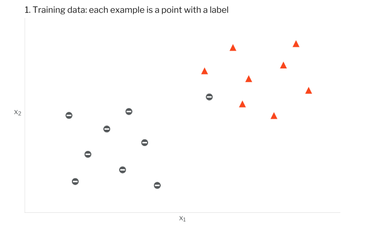
:::

::: {.fragment .fade-in-then-out fragment-index=1}
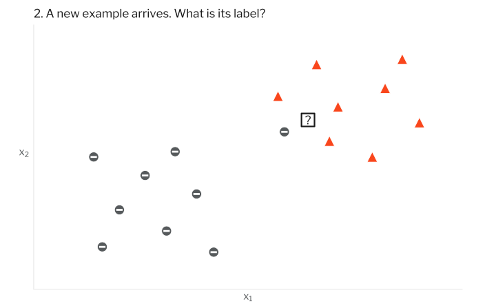
:::

::: {.fragment .fade-in-then-out fragment-index=2}
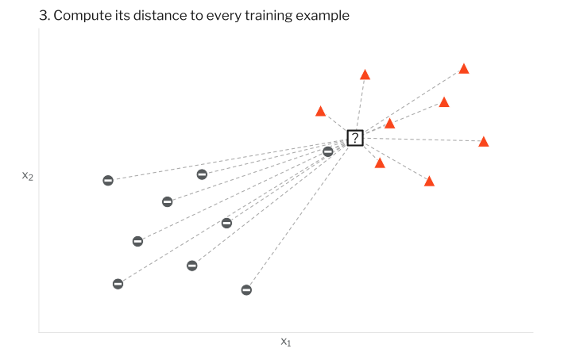
:::

::: {.fragment .fade-in-then-out fragment-index=3}

:::

::: {.fragment fragment-index=4}

:::

::::

::: {.caption}
Synthetic points. The setup follows CIML Fig. 3.4, where the test point "should be positive, but its NN is actually a negative point that's noisy."
:::


---

# Distance Metrics {.smaller}


Used to measure the dissimilarity between two observations. For continuous attributes, with $p$ attributes:

::: {.incremental}
- **Euclidean**: $d(a, b) = \sqrt{\sum_{i=1}^{p} (a_i - b_i)^2}$
    - (or [`sklearn.metrics.pairwise.euclidean_distances`](https://scikit-learn.org/stable/modules/generated/sklearn.metrics.pairwise.euclidean_distances.html) 🙂)
- **Manhattan**: $d(a, b) = \sum_{i=1}^{p} |a_i - b_i|$
    - (or [`sklearn.metrics.pairwise.manhattan_distances`](https://scikit-learn.org/stable/modules/generated/sklearn.metrics.pairwise.manhattan_distances.html) 🙂)
:::

---

# Worked Example: $a = (3, 4)$ and $b = (2, 2)$

::: {.caption}
Source: Gonzalo Bello Lander, CS 418 Lecture 13, "Classification (II)" (2026), slide 5.
:::

:::: {.columns}

::: {.column width="50%"}

::: {.fragment fragment-index=1}
**Euclidean** (straight line)

$\sqrt{(3-2)^2 + (4-2)^2} = \sqrt{1 + 4} = \sqrt{5} \approx 2.24$
:::

::: {.fragment fragment-index=2}
**Manhattan** (city blocks)

$|3 - 2| + |4 - 2| = 1 + 2 = 3$
:::

:::

::: {.column width="50%"}

:::: {.r-stack}

::: {.fragment .fade-out fragment-index=1}

:::

::: {.fragment .fade-in-then-out fragment-index=1}

:::

::: {.fragment fragment-index=2}

:::

::::

:::

::::


---

# Similarity for Binary Features {.smaller}

$N_{11}$: attributes where both $a$ and $b$ are 1; $N_{00}$: both 0; $N_{10}$, $N_{01}$: they disagree.

:::: {.columns}

::: {.column width="50%"}
- **Jaccard**: $S(a, b) = \dfrac{N_{11}}{N_{01} + N_{10} + N_{11}}$
    - (or [`sklearn.metrics.jaccard_score`](https://scikit-learn.org/stable/modules/generated/sklearn.metrics.jaccard_score.html) 🙂)
- **Simple matching (SMC)**: $S(a, b) = \dfrac{N_{00} + N_{11}}{N_{00} + N_{01} + N_{10} + N_{11}}$
    - (or 1 − [`scipy.spatial.distance.hamming`](https://docs.scipy.org/doc/scipy/reference/generated/scipy.spatial.distance.hamming.html) 🙂)
:::

::: {.column width="50%"}

|  | attr. 1 | attr. 2 | attr. 3 |
|---|:---:|:---:|:---:|
| $a$ | 1 | 1 | 0 |
| $b$ | 1 | 0 | 0 |
| type | $N_{11}$ | $N_{10}$ | $N_{00}$ |

:::

::::

::: {.incremental}
- Jaccard: $\frac{1}{0 + 1 + 1} = 0.5$ &nbsp;&nbsp; SMC: $\frac{1 + 1}{1 + 0 + 1 + 1} \approx 0.667$
- difference: does a shared 0 count as agreement?
:::


---

# The k-NN Algorithm {.smaller}

::: {.caption}
Sources: Gonzalo Bello Lander, CS 418 Lecture 13, "Classification (II)" (2026), slides 3 and 9; Hal Daumé III, *[A Course in Machine Learning](http://ciml.info/)* (CIML), v0.99, [ch. 3](http://ciml.info/dl/v0_99/ciml-v0_99-ch03.pdf), §3.2 and Algorithm 3.
:::

1. "Choose a proximity metric and a number of nearest neighbors $k$."
2. "For each observation $z$ in the test set:"
    1. "Compute the distance or similarity between $z$ and every observation in the training set."
    2. "Select the $k$ observations most similar to $z$ ($k$ nearest neighbors)."
    3. "Assign a class label to $z$ based on the class labels of its $k$ nearest neighbors." (majority vote)

::: {.incremental}
- Note there actually is no 'training' phase for K-nearest neighbors
    - **lazy learner**.
- What about ties?
- Why is it a good idea to use an odd number for K?
:::


---

# Lazy Learning: The Data Is the Model {.image-frame-slide}

:::: {.r-stack}

::: {.fragment .fade-out fragment-index=1}
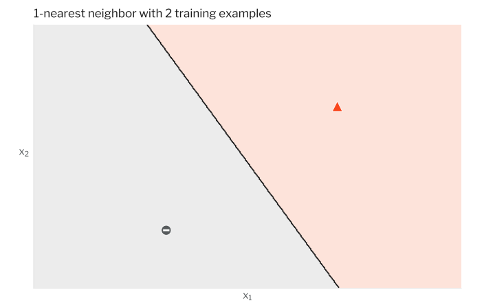
:::

::: {.fragment .fade-in-then-out fragment-index=1}
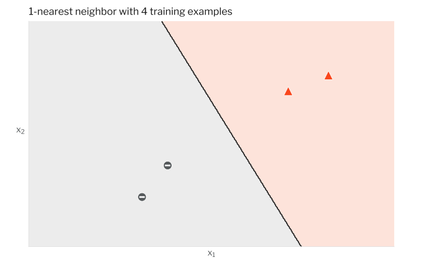
:::

::: {.fragment .fade-in-then-out fragment-index=2}
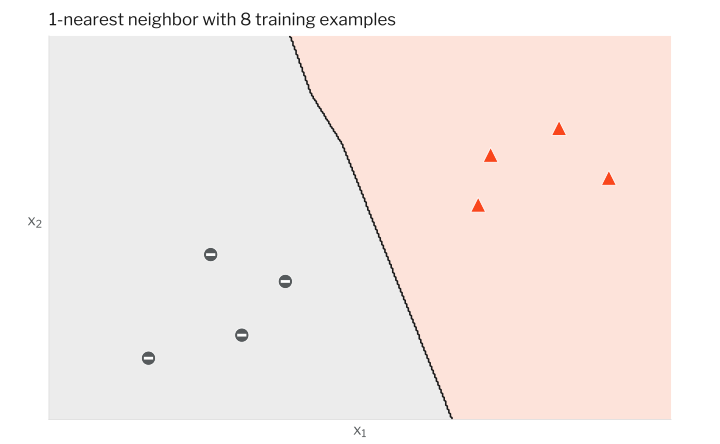
:::

::: {.fragment fragment-index=3}

:::

::::

::: {.caption}
"This line is called the decision boundary for this classifier. It is the line with positive land on one side and negative land on the other side." (CIML §3.3). Synthetic points, 1-nearest neighbor.
:::


---

# Choosing k {.image-frame-slide}

:::: {.r-stack}

::: {.fragment .fade-out fragment-index=1}

:::

::: {.fragment .fade-in-then-out fragment-index=1}

:::

::: {.fragment .fade-in-then-out fragment-index=2}

:::

::: {.fragment fragment-index=3}

:::

::::

::: {.caption}
Synthetic data with three labels deliberately flipped.
:::

---

# Choosing k: Overfitting vs. Underfitting

::: {.incremental}
- "with K = 1, we run the risk of overfitting. On the other hand, if K is large (for instance, K = N), then KNN-Predict will always predict the majority class. Clearly that is underfitting." (CIML)
- "So, K is a **hyperparameter** of the KNN algorithm that allows us to trade-off between overfitting (small value of K) and underfitting (large value of K)." (CIML)
- "a learned model with a decision boundary that is really jagged (like the coastline of Norway) is really complex and prone to overfitting. A learned model with a decision boundary that is really simple (like the bounary [*sic*] between Arizona and Utah) is potentially underfit." (CIML)
:::


---

# Elbow Neighbor Exercise {.smaller}

:::: {.columns}

::: {.column width="40%"}

|  | $A$ | $B$ | Class |
|---|:---:|:---:|:---:|
| $x_1$ | 2.5 | 3.5 | ▲ |
| $x_2$ | 1.5 | 4.0 | ▲ |
| $x_3$ | 5.0 | 1.5 | ● |
| $x_4$ | 4.0 | 2.5 | ● |
| $x_5$ | 2.0 | 1.0 | ▲ |

Classify $z = (3.0, 2.0)$ with $k$-NN and Euclidean distance. How would you classify $z$ if...

- **a.** $k = 1$?
- **b.** $k = 2$?
- **c.** $k = 3$?

:::

::: {.column width="60%"}
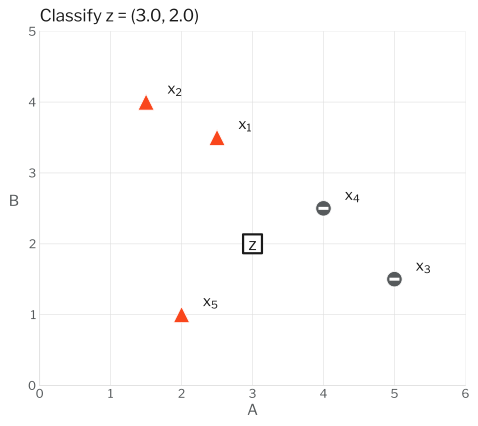
:::

::::


---

# Feature Scale {.image-frame-slide}

:::: {.r-stack}

::: {.fragment .fade-out fragment-index=1}
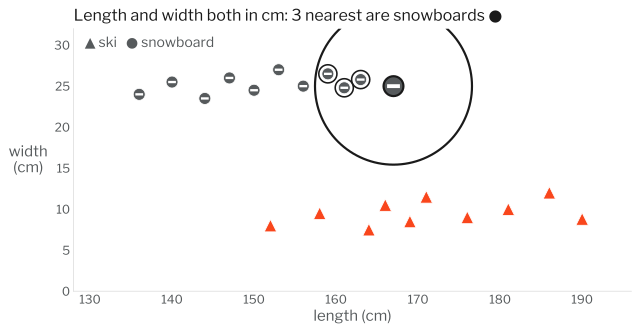
:::

::: {.fragment fragment-index=1}
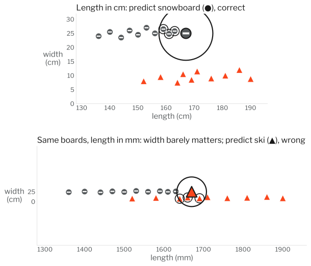
:::

::::

::: {.caption}
Synthetic boards. Example after CIML §3.2 (Figs. 3.5–3.7): "a KNN classifier will effectively ignore the width values and classify almost purely based on height."
:::


---

# Pitfall: Irrelevant Features {.image-frame-slide}

:::: {.r-stack}

::: {.fragment .fade-out fragment-index=1}

:::

::: {.fragment fragment-index=1}

:::

::::

::: {.caption}
"every feature is used, and they are all used the same amount. This means that if you have data with only a few relevant features and lots of irrelevant features, KNN is likely to do poorly." (CIML §3.2). Synthetic points.
:::

---

# k-NN: Pros and Cons {.smaller}

:::: {.columns}

::: {.column width="50%"}
**Advantages**

- "Does not require training a model (lazy learner)."
- "Applicable to categorical and numeric attributes."
- "Makes no assumptions about the probability distribution of the data."
- "Flexibility. Can produce decision boundaries of any shape."
:::

::: {.column width="50%"}
**Disadvantages**

- "Classifying each observation from the test set can be computationally expensive."
- "Easy to overfit due to noise or high dimensionality."
- "Sensitive to redundant or irrelevant attributes."
- "Sensitive to the scale of the data."
- "No descriptive value. Does not provide a model of the relationship between the class label and the attributes."
:::

::::


---

# Decision Trees {.section-header}

---

# Anatomy of a Decision Tree {.image-frame-slide}

:::: {.r-stack}

::: {.fragment .fade-out fragment-index=1}

:::

::: {.fragment .fade-in-then-out fragment-index=1}

:::

::: {.fragment .fade-in-then-out fragment-index=2}

:::

::: {.fragment .fade-in-then-out fragment-index=3}

:::

::: {.fragment fragment-index=4}

:::

::::

::: {.caption}
Example based on slides from [Gonzalo Bello Lander](https://cs.uic.edu/profiles/gonzalo-bello/).
:::


---

# Classify: Walk From Root to Leaf {.image-frame-slide}

:::: {.r-stack}

::: {.fragment .fade-out fragment-index=1}

:::

::: {.fragment .fade-in-then-out fragment-index=1}

:::

::: {.fragment fragment-index=2}
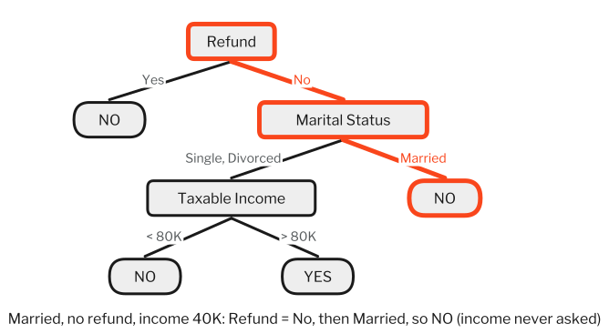
:::

::::


---

# Elbow Neighbor Exercise

:::: {.columns}

::: {.column width="55%"}

:::

::: {.column width="45%"}
According to this tree, which of these people will cheat on their taxes?

- **A.** Divorced, got a refund, taxable income 90K.
- **B.** Single, no refund, taxable income 60K.
- **C.** Married, no refund, taxable income 75K.
- **D.** Single, no refund, taxable income 85K.
:::

::::

---

# Elbow Neighbor Exercise: Answer {.image-frame-slide}

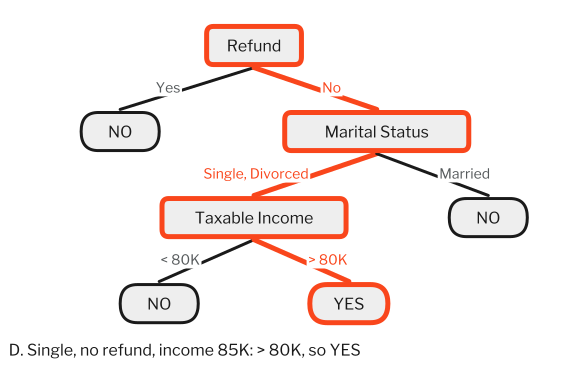

::: {.incremental}
- A: Refund = Yes, so NO. &nbsp; B: under 80K, so NO. &nbsp; C: Married, so NO.
:::

---

# Which Tree?

::: {.incremental}
- computationally infeasible to consider all possible trees to try to choose the 'best' one." (CIML)
    - "Finding the best tree is NP-Hard!" (Zheleva)
- build decision tree greedily
    - TODO add steps
:::


---

# Scoring a Split: Majority Vote {.image-frame-slide}

:::: {.r-stack}

::: {.fragment .fade-out fragment-index=1}

:::

::: {.fragment .fade-in-then-out fragment-index=1}

:::

::: {.fragment fragment-index=2}

:::

::::

::: {.caption}
Invented counts. Scoring rule from CIML §1.3 (where the example is course ratings): "if I made that guess on the training data, how well would I have done? In particular, how many examples would I classify correctly?"
:::


---

# When Majority Vote Can't Decide {.image-frame-slide}

:::: {.r-stack}

::: {.fragment .fade-out fragment-index=1}
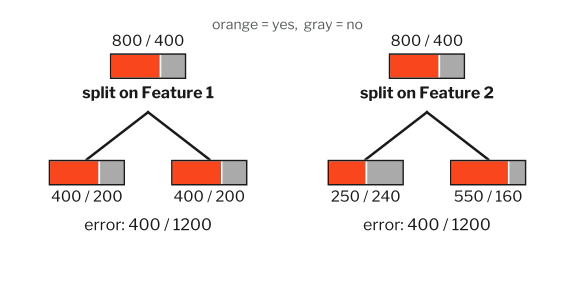
:::

::: {.fragment fragment-index=1}

:::

::::

::: {.caption}
Source: Elena Zheleva, CS 418 lecture slides, Feb. 19, 2026 (after Marine Carpuat). "Both have the same error rate!!! Which is 'progressing more' towards a lower error?"
:::


---

# Entropy: How Much Does a Split Help Distinguish Classes? {.smaller}

::: {.caption}
Source: Gonzalo Bello Lander, CS 418 Lecture 12, "Classification (I)" (2026), slides 14–16. Figure after Sebastian Raschka, "[Why are we growing decision trees via entropy instead of the classification error?](https://sebastianraschka.com/faq/docs/decisiontree-error-vs-entropy.html)": "if we have 2 entropy values (left and right child node), the average will fall onto the straight, connecting line."
:::

:::: {.columns}

::: {.column width="45%"}
"Entropy measures the impurity of a node of the tree."

$$H(v_m) = -\sum_k p(y_k \mid v_m) \log_2 p(y_k \mid v_m)$$

"where $p(y_k \mid v_m)$ is the proportion of observations from class $y_k$ at node $v_m$."

- (or [`scipy.stats.entropy`](https://docs.scipy.org/doc/scipy/reference/generated/scipy.stats.entropy.html), with `base=2` 🙂)

::: {.incremental}
- "Minimum value: 0. When all observations belong to the same class."
- "Maximum value: $\log_2 k$ where $k$ is the number of classes. When observations are equally distributed among all classes."
:::

:::

::: {.column width="55%"}
:::: {.r-stack}

::: {.fragment .fade-out fragment-index=1}
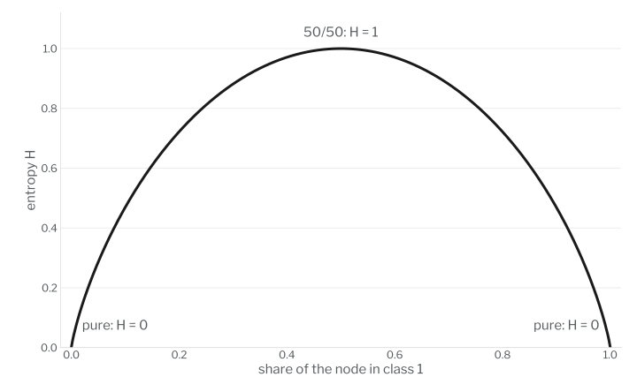
:::

::: {.fragment .fade-in-then-out fragment-index=1}
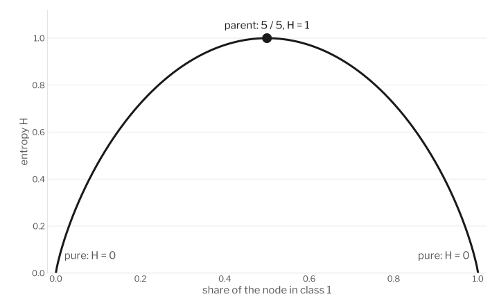
:::

::: {.fragment .fade-in-then-out fragment-index=2}
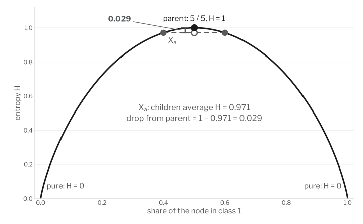
:::

::: {.fragment fragment-index=3}
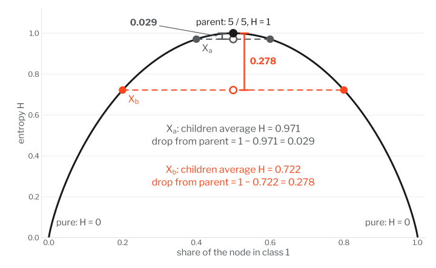
:::

::::
:::

::::


---

# Information Gain {.smaller}

"Information gain measures the difference in entropy resulting from splitting a node of the tree on a given attribute."

$$IG(X_i, v_m) = H(v_m) - \sum_{h=1}^{M} \frac{N_h}{N} H(v_h)$$

"where $N_h$ is the number of observations at node $v_h$."

- (or [`sklearn.metrics.mutual_info_score`](https://scikit-learn.org/stable/modules/generated/sklearn.metrics.mutual_info_score.html), which reports it in nats, not bits 🙂)

::: {.incremental}
- Parent entropy minus the size-weighted average entropy of the children.
- "The best attribute to split on is the one that maximizes the information gain."
- "Information gain is the splitting criterion function used by the ID3 and the C4.5 algorithms."
:::


---


# How Much Does This Question Help Us Distinguish Between Classes? {.image-frame-slide}

:::: {.r-stack}

::: {.fragment .fade-out fragment-index=1}

:::

::: {.fragment .fade-in-then-out fragment-index=1}

:::

::: {.fragment .fade-in-then-out fragment-index=2}

:::

::: {.fragment fragment-index=3}

:::

::::


---

# How Much Does This Question Help Us Distinguish Between Classes? {.smaller}

**Parent**, 9 Cubs / 11 Sox:

$$H = -\tfrac{9}{20}\log_2\tfrac{9}{20} - \tfrac{11}{20}\log_2\tfrac{11}{20} \approx 0.993$$

::: {.incremental}
- **No** (north of Madison), 7 Cubs / 3 Sox: $H = -\tfrac{7}{10}\log_2\tfrac{7}{10} - \tfrac{3}{10}\log_2\tfrac{3}{10} \approx 0.881$
- **Yes** (south of Madison), 2 Cubs / 8 Sox: $H = -\tfrac{2}{10}\log_2\tfrac{2}{10} - \tfrac{8}{10}\log_2\tfrac{8}{10} \approx 0.722$
- **Weighted average** of the children, 10 of 20 fans each: $\tfrac{10}{20}(0.881) + \tfrac{10}{20}(0.722) \approx 0.802$
- **Information gain**: $0.993 - 0.802 \approx 0.191$
:::

---

# Worked Example {.image-frame-slide}

:::: {.r-stack}

::: {.fragment .fade-out fragment-index=1}

:::

::: {.fragment .fade-in-then-out fragment-index=1}

:::

::: {.fragment fragment-index=2}

:::

::::

::: {.caption}
Source: Gonzalo Bello Lander, CS 418 Lecture 12, "Classification (I)" (2026), slides 16–18. Parent: $H(v_0) = -\frac{5}{10}\log_2\frac{5}{10} - \frac{5}{10}\log_2\frac{5}{10} = 1$. "Splitting on $X_b$ is better than splitting on $X_a$."
:::


---

# Continuous Features: Thresholds {.image-frame-slide}

:::: {.r-stack}

::: {.fragment .fade-out fragment-index=1}
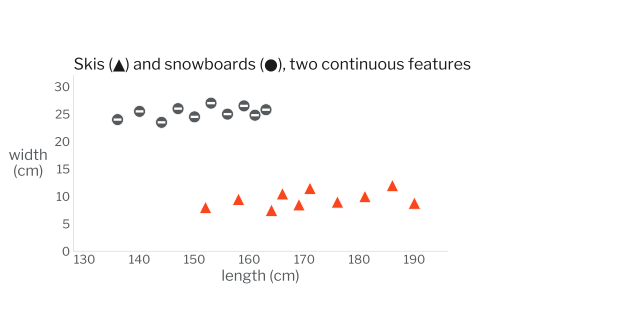
:::

::: {.fragment .fade-in-then-out fragment-index=1}
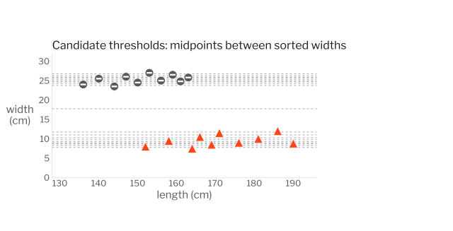
:::

::: {.fragment fragment-index=2}
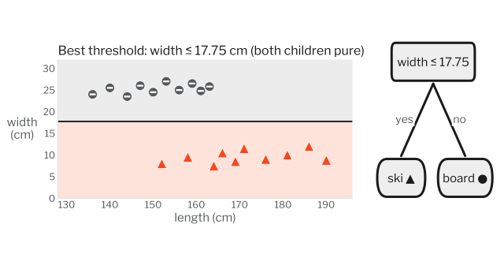
:::

::::

::: {.caption}
"for real-valued features, the decision tree nodes are parameterized by a feature and a threshold for that feature." (CIML §3.3, ski vs. snowboard, Fig. 3.11). Synthetic boards.
:::

---

# Growing a Tree, One Level at a Time {.image-frame-slide}

:::: {.r-stack}

::: {.fragment .fade-out fragment-index=1}
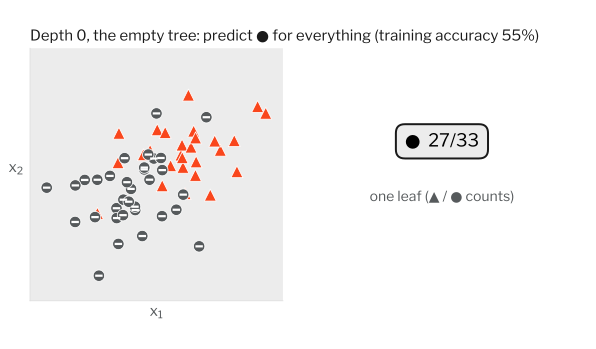
:::

::: {.fragment .fade-in-then-out fragment-index=1}

:::

::: {.fragment .fade-in-then-out fragment-index=2}
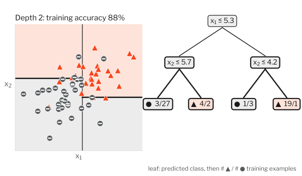
:::

::: {.fragment .fade-in-then-out fragment-index=3}

:::

::: {.fragment fragment-index=4}

:::

::::


---

# Empty Tree vs. Full Tree

::: {.caption}
Source: Hal Daumé III, *[A Course in Machine Learning](http://ciml.info/)* (CIML), v0.99, [ch. 2](http://ciml.info/dl/v0_99/ciml-v0_99-ch02.pdf)
:::

::: {.incremental}
- **Empty tree**: make the same prediction regardless of input
    - not allowed to ask any questions about input
- **Full tree**: For the leaves corresponding to training points, the full decision tree will always make the correct prediction
- "Of course our goal is not to build a model that gets 0% error on the training data. This would be easy! Our goal is a model that will do well on future, unseen data."
:::

---

# Max Depth Is a Hyperparameter {.image-frame-slide}

:::: {.r-stack}

::: {.fragment .fade-out fragment-index=1}

:::

::: {.fragment .fade-in-then-out fragment-index=1}

:::

::: {.fragment fragment-index=2}

:::

::::

::: {.caption}
"By playing with this depth knob, we can adjust between underfitting (the empty tree, depth = 0) and overfitting (the full tree, depth = ∞). Such a knob is called a hyperparameter." (CIML §2.6). Synthetic data, 10% labels flipped; average of 40 draws of 150 training and 1,500 held-out points.
:::

---

# Tuning Max Depth Without Cheating

::: {.incremental}
- Tune on training data?
- Tune on test data?
    - "it breaks our cardinal rule about test data: that you should never touch your test data." (CIML)
- Instead: "Split your data into 70% training data, 10% development data and 20% test data." Pick the depth that does best on the development (validation) data. (CIML)
- "Never ever touch your test data during learning!" (Zheleva)
:::

---

# Occam's Razor {.quote-slide}

> Among competing hypotheses, the one that makes the fewest assumptions should be selected.

::: {.attribution}
A common paraphrase of William of Ockham (c. 1287–1347)
:::


---

# R2D3: A Visual Introduction to Machine Learning {.iframe-slide}

<iframe src="https://r2d3.us/visual-intro-to-machine-learning-part-1/" title="R2D3, A Visual Introduction to Machine Learning, Part 1" loading="lazy" style="border: 1px solid #999; box-shadow: 0 10px 28px rgba(0,0,0,0.12); border-radius: 3px;"></iframe>

::: {.iframe-caption}
Stephanie Yee and Tony Chu, "A Visual Introduction to Machine Learning, Part 1," R2D3: <https://r2d3.us/visual-intro-to-machine-learning-part-1/>
:::


---

# Decision Trees in scikit-learn

```python
from sklearn.tree import DecisionTreeClassifier

model = DecisionTreeClassifier(criterion="entropy", max_depth=3)
model.fit(X_train, y_train)        # learn the splits
model.predict(X_test)              # walk each row from root to leaf
model.score(X_test, y_test)        # accuracy on held-out data
```

::: {.incremental}
- `criterion`: default is `"gini"`
    - `"entropy"` and `"log_loss"`
- [`max_depth`](https://scikit-learn.org/stable/modules/generated/sklearn.tree.DecisionTreeClassifier.html): default `None`. "If None, then nodes are expanded until all leaves are pure or until all leaves contain less than min_samples_split samples." The default is the full tree.
:::

---

# Decision Trees: Pros and Cons {.smaller}

::: {.caption}
Jake VanderPlas, *[Python Data Science Handbook](https://jakevdp.github.io/PythonDataScienceHandbook/05.08-random-forests.html)*, "In-Depth: Decision Trees and Random Forests."
:::

:::: {.columns}

::: {.column width="55%"}
**Advantages**

- Decision trees are very easy to understand and interpret.
- Algorithms for decision tree induction are very efficient, esp. greedy algorithms
- Usually robust to irrelevant / redundant attributes.

**Disadvantages** (Bello)

- Easy to overfit.
    - Small changes in the data can lead to large changes in the structure of decision trees.
- Rectilinear decision boundaries.
:::

::: {.column width="45%"}


"it is very easy to go too deep in the tree, and thus to fit details of the particular data rather than the overall properties of the distributions they are drawn from." (VanderPlas)
:::

::::


---

# Week 9, Day 2 {.course-title .photo-title data-state="photo-title photo-title-zoom" background-image="../assets/orange-line-stops-better/stop10-halsted-a.jpg" background-size="cover"}

<h2>SVMs and Kernels</h2>

Jack Bandy
2026

---

# Map {.split}

::: {.split-content .narrow-aside}

::: {}
- Week 9: Halsted
- Day 2
    - Support Vector Machines
    - Kernels
:::

{.figure alt="Orange Line map with the Halsted stop marked, the Week 9 stop"}

:::

---


# Support Vector Machines {.section-header}

---

# Support Vector Machines

::: {style="border:3px dashed #f9461c; border-radius:12px; padding:0.8em 1em; margin-top:0.4em;"}
[TODO]{.eyebrow .todo}

::: {.dense}
- **TK**
:::
:::

---

# Kernels {.section-header}

---

# Kernels

::: {style="border:3px dashed #f9461c; border-radius:12px; padding:0.8em 1em; margin-top:0.4em;"}
[TODO]{.eyebrow .todo}

::: {.dense}
- **TK**
:::
:::

---

# Appendix: Minkowski Distance {.section-header}

---

# Minkowski Distance

A family of distances for continuous attributes, with $p$ attributes:

- **Minkowski**: $d(a, b) = \left( \sum_{i=1}^{p} |a_i - b_i|^r \right)^{1/r}$, "where $r$ is a parameter"
    - $r = 1$ gives Manhattan; $r = 2$ gives Euclidean
    - (or [`scipy.spatial.distance.minkowski`](https://docs.scipy.org/doc/scipy/reference/generated/scipy.spatial.distance.minkowski.html), with `p` = $r$ 🙂)

---

# Appendix: Pruning {.section-header}

---

# Pruning

"In some cases, we may want to stop the decision tree induction algorithm early to avoid overfitting." (Bello)

::: {.incremental}
- **Pre-pruning (early stopping)**: "the decision tree induction algorithm is stopped before generating the full tree (for example, when the observed improvement in the estimate of the generalization error is below a certain threshold)." (Bello) Max depth is one such rule.
- **Post-pruning**: "the decision tree is initially grown to its maximum size and is then trimmed. The tree pruning step terminates when no further improvement in the estimate of the generalization error is observed." (Bello)
- Pruning has "the advantage that different branches can have different depths, accounting for the fact that the amount of data that gets passed down each branch might differ dramatically." (CIML)
:::

---

# Sources {.sources}

1. GitHub source: <https://github.com/jackbandy/data-science-fun/blob/main/docs/slides/week9.qmd>.
2. Slides developed using materials from [Elena Zheleva](https://www.cs.uic.edu/~elena/) and [Gonzalo Bello Lander](https://cs.uic.edu/profiles/gonzalo-bello/), the Berkeley DS 100 team, Marine Carpuat, and Brian Ziebart.
3. Slide deck built with [Quarto](https://quarto.org/) revealjs.
4. Title font is Big Shoulders; Body font is [Libre Franklin](https://en.wikipedia.org/wiki/Franklin_Gothic#Libre_Franklin).
5. Hal Daumé III, *[A Course in Machine Learning](http://ciml.info/)*, v0.99, [ch. 1](http://ciml.info/dl/v0_99/ciml-v0_99-ch01.pdf) ("Decision Trees"), [ch. 2](http://ciml.info/dl/v0_99/ciml-v0_99-ch02.pdf) ("Limits of Learning"), and [ch. 3](http://ciml.info/dl/v0_99/ciml-v0_99-ch03.pdf) ("Geometry and Nearest Neighbors").
6. Gonzalo Bello Lander, CS 418 Lecture 12 ("Classification (I): Basic Concepts & Decision Trees") and Lecture 13 ("Classification (II): More Classification Techniques"), 2026. The tax-cheating tree and Exercises 12.2–12.4 and 13.1 are from these slides.
7. Elena Zheleva, CS 418 lecture slides, Feb. 19 and 24, 2026 (using materials by Marine Carpuat, Lise Getoor, and Brian Ziebart).
8. Jake VanderPlas, *[Python Data Science Handbook](https://jakevdp.github.io/PythonDataScienceHandbook/)*, ["In-Depth: Decision Trees and Random Forests"](https://jakevdp.github.io/PythonDataScienceHandbook/05.08-random-forests.html), text CC BY-NC-ND.
9. Stephanie Yee and Tony Chu, ["A Visual Introduction to Machine Learning, Part 1"](https://r2d3.us/visual-intro-to-machine-learning-part-1/), R2D3.
10. Sebastian Raschka, ["Why are we growing decision trees via entropy instead of the classification error?"](https://sebastianraschka.com/faq/docs/decisiontree-error-vs-entropy.html), Machine Learning FAQ.
11. scikit-learn developers, [`DecisionTreeClassifier`](https://scikit-learn.org/stable/modules/generated/sklearn.tree.DecisionTreeClassifier.html) documentation, v1.8.
12. Week 9 figures: [`make_week9_figures.py`](https://github.com/jackbandy/data-science-fun/blob/main/docs/assets/week9/make_week9_figures.py); point clouds and ski/snowboard data are synthetic.
